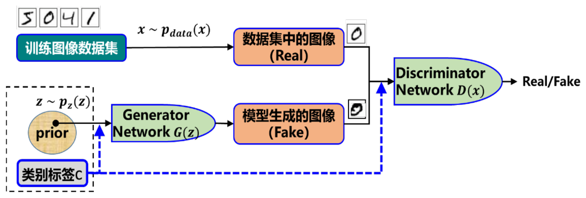
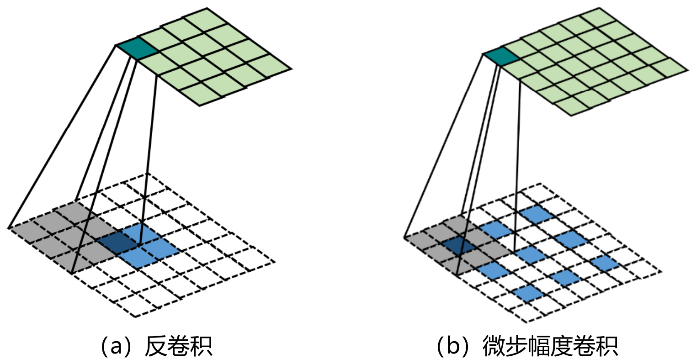

## 两个方向：改条件与改结构

上一篇 [生成式模型：从 AE/VAE 到 GAN 的范式框架](/posts/dl-basics/generative-paradigms/) 建立了 GAN 的极小极大框架。但那套推导停留在"任意可微的 $G$ 与 $D$"这一层，没有规定网络长什么样，也没有回答生成过程能否被控制。

在 GAN 之后，有两条相互独立的改进路线：

- **cGAN（条件 GAN）**：改的是输入输出关系。原始 GAN 只能从噪声随机生成，无法指定"生成数字 3"；cGAN 在 $G$ 和 $D$ 中都加入条件 $c$，把生成目标从 $p_g(x)$ 换成 $p_g(x\mid c)$。
- **DCGAN（深度卷积 GAN）**：改的是网络结构。原始 GAN 用多层感知机，DCGAN 把 $G$ 和 $D$ 换成卷积网络，并用微步幅度卷积做上采样，专门针对图像。

两者正交，可以叠加：cGAN 可以仍然用 MLP 实现，DCGAN 也可以不带条件。把它们合起来就是"条件 + 卷积生成器"的骨架，pix2pix 正是这个组合，下一篇再展开。

## cGAN：给生成过程加一个可控旋钮

### 问题：原始 GAN 只能随机采样

原始 GAN 的生成器是 $G(z)$，$z\sim p_z(z)$。训练完成后，从噪声采样得到的样本"像训练数据"，但具体生成哪一类完全不受控制：在 MNIST 上训练，生成器可能这次给一个 3，下次给一个 8，调用者无法指定。判别器 $D(x)$ 只看样本真不真实，不看它是什么。

要控制生成类别，就需要把类别信息同时交给生成器和判别器。cGAN 的定义正是这一点：**在生成模型 $G$ 和判别模型 $D$ 中都加入条件约束 $c$ 来指导样本的生成**，$c$ 可以是任何补充信息，例如类别标签；这样模型在生成新样本的同时还可以控制样本的类型。

### 条件怎么进入网络

常见的实现方式是：**加入的控制类别 $c$ 以嵌入向量的形式与 $z$ 或者 $x$ 拼接在一起**。

- 类别标签先做 one-hot 编码或查表得到嵌入向量 $e(c)$；
- **生成器**输入拼接后的 $[z;e(c)]$，输出与 $c$ 对应的图像，记作 $G(z\mid c)$；
- **判别器**输入图像 $x$ 与标签 $c$，输出"这幅图在标签 $c$ 条件下为真"的概率，记作 $D(x\mid c)$。

条件必须同时进入 $D$。如果只有 $G$ 接收 $c$，判别器仍然只判断真假，生成器完全可以把条件忽略掉而不受惩罚——对抗信号里没有任何一项在检查"图和标签是否匹配"。只有让 $D$ 也看到 $c$，"这张图与标签是否相符"才会成为判别标准的一部分。

:::note[记号说明]
常见记号写作 $G(z\mid c)$、$D(x\mid c)$，表示"给定条件 $c$ 时的生成结果/判别概率"，沿用即可；它并不是严格的条件分布记号，$G$ 对 $z$ 也没有定义分布。严格地说，$G$ 是二元函数 $G(z,c)$，$D$ 也是 $D(x,c)$，$\mid$ 只表示"条件化于 $c$"。
:::

### 条件目标函数

因为 $G$、$D$ 都额外接收了条件 $c$，目标函数变成条件形式。写规范版本时，两个期望都必须交代 $c$ 的来源：

$$
\min_G\max_D V(D,G)
=\mathbb E_{(x,c)\sim p_{data}(x,c)}\big[\log D(x,c)\big]
+\mathbb E_{c\sim p_{data}(c),\,z\sim p_z(z)}\big[\log\big(1-D(G(z,c),c)\big)\big].
$$

第一项对联合分布 $p_{data}(x,c)$ 取期望，采样得到成对的 $(x,c)$；第二项从边缘分布 $p_{data}(c)$ 采样条件、从先验 $p_z$ 采样噪声，同一个 $c$ 同时进入 $G$ 与 $D$。训练时按批次实现：真实项直接使用真实样本的标签，生成项复用这一批的 $c$（相当于按 $p_{data}(c)$ 采样），每个 $c$ 配独立的 $z$。式中 $D(x,c)$、$G(z,c)$ 是严格的二元函数记号，与正文的简写 $D(x\mid c)$、$G(z\mid c)$ 同义（见上面的记号说明）。

以 MNIST 为例，输入输出关系是：

- **生成器**：输入噪声 $z$ 与某个数字标签 $c\in\{0,\dots,9\}$，输出与 $c$ 对应的图像 $G(z\mid c)$；
- **判别器**：输入一幅图像 $x$（真实的或生成的）与一个数字标签 $c$，输出该图像在标签 $c$ 条件下的真实概率 $D(x\mid c)$；
- **训练完成后**：向 $G$ 输入某个数字标签和噪声，就能生成与该标签对应的图像。

### 为什么有效：每个条件切片各做一次对抗

固定 $G$ 时，对每个 $c$ 单独重复上一篇的逐点推导。把条件期望写成积分，对 $D(x,c)$ 求导令零，得到条件版本的最优判别器：

$$
D^*(x,c)=\frac{p_{data}(x,c)}{p_{data}(x,c)+p_g(x,c)}.
$$

代回后，每个 $c$ 上的目标等价于一个条件 JSD：$-\log 4+2D_{\mathrm{JS}}\big(p_{data}(x\mid c)\,\|\,p_g(x\mid c)\big)$。所以 cGAN 并没有换一套损失，而是把原来一个对抗问题**按 $c$ 拆成一组条件对抗问题**；最优时对每个 $c$ 都有 $p_g(x\mid c)=p_{data}(x\mid c)$，且 $D^*(x,c)=\frac12$。

这个视角解释了两件事：

- 标签不只是给生成器的"提示"，它改变了判别器在每个切片上的评价标准；
- 若某个类别的训练样本很少，对应切片学不好，条件生成的质量依赖每个类别的数据量，而不是总数据量。

它同时说明了 cGAN 与"先训练分类器再筛选"的区别：对真实图像 $x$ 配上错误标签 $c$，联合分布中 $p_{data}(x,c)=0$，最优判别器会给出 $D^*(x,c)=0$。也就是说，判别器不只判断真假，还判断**图与标签是否匹配**，生成器无法靠"生成逼真的图但类别不对"蒙混过去。

条件不限于类别标签：$c$ 可以是一段文本、另一幅图像。当 $c$ 是整幅输入图像时，cGAN 就变成了图像到图像的转换，这就是 pix2pix 的入口。

## DCGAN：把多层感知机换成卷积

### 动机

原始 GAN 的 $G$ 和 $D$ 都是多层感知机。图像有局部相关性和平移等变性，MLP 把图像拉平成向量，丢掉了这些结构，参数多、训练不稳定、生成质量差。

DCGAN 是原始 GAN（Vanilla GAN）的改进版，**训练方法与原始 GAN 类似**；主要区别是相比原始 GAN 中使用的多层感知机，DCGAN 的判别器和生成器都使用了卷积神经网络，以提升图像处理能力。但这种改变**不是简单的替换**，而是对卷积神经网络的结构做了若干改变，以进一步提高生成样本的质量和收敛速度。

### 生成器：从 100 维噪声到 64×64×3

生成器的结构是：输入一个随机采样得到的 **100 维噪声向量 $z$**，中间经过 **4 层微步幅度卷积**（fractionally strided convolution）的处理，且**每通过一层通道数减半、长宽扩大一倍**，最终输出一个 **$64\times64\times3$** 大小的图像。

逐层展开：

| 阶段 | 空间尺寸 | 通道数 |
| --- | --- | --- |
| 输入噪声 $z$ | — | 100 |
| 投影并重塑（Project and reshape） | $4\times4$ | 1024 |
| 微步幅度卷积 1 | $8\times8$ | 512 |
| 微步幅度卷积 2 | $16\times16$ | 256 |
| 微步幅度卷积 3 | $32\times32$ | 128 |
| 微步幅度卷积 4 | $64\times64$ | 3 |

第一层不是卷积，而是一个全连接投影把 100 维向量变成 $4\times4\times1024$，再 reshape 成特征图；之后四层逐步把低分辨率、高通道的表示展开成高分辨率图像。空间每层翻倍、通道每层减半，是这类生成器的标准节奏。

### 微步幅度卷积：怎么把小特征图放大

普通卷积的输出尺寸是

$$
O=\left\lfloor\frac{I+2P-K}{S}\right\rfloor+1,
$$

步长 $S>1$ 时做下采样。微步幅度卷积反过来放大图像，直观做法是**在输入元素之间插入零**（相当于步长小于 1 的"分数步长"），再按普通卷积滑动。对应的尺寸公式是

$$
O=(I-1)S-2P+K,
$$

其中 $S$ 是放大步幅。以生成器的第一层为例，$I=4,\ K=4,\ S=2,\ P=1$，得到 $O=3\times2-2+4=8$；继续 $32\to64$ 时 $O=31\times2-2+4=64$，与结构图中的 $4\to8\to16\to32\to64$ 一致。

**微步幅度卷积与标准的反卷积（Deconvolution）处理类似，都是将图像特征图变大，但区别在于 padding 的方式不同**。

:::note[命名补充]
文献里这个操作更常被称为**转置卷积**（transposed convolution）；"deconvolution"严格说指卷积的逆运算，用它命名容易让人误以为可以从输出精确恢复输入。DCGAN 论文因此刻意采用 "fractionally strided convolution" 这个名字，本文沿用这一叫法。这里的"padding 方式不同"，指的是两者在输出边界补零方式上的差异，而不是两种不同的数学运算。
:::

### 判别器：一个标准 CNN

DCGAN 的判别器结构与标准的卷积神经网络类似：输入 $64\times64\times3$ 图像，经过若干 $5\times5$ 卷积层，空间尺寸逐层减半、通道数逐层翻倍，最后展平经全连接层输出一个标量，表示输入为真实图像的概率。

| 阶段 | 空间尺寸 | 通道数 |
| --- | --- | --- |
| 输入图像 | $64\times64$ | 3 |
| 卷积 1 | $32\times32$ | 64 |
| 卷积 2 | $16\times16$ | 128 |
| 卷积 3 | $8\times8$ | 256 |
| 卷积 4 | $4\times4$ | 512 |
| 全连接 + Sigmoid | — | 1 |

注意两边的对称性：生成器用微步幅度卷积把空间放大，判别器用带步长的卷积把空间缩小；生成器从 100 维向量出发，判别器把图像压缩回一个概率。

### 论文补充的结构准则

DCGAN 论文把对卷积神经网络结构的改变归纳为一组经验准则，可以作为答题时的补充（注意它们是实验调出来的，不是理论保证）：

1. **去掉池化层**：判别器用带步长的卷积做下采样，生成器用微步幅度卷积做上采样，让网络自己学上下采样方式；
2. **生成器除输出层用 $\tanh$ 外全部用 ReLU**，**判别器全部用 LeakyReLU**（负半轴斜率 0.2）；
3. **生成器和判别器都使用 BatchNorm**，但生成器的输出层和判别器的输入层不加——论文报告对所有层直接加 BN 会引起样本震荡和训练不稳定；
4. **去掉全连接层**：除生成器的输入投影与判别器的输出层外，全部使用卷积。

### 训练与局限

训练流程与原始 GAN 完全相同：交替更新 $D$ 和 $G$，目标仍是极小极大（实践中同样可用非饱和损失）。**DCGAN 改的是结构，不是目标函数**，上一篇关于最优判别器和 JSD 的结论原样成立。

收益是收敛更快、训练更稳定、生成质量更高；论文还展示了潜空间中存在有语义的方向（例如"戴眼镜的男人"这类向量运算），以及判别器学到的卷积特征可以迁移到分类任务上。这些是论文在特定数据集上的结果，不是每次训练都必然出现。

局限也要如实说明：模式坍塌和训练不稳定仍然存在，只是被缓解；结构准则是在 LSUN 等 $64\times64$ 数据上调出来的经验，不保证迁移到其他分辨率；更高分辨率的生成仍然困难。cGAN 这边，条件控制的有效性依赖每个类别的数据量，且条件只控制类别这一类属性，样本的其余细节仍由 $z$ 随机决定。

## 两种改造的关系

cGAN 与 DCGAN 是两个正交的方向：

- cGAN 动的是**输入输出关系**：$G(z)\to G(z\mid c)$，$D(x)\to D(x\mid c)$，目标从 $p_g(x)\to p_{data}(x)$ 变成条件分布之间的对抗；
- DCGAN 动的是**网络结构**：MLP 换成卷积网络，并配上一组针对图像的架构经验。

把两者叠加，就得到"条件 + 卷积生成器"的 GAN。下一篇 pix2pix 会把条件从标签换成整幅输入图像，并进一步改造生成器（U-Net）和判别器（PatchGAN）；CycleGAN 则去掉成对数据的要求。复习时应先把本篇的两条线分清：**条件化不改变对抗框架，卷积化不改变训练目标**。

## 答题要点

:::tip[cGAN 要点]

1. 条件 $c$ 同时加入生成器 $G$ 和判别器 $D$，$c$ 可以是类别标签等任何补充信息，以嵌入向量形式与 $z$（$G$）或 $x$（$D$）拼接。
2. 条件目标函数：$\min_G\max_D\ \mathbb E_{(x,c)\sim p_{data}(x,c)}[\log D(x,c)]+\mathbb E_{c\sim p_{data}(c),\,z\sim p_z}[\log(1-D(G(z,c),c))]$。
3. 最优判别器 $D^*(x,c)=\frac{p_{data}(x,c)}{p_{data}(x,c)+p_g(x,c)}$，每个 $c$ 切片等价于一次条件 JSD 对抗；最优时 $p_g(x\mid c)=p_{data}(x\mid c)$、$D^*=\frac12$。
4. 训练后向 $G$ 输入标签与噪声即可生成指定类别的图像；判别器还负责判断图与标签是否匹配。

:::

:::tip[DCGAN 要点]

1. 用卷积网络替换原始 GAN 的多层感知机，训练方法仍是原始 GAN 的极小极大交替训练。
2. 生成器：100 维噪声 → 投影为 $4\times4\times1024$ → 4 层微步幅度卷积，每层通道减半、空间翻倍 → $64\times64\times3$。
3. 微步幅度卷积与反卷积都是上采样，区别在 padding 方式；本质是插零后卷积 / 转置卷积，尺寸 $O=(I-1)S-2P+K$。
4. 判别器：标准 CNN，$5\times5$ 卷积配步长下采样，最后全连接输出真假概率。

:::

## 小结

cGAN 回答"怎么控制生成什么"：把条件同时塞进 $G$ 和 $D$，让判别器的评价标准随 $c$ 变化，对抗目标按条件切片拆开。DCGAN 回答"怎么把 GAN 做成图像网络"：用卷积与微步幅度卷积替换 MLP，并配合一组经验结构准则，目标函数保持不变。这两个改造可以叠加，下一篇 [pix2pix 与 CycleGAN](/posts/dl-basics/pix2pix-cyclegan/) 就是在"条件 + 卷积"的骨架上继续做任务层面的改造。
