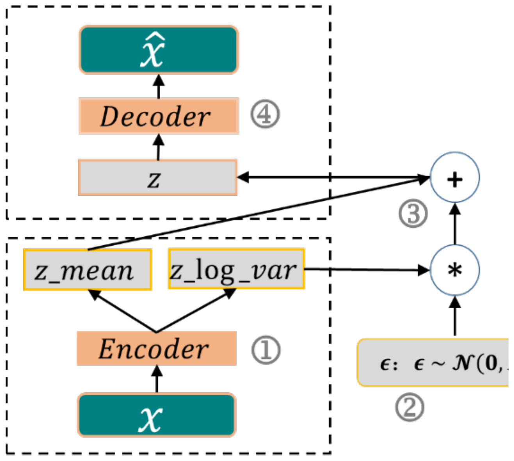
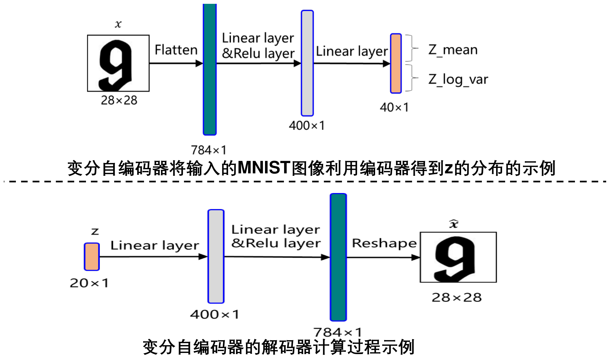

## 生成式模型在学什么

判别模型学的是条件分布 $p(y\mid x)$，给定输入预测标签；

生成模型学的是数据本身的分布 $p_{data}(x)$，目标是让模型分布 $p_{model}(x)$ 尽量接近真实分布，并能从中采样出新样本。

两个步骤：

- **训练**：从训练集 $\{x_i\}$ 中学习数据分布，得到 $p_{model}(x)\approx p_{data}(x)$；
- **生成**：从 $p_{model}(x)$ 中采样，得到训练集中不存在、但看起来来自同一分布的新样本。

:::tip
这里的关键词是**分布**，不是重构函数。一个模型如果只能把训练样本压缩后再还原，它能做降维和特征提取，但还不能说明如何采样出一个新样本。
:::

 AE、VAE、GAN 分别代表了三种不同的回答方式：

- **AE（自编码器）**：学习确定性的编码-解码映射，用重构误差训练；本身不是严格的生成模型。
- **VAE（变分自编码器）**：给潜变量 $z$ 定义先验和近似后验，用变分下界训练，训练后可以从先验采样再解码。
- **GAN（生成对抗网络）**：不显式建模密度，用一个判别器充当可学习的损失函数，通过对抗博弈让生成分布逼近真实分布。

本文的记号如下：随机变量 $X$ 的取值记为 $x$，潜变量 $Z$ 的取值记为 $z$；真实数据分布为 $p_{data}(x)$，模型分布为 $p_\theta(x)$；编码器参数记为 $\phi$，AE 的解码器参数记为 $\psi$，VAE 的解码器（生成）参数记为 $\theta$；$\mathbb{E}$ 表示期望，$D_{\mathrm{KL}}$ 表示 KL 散度。

## 自编码器：先学会压缩与重构

自编码器由两部分组成：

- **编码器** $\phi: x\mapsto z$，把输入压缩成低维隐含表示 $z$；
- **解码器** $\psi: z\mapsto x'$，把 $z$ 重构回与 $x$ 同维的 $x'$。

以单隐藏层、编码器和解码器都用感知机为例：

$$
z=\sigma(\mathbf W x+\mathbf b),\qquad
x'=\sigma'(\mathbf W' z+\mathbf b'),
$$

其中 $\sigma,\sigma'$ 是激活函数，$\mathbf W,\mathbf W'$ 是权重矩阵，$\mathbf b,\mathbf b'$ 是偏置。编码器和解码器通常不共享参数。

训练目标是最小化重构误差。对整个训练集 $X$：

$$
\phi,\psi=\arg\min_{\phi,\psi}\ \lVert X-\psi\circ\phi(X)\rVert^2,
$$

对单个样本就是

$$
\mathcal L(x,x')=\lVert x-x'\rVert^2
=\lVert x-\sigma'(\mathbf W'(\sigma(\mathbf W x+\mathbf b))+\mathbf b')\rVert^2.
$$

中间表示 $z$ 的维度通常小于输入维度，这形成 **信息瓶颈**，迫使网络保留最重要的特征。因此编码器部分有以下用途：

1. **去噪**：训练时给输入加噪，要求还原干净样本；
2. **特征提取**：在无标注数据上预训练编码器，把 $z$ 送入有监督模型；
3. **降维与可视化**：把高维数据压到二维或三维，观察聚类结构。堆叠自编码器就是增加中间层，形成更深的编码器。

:::warning[AE 不是严格的生成模型]
AE 的潜变量是确定性的 $z=\phi(x)$，没有定义 $p(z)$，也没有定义如何从 $z$ 采样（本质上是点）。训练好之后，从潜空间里随便取一个点解码，通常得不到有意义的样本；潜空间可能存在大量没有数据支撑的“空洞”。这正是 VAE 要补上的部分。
:::

## 变分自编码器：把编码从点变成分布

### 从确定性编码到概率编码

VAE 的想法是：既然解码器只要能拿到一个合适的 $z$ 就能重构图像，那么能不能让 $z$ 来自一个学到的分布，而不是直接来自某张图的编码？如果 $z$ 从数据整体的分布中采样，解码器就应该能生成新的合理图像。

具体做法是让编码器输出一个分布，而不是一个点：

$$
q_\phi(z\mid x)=\mathcal N\big(z;\boldsymbol\mu_\phi(x),\operatorname{diag}(\boldsymbol\sigma_\phi^2(x))\big),
$$

即编码器为每个输入 $x$ 输出均值 $\boldsymbol\mu$ 和方差 $\boldsymbol\sigma^2$（实践中通常输出 $\log\boldsymbol\sigma^2$ 以保证数值稳定）。同时设定一个先验

$$
p(z)=\mathcal N(0,\mathbf I),
$$

解码器则建模似然 $p_\theta(x\mid z)$，例如高斯似然或伯努利似然。

生成过程因此变成：

$$
z\sim p(z)=\mathcal N(0,\mathbf I),\qquad x\sim p_\theta(x\mid z).
$$

训练完成后，生成新样本只需要从标准正态分布采样 $z$，再送入解码器；编码器在生成阶段可以完全丢掉。

### 为什么需要 ELBO

VAE 的真正目标是最大化数据的边际似然：

$$
p_\theta(x)=\int p_\theta(x\mid z)p(z)\,dz.
$$

但这个积分对一般的非线性解码器不可解，直接最大化 $\log p_\theta(x)$ 做不到。变分推断的做法是引入编码器 $q_\phi(z\mid x)$ 作为真实后验 $p_\theta(z\mid x)$ 的近似，并优化一个可计算的下界。

从恒等式出发：

$$
\log p_\theta(x)
=\log\int q_\phi(z\mid x)\frac{p_\theta(x,z)}{q_\phi(z\mid x)}\,dz.
$$

把积分写成对 $q_\phi(z\mid x)$ 的期望：

$$
\log p_\theta(x)
=\log\mathbb E_{q_\phi(z\mid x)}\left[\frac{p_\theta(x,z)}{q_\phi(z\mid x)}\right].
$$

由于 $\log$ 是凹函数，由 Jensen 不等式：

$$
\log p_\theta(x)
\ge \mathbb E_{q_\phi(z\mid x)}\left[\log\frac{p_\theta(x,z)}{q_\phi(z\mid x)}\right].
$$

又因为 $p_\theta(x,z)=p_\theta(x\mid z)p(z)$，右边可以拆成

$$
\mathrm{ELBO}(\theta,\phi;x)
=\mathbb E_{q_\phi(z\mid x)}[\log p_\theta(x\mid z)]
-D_{\mathrm{KL}}\big(q_\phi(z\mid x)\,\|\,p(z)\big).
$$

这就是 **ELBO**（证据下界，Evidence Lower Bound）。两项的含义很清楚：

- **重构项**：给定 $z$ 时生成 $x$ 的对数似然，越大说明解码器越能还原输入；
- **KL 正则项**：让近似后验 $q_\phi(z\mid x)$ 靠近先验 $p(z)$，否则编码器可以把每张图的 $z$ 压到互不重叠的点上，潜空间又会退化成 AE 的样子。

更精确地，$\log p_\theta(x)$ 与 ELBO 的差距恰好是后验近似误差：

$$
\log p_\theta(x)
=\mathrm{ELBO}(\theta,\phi;x)
+D_{\mathrm{KL}}\big(q_\phi(z\mid x)\,\|\,p_\theta(z\mid x)\big).
$$

所以最大化 ELBO 同时在做两件事：提高似然，以及让 $q_\phi(z\mid x)$ 更接近真实后验。

训练时最小化负 ELBO：

$$
\mathcal L_{\mathrm{VAE}}
=-\mathbb E_{q_\phi(z\mid x)}[\log p_\theta(x\mid z)]
+D_{\mathrm{KL}}\big(q_\phi(z\mid x)\,\|\,p(z)\big).
$$

如果解码器是固定方差的高斯似然，重构项等价于均方误差（差一个与参数无关的常数）；如果是伯努利似然，则等价于二元交叉熵。

当 $q_\phi(z\mid x)$ 是对角高斯、先验是标准正态时，KL 项有闭式解：

$$
D_{\mathrm{KL}}\big(q_\phi(z\mid x)\,\|\,p(z)\big)
=\frac12\sum_{j=1}^{d}
\left(\mu_j^2+\sigma_j^2-1-\log\sigma_j^2\right),
$$

其中 $d$ 是潜变量维数，$\mu_j,\sigma_j$ 是编码器对第 $j$ 维输出的均值和标准差。若编码器输出的是 $\log\sigma_j^2$，先把 $\sigma_j^2$ 取指数还原即可。

### 重参数化：让采样可以反传

ELBO 里有一项 $\mathbb E_{q_\phi(z\mid x)}[\cdot]$，需要对 $z\sim q_\phi(z\mid x)$ 采样。采样本身是随机操作，梯度无法直接穿过“从分布里抽一个数”这一步，因此不能直接对 $\phi$ 做反向传播。

重参数化技巧把随机性挪到一个与参数无关的噪声变量上：

$$
z=\boldsymbol\mu_\phi(x)+\boldsymbol\sigma_\phi(x)\odot\boldsymbol\varepsilon,
\qquad \boldsymbol\varepsilon\sim\mathcal N(0,\mathbf I),
$$

其中 $\odot$ 是逐元素乘法。这样一来：

- 随机性只来自 $\boldsymbol\varepsilon$，而 $\boldsymbol\varepsilon$ 不依赖 $\phi$；
- $z$ 是 $\boldsymbol\mu_\phi(x)$ 和 $\boldsymbol\sigma_\phi(x)$ 的确定性函数，梯度可以正常流回编码器；
- 采样仍然等价于从 $\mathcal N(\boldsymbol\mu,\operatorname{diag}(\boldsymbol\sigma^2))$ 中采样。

写成标量形式就是 $z=\mu+\varepsilon\times\sigma$。它没有消除随机性，而是把随机性从“参数化的分布”转移到了“外部噪声”，从而既保留采样，又能训练。

### 生成、条件 VAE 与局限

训练完成后，生成阶段只保留解码器 $p_\theta(x\mid z)$：先从 $\mathcal N(0,\mathbf I)$ 采样 $z$，再解码得到 $\hat x$。这一过程回应了两个核心问题：

- **为什么能生成看似真实的图像**：解码器在训练中见过大量“潜码—图像”对，重构项迫使它把潜码映射到数据流形附近；KL 项又把每个输入的编码分布拉向标准正态，促使从先验采样的 $z$ 多数落在解码器训练时覆盖过的区域，而不是潜空间的空洞里。
- **随机性从哪来**：训练时来自重参数化中的 $\varepsilon$，生成时来自对先验 $p(z)$ 的采样。两者都不是确定性的编码结果。

条件 VAE 在此基础上把类别标签 $c$ 拼接进编码器和解码器，建模 $q_\phi(z\mid x,c)$ 与 $p_\theta(x\mid z,c)$。生成时指定标签 $c$，就能控制样本类别。

像素级似然（尤其是 MSE 形式）倾向于产生模糊样本；KL 项过强时可能出现后验坍塌，编码器忽略 $z$ 而只靠解码器记忆；ELBO 只是下界，和真实对数似然仍有差距。这些也是后来 GAN 强调“样本清晰度”的出发点。

## 生成对抗网络：把评价交给判别器

### 两个网络，一个目标

GAN 不显式建模 $p_{model}(x)$，而是把生成过程写成一个神经网络：

- **生成器** $G(z)$：从噪声 $z\sim p_z(z)$（通常取均匀分布或标准正态）映射到样本空间；
- **判别器** $D(x)$：输入真实样本或生成样本，输出它认为样本为真的概率。

两者的目标写在同一个极小极大目标函数里：

$$
\min_G\max_D V(D,G)
=\mathbb E_{x\sim p_{data}(x)}[\log D(x)]
+\mathbb E_{z\sim p_z(z)}[\log(1-D(G(z)))].
$$

判别器 $D$ 要最大化 $V$：

- 对真实样本输出高概率 $\mathbb E_{x\sim p_{data}(x)}[\log D(x)]\uparrow$
- 对生成样本输出低概率 $\mathbb E_{z\sim p_z(z)}[\log(1-D(G(z)))]\downarrow$；

生成器 $G$ 要最小化 $V$：

- 让 $D(G(z))$ 尽可能大，也就是让判别器把假样本判成真。
  
训练时交替进行：固定 $G$ 更新 $D$ 若干步，再固定 $D$ 更新 $G$ 一步。

1. 固定 $G$，训练 $D$：给 $D$ 看真实数据（标为真）和 $G$ 生成的假数据（标为假），提升 $D$ 的辨别能力。
2. 固定 $D$，训练 $G$：让 $G$ 生成假数据送入 $D$，希望 $D$ 把它判为真；通过反向传播将梯度传回 $G$，促使 $G$ 改进生成质量。
3. 动态均衡：理想状态下，随着迭代进行，$G$ 生成的数据分布逼近真实数据分布，$D$ 难以区分真伪（输出接近 0.5）。

$V(D,G)$ 是一个标量，$D$ 和 $G$ 并不是朝同一个方向优化，而是对同一个标量做方向相反的两个优化。由于第一项 $\mathbb E_{x\sim p_{data}}[\log D(x)]$ 与 $G$ 无关，$G$ 实际上只优化第二项：

$$
\min_G\ \mathbb E_{z\sim p_z(z)}[\log(1-D(G(z)))].
$$

**判别器的输出同时充当了生成器的损失函数**。GAN 没有人为设计“生成得像不像”的显式损失，而是让判别器在学习中自己给出评价，生成器再针对这个评价改进。

### 最优判别器与 JSD(理论收敛性)

固定 $G$ 时，先看 $D$ 的最优解。把期望写成积分，逐点对 $D(x)$ 最大化：

$$
V(D,G)=\int \Big[p_{data}(x)\log D(x)+p_g(x)\log(1-D(x))\Big]dx,
$$

其中 $p_g$ 是生成样本的分布。对被积函数关于 $D(x)$ 求导并令其为零：

$$
\frac{p_{data}(x)}{D(x)}-\frac{p_g(x)}{1-D(x)}=0,
$$

解得

$$
D^*(x)=\frac{p_{data}(x)}{p_{data}(x)+p_g(x)}.
$$

代回 $V$，可以得到

$$
V(D^*,G)=-\log 4+2D_{\mathrm{JS}}(p_{data}\,\|\,p_g),
$$

其中 $D_{\mathrm{JS}}$ 是 Jensen-Shannon 散度：

$$
D_{\mathrm{JS}}(P\,\|\,Q)
=\frac12D_{\mathrm{KL}}\left(P\,\Big\|\,\frac{P+Q}{2}\right)
+\frac12D_{\mathrm{KL}}\left(Q\,\Big\|\,\frac{P+Q}{2}\right).
$$

JSD 非负，且当且仅当 $p_g=p_{data}$ 时为零。因此：

- 判别器的最优值是 $D^*(x)=\frac{p_{data}}{p_{data}+p_g}$；
- 生成器把 $p_g$ 推向 $p_{data}$ 时，JSD 趋近于零；
- 达到全局最优时 $p_g=p_{data}$，此时 $D^*(x)=\frac12$，判别器对真假样本都只能给出 0.5 的概率，无法区分。

这也解释了为什么 GAN 的“评价”可以交给判别器：在理论上，最优判别器对应的 $V$ 等价于真实分布与生成分布之间的 JSD。实际训练中判别器达不到最优，但它仍然提供了一个随 $G$ 变化而变化的、可学习的损失曲面。

### 训练细节与局限

理论上的 $\min_G \mathbb E_{z\sim p_z(z)}[\log(1-D(G(z)))]$ 在训练初期可能梯度很小：如果 $D$ 很快就能把假样本判得很准，$D(G(z))\approx 0$，$\log(1-D(G(z)))$ 对 $G$ 的梯度接近消失。实践中常改用**非饱和损失**：

$$
\max_G\ \mathbb E_{z\sim p_z(z)}[\log D(G(z))],
$$

它在 $D(G(z))$ 接近 0 时仍然有可用的梯度。

GAN 的局限同样明确：

- 训练不稳定，$D$ 和 $G$ 的平衡容易被打破；
- 可能出现模式坍塌，$G$ 只生成少数几类样本,不能覆盖真实数据分布的全部模式；
- 没有显式密度，无法直接计算 $\log p_\theta(x)$；
- 收敛性缺乏像 VAE 那样的下界保证。

## 三种范式的对照

| 维度 | AE | VAE | GAN |
| --- | --- | --- | --- |
| 潜变量 | 确定性的 $z=\phi(x)$ | 分布 $q_\phi(z\mid x)$ | 噪声 $z\sim p_z$ |
| 训练目标 | 重构误差 | 负 ELBO：重构项 + KL 正则 | 极小极大博弈 |
| 是否显式密度 | 否 | 是（变分下界） | 否（隐式） |
| 生成方式 | 没有原则性的采样方式 | 从先验采样 $z$ 再解码 | 从噪声采样后过生成器 |
| 优点 | 简单，适合降维与特征提取 | 训练稳定，潜空间连续，可采样 | 样本通常更清晰 |
| 缺点 | 不能真正生成新样本 | 样本偏模糊，可能后验坍塌 | 训练不稳定，可能模式坍塌 |

如果只想做降维、去噪或特征预训练，AE 足够；如果需要稳定的概率生成和连续的潜空间，选 VAE；如果目标是样本清晰度且能接受训练难度，选 GAN
