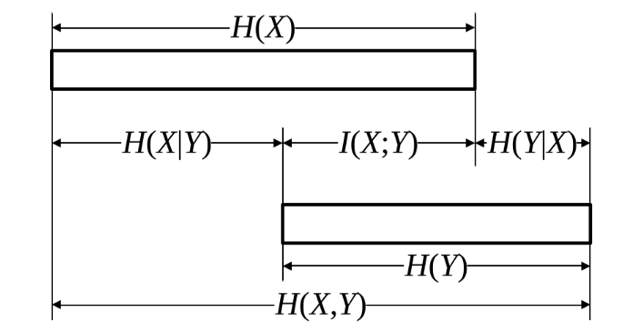

## 香农信息与自信息量

信息论中，信息量用于度量一个随机事件发生时所消除的不确定性，或者说是事件发生带来的“惊讶程度”。

设离散随机变量 $X$ 的取值为 $x$，记

$$
p(x)=P(X=x)
$$

为事件 $X=x$ 的概率。直观上：

- 事件发生的概率越小，它包含的信息量越大；
- 事件发生的概率越大，它包含的信息量越小。

## 自信息量

定义事件 $X=x$ 的自信息量（self-information）为

$$
I(x)=-\log_b p(x),
$$

其中 $b>0$ 且 $b\neq 1$。底数 $b$ 可根据场景选择：

- $b=2$：单位为比特（bit）；
- $b=e$：单位为纳特（nat）；
- $b=10$：单位为哈特莱（hartley）。

若不特别说明，下文所有 $\log$ 使用同一底数。

这样定义的理由是：自信息量 $I(x)$ 应满足以下性质：

1. $I(x)$ 随 $p(x)$ 单调递减；
2. $p(x)=1$ 时，$I(x)=0$；
3. $p(x)\to 0^+$ 时，$I(x)\to+\infty$；
4. 对独立事件 $X=x$ 与 $Y=y$，有

$$
I(x,y)=I(x)+I(y).
$$

在通常的连续性、单调性假设下，满足这些条件的函数形式为

$$
I(x)=-C\log p(x).
$$

取 $C=1$，即得到

$$
I(x)=-\log p(x).
$$

### 联合自信息量与条件自信息量

联合自信息量定义为

$$
I(x,y)=-\log p(x,y),
$$

其中

$$
p(x,y)=P(X=x,Y=y).
$$

条件自信息量定义为

$$
I(x|y)=-\log p(x|y),
$$

其中

$$
p(x|y)=P(X=x\mid Y=y).
$$

由概率乘法定律

$$
p(x,y)=p(x)p(y|x)=p(y)p(x|y),
$$

可得

$$
I(x,y)=I(x)+I(y|x)=I(y)+I(x|y).
$$

## 信息熵

信息熵（entropy）是随机变量不确定性的度量。对离散随机变量 $X$，其自信息

$$
I_X(X)=-\log p(X)
$$

本身是一个随机变量。定义 $X$ 的熵为自信息的数学期望：

$$
H(X)=\mathbb E[I_X(X)]
=-\sum_x p(x)\log p(x).
$$

也就是说，熵是随机变量 $X$ 的自信息量的期望值。

### 联合熵

联合熵描述随机变量 $X$ 与 $Y$ 整体的不确定性：

$$
H(X,Y)=\mathbb E[-\log p(X,Y)]
=-\sum_x\sum_y p(x,y)\log p(x,y).
$$

当 $X$ 与 $Y$ 独立时，即

$$
p(x,y)=p(x)p(y),
$$

有

$$
\begin{aligned}
H(X,Y)
&=-\sum_x\sum_y p(x)p(y)\log\bigl(p(x)p(y)\bigr)\\
&=-\sum_x\sum_y p(x)p(y)\log p(x)
  -\sum_x\sum_y p(x)p(y)\log p(y)\\
&=-\sum_x p(x)\log p(x)\sum_y p(y)
  -\sum_y p(y)\log p(y)\sum_x p(x)\\
&=H(X)+H(Y).
\end{aligned}
$$

一般情况下，

$$
H(X,Y)\le H(X)+H(Y),
$$

等号成立当且仅当 $X$ 与 $Y$ 独立。

### 条件熵

条件熵描述在已知随机变量 $Y$ 的条件下，随机变量 $X$ 剩余的不确定性：

$$
H(X|Y)=\mathbb E[-\log p(X|Y)]
=-\sum_x\sum_y p(x,y)\log p(x|y).
$$

它也可以写成

$$
H(X|Y)=\sum_y p(y)H(X|Y=y),
$$

其中

$$
H(X|Y=y)=-\sum_x p(x|y)\log p(x|y).
$$

对任意联合分布，有链式法则

$$
H(X,Y)=H(X)+H(Y|X)=H(Y)+H(X|Y).
$$

若 $X$ 与 $Y$ 不独立，则互信息

$$
I(X;Y)=H(X)-H(X|Y)=H(Y)-H(Y|X)
$$

大于 $0$，因此

$$
H(X,Y)=H(X)+H(Y)-I(X;Y)<H(X)+H(Y).
$$

## 离散信源的最大熵定理

定理：设离散随机变量 $X$ 仅有有限个可能取值 $x_1,\dots,x_n$，且

$$
p_i=P(X=x_i),\qquad \sum_{i=1}^n p_i=1,\qquad p_i\ge 0.
$$

则当且仅当

$$
p_i=\frac1n,\qquad i=1,\dots,n
$$

时，信息熵 $H(X)$ 达到最大值。最大值为

$$
H_{\max}(X)=\log_b n.
$$

证明：为方便求导，先用自然对数 $\ln$ 证明。由于换底公式

$$
\log_b p=\frac{\ln p}{\ln b},
$$

底数 $b>1$ 时 $\ln b>0$，所以最大化

$$
H(X)=-\sum_i p_i\log_b p_i
$$

等价于最大化

$$
-\sum_{i=1}^n p_i\ln p_i.
$$

构造拉格朗日函数

$$
\mathcal L(p_1,\dots,p_n,\lambda)
=
-\sum_{i=1}^n p_i\ln p_i
+\lambda\left(\sum_{i=1}^n p_i-1\right).
$$

对每个 $p_i$ 求偏导：

$$
\frac{\partial \mathcal L}{\partial p_i}
=
-\ln p_i-1+\lambda=0.
$$

因此

$$
p_i=e^{\lambda-1}
$$

对所有 $i$ 都相同。再由约束

$$
\sum_{i=1}^n p_i=n e^{\lambda-1}=1,
$$

得

$$
e^{\lambda-1}=\frac1n,
$$

所以

$$
p_i=\frac1n,\qquad i=1,\dots,n.
$$

此时

$$
H_{\max}(X)
=
-\sum_{i=1}^n \frac1n\log_b\frac1n
=
\log_b n.
$$

因此，有限离散随机变量在均匀分布时熵最大。
