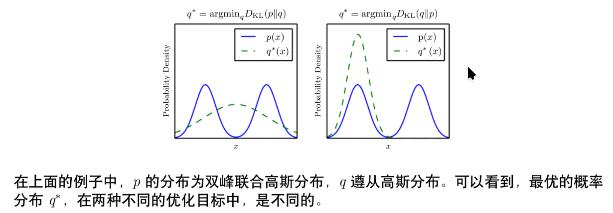

## 记号约定

沿用前文记号：

- 离散随机变量 $X$ 的取值为 $x$；
- 分布 $P$ 的概率质量函数记为
  $$
  p(x)=P(X=x)；
  $$
- 分布 $Q$ 的概率质量函数记为
  $$
  q(x)=Q(X=x)；
  $$
- 连续情形下，$p(x),q(x)$ 分别表示分布 $P,Q$ 的概率密度函数；
- $\mathbb E_{X\sim P}[\cdot]$ 表示对服从分布 $P$ 的随机变量 $X$ 取期望；
- 分布 $P$ 的熵记为
  $$
  H(P)=-\sum_x p(x)\log p(x)
  $$
  或连续情形
  $$
  H(P)=-\int p(x)\log p(x)\,dx；
  $$
- 交叉熵记为 $H(P,Q)$，注意它不是联合熵 $H(X,Y)$；
- KL 散度记为 $D_{KL}(P\|Q)$。

下文默认 $P,Q$ 定义在同一取值空间 $\mathcal X$ 上；若 $q(x)=0$ 而 $p(x)>0$，则相应的 KL 散度或交叉熵取 $+\infty$。

---

## KL散度

KL散度（Kullback-Leibler Divergence）又称相对熵，用于衡量两个概率分布 $P$ 和 $Q$ 之间的差异。一般形式可写为

$$
D_{KL}(P\|Q)
=
\mathbb E_{X\sim P}\left[\log \frac{dP}{dQ}(X)\right].
$$

:::tip[关于符号]
这里不深入测度论。只需知道：在常见离散情形下，$\frac{dP}{dQ}(x)$ 对应概率质量比
$$
\frac{p(x)}{q(x)}；
$$
在连续情形下，它对应密度比
$$
\frac{p(x)}{q(x)}。
$$
具体是求和还是积分，取决于 $X$ 是离散还是连续。
:::

### 连续情形

若 $X$ 为连续随机变量，$p(x),q(x)$ 为概率密度，则

$$
D_{KL}(P\|Q)
=
\int_{\mathcal X} p(x)\log \frac{p(x)}{q(x)}\,dx.
$$

交叉熵为

$$
H(P,Q)
=
-\int_{\mathcal X} p(x)\log q(x)\,dx.
$$

### 离散情形

下文以离散随机变量为例，这也是机器学习分类任务中的常见场景：

$$
D_{KL}(P\|Q)
=
\sum_{x\in\mathcal X} p(x)\log \frac{p(x)}{q(x)}.
$$

交叉熵为

$$
H(P,Q)
=
-\sum_{x\in\mathcal X} p(x)\log q(x).
$$

若将求和换成积分、概率质量函数换成概率密度函数，结论形式完全平行。

### KL散度的性质

- KL 散度是非负的：
  $$
  D_{KL}(P\|Q)\ge 0.
  $$
  当且仅当 $P=Q$ 几乎处处成立时，等号成立。

- KL 散度不是对称的：
  $$
  D_{KL}(P\|Q)\neq D_{KL}(Q\|P).
  $$
  因此它不是距离度量，也不满足三角不等式；它衡量的是用分布 $Q$ 去表示分布 $P$ 时的不对称差异或额外代价。

### 交叉熵

对 KL 散度变形，可得

$$
\begin{aligned}
D_{KL}(P\|Q)
&=
\sum_x p(x)\log\frac{p(x)}{q(x)}\\
&=
\sum_x p(x)\log p(x)
-
\sum_x p(x)\log q(x)\\
&=
-H(P)+H(P,Q).
\end{aligned}
$$

因此

$$
D_{KL}(P\|Q)=H(P,Q)-H(P),
$$

或等价地，

$$
H(P,Q)=H(P)+D_{KL}(P\|Q).
$$

也就是说，交叉熵由分布 $P$ 的熵与 KL 散度两部分组成。

交叉熵衡量的是：当真实分布为 $P$ 时，使用基于分布 $Q$ 的编码方案所需的平均编码长度。当 $P=Q$ 时，交叉熵等于 $H(P)$。

只有当目标分布 $P$ 固定不变时，**最小化交叉熵才等价于最小化 KL 散度**，因为此时 $H(P)$ 是常数。这时候优化目标就是让模型预测分布 $Q$ 尽可能接近真实分布 $P$，从而使 KL 散度尽可能小。

---

## 应用：监督分类中的交叉熵损失

交叉熵常用作分类、目标检测、语义分割等任务的损失函数。

二分类交叉熵损失为

$$
L
=
-\sum_{i=1}^{N}
\left[
y_i\log \hat y_i
+
(1-y_i)\log(1-\hat y_i)
\right],
$$

其中 $N$ 是样本数，$y_i\in\{0,1\}$ 是第 $i$ 个样本的真实标签，$\hat y_i\in(0,1)$ 是模型预测的正类概率。实际中常取平均，即再除以 $N$。

多分类交叉熵损失为

$$
L
=
-\sum_{i=1}^{N}
\sum_{c=1}^{C}
y_{i,c}\log \hat y_{i,c},
$$

其中 $C$ 是类别数，$y_{i,c}$ 是第 $i$ 个样本在类别 $c$ 上的真实标签分布，通常为 one-hot 向量；$\hat y_{i,c}$ 是模型预测的概率。

:::tip[one-hot向量]
在分类问题中，真实标签通常表示为一个长度为类别数的向量，其中只有一个元素为 1，表示正确类别，其余元素为 0。
:::

一般情况下，$P$ 是真实标签的分布，通常为 one-hot 向量；$Q$ 是模型预测的分布。交叉熵可以作为损失函数来优化模型参数，使模型预测分布尽可能接近真实标签分布。

训练过程中，模型预测分布 $Q$ 通常从接近均匀分布的高熵状态，逐渐调整为更接近真实分布 $P$ 的低熵状态，最终使 $Q$ 与 $P$ 尽可能接近，KL 散度尽可能小；当 $P$ 固定时，交叉熵也尽可能小。

:::tip[关于“熵最大”]
“熵最大”是有条件的：只有在没有任何先验知识、且假设为均匀分布时，熵才最大。神经网络的初始化确实可能让 Softmax 输出接近均匀分布，但这只是工程上的初始化特性，并不是信息论推导出的必然起点。
:::
