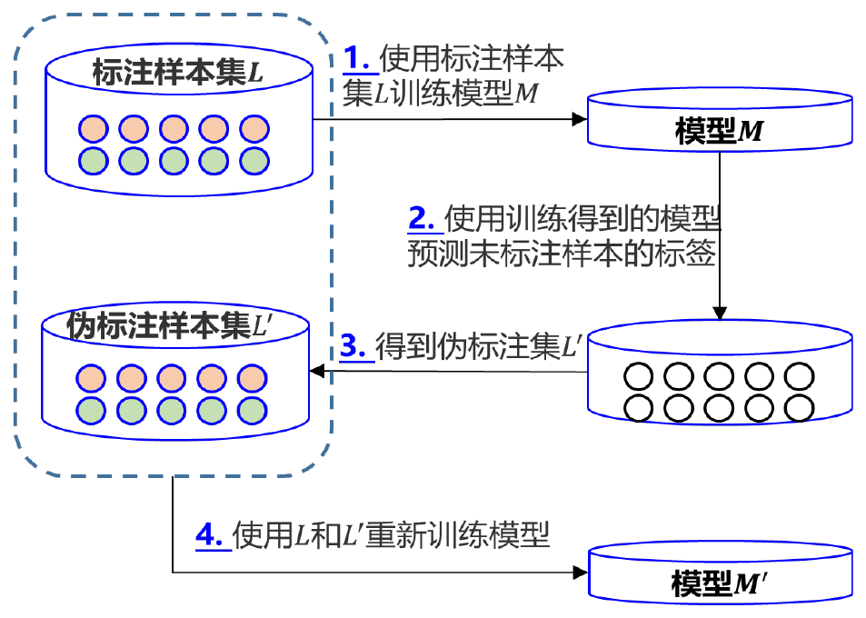
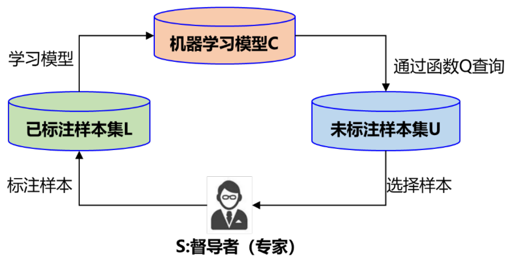

## 全章速查

| 主题 | 一句话结论 | 关键点 |
| --- | --- | --- |
| CPU 与 GPU | CPU 用少量复杂核处理串行逻辑，GPU 用大量简单核并行处理类型统一的批量运算 | 二者协作，GPU 不取代 CPU |
| 软件栈 | 驱动 → CUDA → cuDNN → 深度学习框架 | CUDA 是并行计算平台，cuDNN 是神经网络算子加速库 |
| 数据集 | 样本由特征向量与标签组成，监督学习学 $x\mapsto y$ 的映射 | $(x_i,y_i)$，$x_i\in\mathbb R^n$ |
| 标注一致性 | Pearson 测线性相关；kappa 测离散分类的一致并扣除随机一致 | $\kappa=\dfrac{p_o-p_e}{1-p_e}$ |
| 数据划分 | 训练集学参数，验证集选模型与超参数，测试集只做最终报告 | 测试集在训练阶段必须 unseen |
| K 折交叉验证 | 轮流留一折做测试，K 次性能取平均 | K 常取 5 或 10 |
| 学习范式 | 有监督、无监督、半监督、直推式、主动、强化 | 按标签与反馈方式划分 |
| 自训练与主动学习 | 自训练自动加高置信度的伪标签；主动学习请人标低置信度样本 | 一个无需人工，一个必须有人工 |

## 计算环境

### CPU 与 GPU 的分工

GPU（Graphics Processing Unit）是显卡上的芯片，与显卡集成在一起。把它和 CPU 放在一起对比，可以从五个角度看：

| 维度 | CPU | GPU |
| --- | --- | --- |
| 分工 | 通用处理器，擅长复杂逻辑与串行任务 | 专用处理器，擅长关联性低、可分块、高度线程化的并行计算 |
| 协作关系 | 主芯片 | 从芯片，分担 CPU 的部分工作 |
| 内部构成 | 核心少而复杂，流水线短 | 大量逻辑运算单元（ALU）与超长流水线，适合类型统一的数据 |
| 位置 | 独立芯片，插在主板插槽 | 集成在独立显卡上 |
| 厂商 | Intel、AMD 等 | NVIDIA（N 卡）、AMD（A 卡）等 |

深度学习之所以依赖 GPU，是因为神经网络里大量计算彼此独立、可以并行：MLP 的同一层神经元、CNN 同一特征图上的不同位置、RNN 沿序列的批量样本、Transformer 的批量注意力，都可以拆成互不依赖的矩阵与张量运算。GPU 的并行架构正好匹配这种计算模式。

除算力外，显存容量与带宽同样是硬约束：它们决定能放下多大的模型和多大的 batch，也决定数据搬运的速度。规模再大时，会用多卡并行或 TPU 等专用加速器。

### GPU 软件栈

以 NVIDIA 产品为例，搭一套可用的 GPU 环境按层次来：

1. **显卡与驱动**：安装 GPU 硬件对应的驱动程序；
2. **CUDA**：NVIDIA 的通用并行计算平台与编程模型，让程序能调用 GPU 做大规模并行计算；
3. **cuDNN**：CUDA Deep Neural Network library，专用于深度神经网络的 GPU 加速库，对卷积、池化、归一化、激活等算子的前向与反向传播做了优化，Caffe2、Keras、PyTorch、TensorFlow 等框架都依赖它；
4. **深度学习框架**：在以上基础上调用 GPU。

层次越往下越接近硬件，越往上越接近模型代码。装环境时版本要匹配：驱动支持 CUDA 的版本，CUDA 与 cuDNN 版本对应，框架再对应 CUDA 版本。

### Python 环境与框架

Anaconda 把科学计算常用的语言与工具打成一个包，装一次就能得到完整的 Python 环境，核心组件包括：

| 组件 | 用途 |
| --- | --- |
| Conda | 包管理：安装、更新、删除，并解决包依赖 |
| Numpy | 数组与矩阵运算 |
| Scipy | 最优化、线性代数、积分、插值、拟合、特殊函数等，依赖 Numpy |
| Matplotlib | 绘图与数据可视化 |
| Scikit-learn | 经典机器学习算法库：SVM、逻辑回归、朴素贝叶斯、随机森林、k-means 等 |

深度学习框架提供常用层、优化器、数据加载与预训练模型，避免重复造轮子。典型框架有 TensorFlow、PyTorch 与 MindSpore。框架应装在虚拟环境里：不同虚拟环境的依赖互不影响，可以按项目切换版本；直接在同一个物理环境里反复装卸，只能保留一套配置。

算力也可以从云上获取，例如华为昇腾 ModelArts 这类平台，按需租用 GPU 或专用加速卡。

## 数据集的数学表示

### 样本、特征与标签

数据集由若干样本（实例）组成，样本 $i$ 包含特征（属性）$x_i$ 与类别标签（目标值）$y_i$，整个数据集写成

$$
D=\{(x_1,y_1),(x_2,y_2),\dots,(x_m,y_m)\}.
$$

样本通常有多个特征，例如鸢尾花数据集每个样本有 4 个特征（花萼长宽、花瓣长宽），三类花各 50 个样本。特征因此写成列向量

$$
x_i=(x_{i1},x_{i2},\dots,x_{in})^{\top}\in\mathbb R^n,
$$

$y_i$ 是样本 $i$ 的类别标签。训练集中样本的真实类别称为真实值（ground truth），模型输出的类别称为预测值（prediction）。

**ground truth 与 gold standard 的区别**：ground truth 指通过直接观察收集到的真实结果；gold standard（金标准）原是医学上公认最可靠的诊断方法。在机器学习里默认用 ground truth；只有当一个测量可以很好地代表真实结果时，才称它为 gold standard。

## 标注一致性

人工标注难免有主观差异，需要量化评价者之间的一致程度。两类指标对应两类标注：连续评分用相关系数，离散类别用 kappa。

### Pearson 相关系数

Pearson 相关系数衡量两个变量之间的线性相关：

$$
\rho_{X,Y}=\frac{\mathrm{cov}(X,Y)}{\sigma_X\sigma_Y}
=\frac{\mathbb E[(X-\mu_X)(Y-\mu_Y)]}{\sigma_X\sigma_Y},
$$

其中 $\mu$、$\sigma$ 分别是均值与标准差。取值区间为 $[-1,1]$：$+1$ 完全正相关，$-1$ 完全负相关，$0$ 没有线性相关。它适用于衡量两个评分者打分的一致性、预测值与真实值的相关性，离散与连续变量都能算；但它只看线性关系，且对整体平移不敏感。

例如两个评委对五个作品的评分：

$$
\text{rater1}=[0.5,1.6,2.5,2.5,2.4],\qquad
\text{rater2}=[1.5,2.6,3.5,3.5,3.4].
$$

rater2 恰好等于 rater1 的每个分数加 $1$，两组数据的偏差向量完全相同，协方差等于方差，$\rho=1$。Pearson 认为这是"完全正相关"，可逐项看两人并没有给出同一个分数——对于离散分类的一致性，这种偏移必须被扣掉，因此需要 kappa。

### Cohen's kappa

Cohen's kappa 衡量**两个评价者**对**离散类别**判断的一致性。它比"简单一致百分比"更稳健，因为扣除了两人随机给出相同类别的可能。

设混淆矩阵为

| | B 判 Yes | B 判 No |
| --- | --- | --- |
| A 判 Yes | $a$ | $b$ |
| A 判 No | $c$ | $d$ |

观测一致率与随机一致率分别为

$$
p_o=\frac{a+d}{a+b+c+d},
\qquad
p_e=\frac{a+b}{n}\cdot\frac{a+c}{n}+\frac{c+d}{n}\cdot\frac{b+d}{n},
$$

其中 $n=a+b+c+d$；第一项是两人随机都判 Yes 的概率，第二项是随机都判 No 的概率。kappa 为

$$
\kappa=\frac{p_o-p_e}{1-p_e}.
$$

**数值例：50 个奖学金申请者，两位评委各判 Yes/No。**

| | B Yes | B No |
| --- | --- | --- |
| A Yes | 20 | 5 |
| A No | 10 | 15 |

1. 观测一致率：$p_o=(20+15)/50=0.7$；
2. A 判 Yes 的比例 $25/50=0.5$，B 判 Yes 的比例 $30/50=0.6$，随机都判 Yes 的概率 $p_{yes}=0.5\times0.6=0.3$；
3. A 判 No 的比例 $0.5$，B 判 No 的比例 $0.4$，随机都判 No 的概率 $p_{no}=0.5\times0.4=0.2$；
4. $p_e=0.3+0.2=0.5$；
5. $\kappa=\dfrac{0.7-0.5}{1-0.5}=0.4$。

kappa 取值在 $[-1,1]$：$0$ 表示一致程度与随机猜测相当，负值表示比随机还差。常用的 Landis–Koch 分级把 $0.21$–$0.40$ 视为一般（fair），$0.41$–$0.60$ 视为中等（moderate），本例的 $0.4$ 属于中等偏弱。

### Fleiss' kappa

评价者多于两个时用 Fleiss' kappa。设有 $N$ 个被标注对象（item）、$n$ 个评价者、$k$ 个类别，$n_{ij}$ 是第 $i$ 个对象被评为第 $j$ 类的次数：

$$
p_j=\frac{1}{Nn}\sum_{i=1}^{N}n_{ij},
$$

$p_j$ 是第 $j$ 类被选择的总体比例，即该类的随机一致概率。每个对象内部的一致程度为

$$
P_i=\frac{1}{n(n-1)}\left(\sum_{j=1}^{k}n_{ij}^{2}-n\right),
$$

分子 $\sum_j n_{ij}^2-n$ 数的是同一对象内"同类的评价者配对"个数，分母 $n(n-1)$ 是全部有序配对个数。再对对象取平均并用类别比例算随机一致：

$$
p_o=\frac{1}{N}\sum_{i=1}^{N}P_i,
\qquad
p_e=\sum_{j=1}^{k}p_j^{2},
\qquad
\kappa=\frac{p_o-p_e}{1-p_e}.
$$

**数值例：14 个评价者对 10 个对象做 5 级评价**（$N=10$，$n=14$，$k=5$）。统计各对象在各等级上的人数后，各类合计为

$$
(20,\ 28,\ 39,\ 21,\ 32),
\qquad
p_j=(0.143,\ 0.200,\ 0.279,\ 0.150,\ 0.229).
$$

以第 2 个对象为例，五级人数为 $(0,2,6,4,2)$：

$$
P_2=\frac{1}{14\times13}\left(0^2+2^2+6^2+4^2+2^2-14\right)
=\frac{46}{182}\approx0.253.
$$

同样算出十个对象，$P_i$ 依次为 $1.000,0.253,0.308,0.440,0.330,0.462,0.242,0.176,0.286,0.286$，于是

$$
p_o=\frac{3.783}{10}=0.378,
\qquad
p_e=0.143^2+0.200^2+0.279^2+0.150^2+0.229^2=0.213,
$$

$$
\kappa=\frac{0.378-0.213}{1-0.213}=0.210.
$$

结论是这批标注只有"一般"程度的一致性，等级 3 的占比最高（0.279）也说明评价者在中间等级上更集中。

## 数据划分与模型选择

### 训练集、验证集、测试集

| 子集 | 作用 | 使用阶段 |
| --- | --- | --- |
| 训练集 | 学习模型参数 | 训练 |
| 验证集 | 模型选择、调整超参数 | 训练与调参 |
| 测试集 | 最终报告模型性能 | 只在最后评估一次 |

测试集在训练阶段必须是模型没见过的样本（unseen），否则评估结果会虚高。验证集与测试集作用相似，区别在于验证集用于选模型和调超参数，因此**一般不用于报告最终结果**；确认超参数后，最终模型在训练数据上重训，测试集只负责最后那一次评估。

### 留出法

留出法（hold-out）把数据随机分成两部分：一部分训练，一部分测试；在训练集上学到模型，在测试集上算准确率作为性能指标。常见比例是 7:3 或 8:2。

优点是简单；缺点是评估结果依赖这一次划分，数据量小时尤其不稳定——换一种分法，指标可能明显波动。

### K 折交叉验证

K 折交叉验证把数据分成 K 份（K 常取 5 或 10），轮流用其中一份做测试、其余 K−1 份训练：

| 轮次 | D1 | D2 | D3 | D4 | D5 | 结果 |
| --- | --- | --- | --- | --- | --- | --- |
| 1 | 测试 | 训练 | 训练 | 训练 | 训练 | $r_1$ |
| 2 | 训练 | 测试 | 训练 | 训练 | 训练 | $r_2$ |
| 3 | 训练 | 训练 | 测试 | 训练 | 训练 | $r_3$ |
| 4 | 训练 | 训练 | 训练 | 测试 | 训练 | $r_4$ |
| 5 | 训练 | 训练 | 训练 | 训练 | 测试 | $r_5$ |

最终指标取 K 次结果的均值：

$$
\bar r=\frac{1}{K}\sum_{k=1}^{K}r_k.
$$

每个样本都恰好被测试一次，评估不再押在单次划分上，稳定性比留出法好；代价是要训练 K 次模型。

### 分层 K 折

分层抽样（stratified k-fold）要求每一折内各类别的比例与原数据集一致。例如原数据中正负样本是 1:9，普通随机划分可能让某一折几乎没有正样本，分层划分则保证每折都约 1:9。类别不均衡或数据量小时，应优先用分层 K 折。

### 网格搜索调超参数

**参数**由数据学习得到，如权重、偏置；**超参数**在训练前人为设定，如学习率、网络层数、每层神经元数、迭代次数、正则化系数、K 的取值。

网格搜索（grid search）把所有候选超参数组合都试一遍，取性能最好的一组。连续超参数先离散化成网格：如 B 的取值区间为 $[0,1]$，可离散为 $\{0,0.25,0.5,0.75,1.0\}$。与 K 折交叉验证结合：

1. 确定评价指标；
2. 对每一组超参数 $(A,B)$，在训练集上做 K 折交叉验证，得到 K 次性能的均值；
3. 比较所有组合的均值，选出最优组合。

代价是"组合数 × K"次训练。调参只在训练集与验证折上进行，不能拿测试集来挑超参数。

## 学习范式的划分

按样本标签的情况，机器学习方法分为：

| 范式 | 标签情况 | 学习任务 |
| --- | --- | --- |
| 有监督学习 | 训练样本全部有标签 | 学习输入到输出的映射 |
| 无监督学习 | 训练样本无标签 | 揭示数据的内在性质与规律（聚类、降维等） |
| 半监督学习 | 部分样本有标签，其余无标签 | 自动把无标签样本中置信度高的那部分连同伪标签加入训练集，提升泛化 |
| 直推式学习（特殊的半监督） | 训练样本有标签，测试样本的特征可见 | 训练时利用测试集除标签外的信息，如样本相似度或连接关系 |
| 主动学习 | 部分样本有标签，其余无标签 | 把置信度低的样本交人工专家标注后加入训练集 |
| 强化学习 | 无标签，但有与输出目标相关的反馈 | 决策类问题：学习在环境中如何行动 |

三组容易混的概念，一句话区分：

- **纯半监督**：模型自己给无标签样本打伪标签，挑置信度**高**的，不依赖人工；
- **直推式**：测试集的特征在训练时就可见，利用的是特征间的相似度、图结构等信息，仍然不用测试标签；
- **主动学习**：挑置信度**低**的样本，请 Oracle（通常是人类专家）标注，必须有人参与。

## 半监督学习：自训练

半监督学习的典型设定是少量有标签数据 $L$ 加大量无标签数据 $U$，希望利用 $U$ 提升性能而不额外标注。最简单的算法是自训练（self-training）：

1. 用有标签集 $L$ 训练分类器 $C_{int}$；
2. 用 $C_{int}$ 预测未标注集 $U$ 的类别；
3. 选出置信度较高的样本，连同预测出的伪标签组成 $L'$，从 $U$ 中移除；
4. 用 $L\cup L'$ 重新训练，得到新模型，回到第 2 步，直到满足停止条件（如 $U$ 为空、达到最大轮数、验证集性能不再提升）。

这套流程不需要人工干预，但风险是**确认偏差**：模型的错误预测被当成标签加入训练集，会强化自身错误。缓解手段包括设置较高的置信度阈值、每轮只加少量样本、用验证集监控性能，并保留一部分无标签数据暂不加入。

## 主动学习

主动学习同样面对"少量标签 + 大量无标签"，但把选择权交给模型：用查询函数 $Q$ 从无标签集中挑出**最有价值**的样本，向 Oracle 询问标签，再加入训练集。目标是用尽量少的标注成本达到尽量高的性能。

关键在查询策略 $Q$：选得准，少量标注就能显著提升；选得差，等于随机标注。常见策略分两类。

### 基于不确定性采样

不确定性采样（uncertainty sampling）挑选模型最没把握的样本。三种常用度量，用两个三分类样本对比（$p_1=(0.8,0.1,0.1)$，$p_2=(0.4,0.4,0.2)$）：

| 度量 | 定义 | $p_1$ | $p_2$ | 选谁 |
| --- | --- | --- | --- | --- |
| 最低置信度 | $1-\max_j p_j$，最大概率最小者最不确定 | $0.2$ | $0.6$ | $p_2$ |
| 边缘采样 | $p_{(1)}-p_{(2)}$，最大与次大概率之差最小者最不确定 | $0.7$ | $0$ | $p_2$ |
| 信息熵 | $H(p)=-\sum_j p_j\log p_j$，熵大者不确定 | $0.922$ | $1.522$ | $p_2$ |

熵的计算（以 2 为底）：

$$
H(p_1)=-(0.8\log_2 0.8+2\times0.1\log_2 0.1)\approx0.922,
$$

$$
H(p_2)=-(2\times0.4\log_2 0.4+0.2\log_2 0.2)\approx1.522.
$$

三种度量在本例中结论一致：$p_2$ 更"犹豫"，更值得送标注。信息熵的一般定义与性质见 [信息熵](/posts/dl-basics/informationtheory/)。

### 基于委员会的查询

基于委员会的查询（Query-by-Committee, QBC）训练多个模型组成委员会，挑选**委员会分歧最大**的样本。两种常见度量：

- **投票熵**：每个成员对样本投一个类别，得票分布为 $v=(v_1,\dots,v_k)$，计算
  $$
  H(v)=-\sum_{j=1}^{k}\frac{v_j}{C}\log\frac{v_j}{C},
  $$
  $C$ 是成员数；票型越集中越一致，越分散票熵越大。
- **平均 KL 散度**：设成员 $c$ 的类别分布为 $p_c(y\mid x)$，委员会平均分布为
  $$
  \bar p(y\mid x)=\frac{1}{C}\sum_{c=1}^{C}p_c(y\mid x),
  $$
  选
  $$
  \frac{1}{C}\sum_{c=1}^{C}\mathrm{KL}\big(p_c\,\|\,\bar p\big)
  $$
  最大的样本。KL 散度越大，成员之间的分布越不一致。KL 的定义与性质见 [KL 散度与交叉熵](/posts/dl-basics/kldivergenceandcrossentropy/)。

### 半监督与主动学习的对照

| 维度 | 半监督学习（自训练） | 主动学习 |
| --- | --- | --- |
| 谁产生标签 | 模型自己，伪标签 | 人类专家（Oracle） |
| 选哪些样本 | 置信度**高**的 | 置信度**低**或委员会分歧大的 |
| 人工成本 | 无 | 有，但只为少量精选样本付费 |
| 主要风险 | 确认偏差，错误自我强化 | 查询策略失效时退化为随机标注 |
| 适用场景 | 标签少、无标注预算 | 标注预算有限但可请专家 |

## 易错点

1. **验证集不能报告最终结果**：验证集用于模型选择与调超参数，最终指标必须来自测试集；测试集在训练阶段必须 unseen。
2. **参数与超参数不要混**：权重、偏置由训练学得；学习率、层数、迭代次数、每层神经元数、K、正则系数是超参数。
3. **Pearson 不懂"偏移"**：rater2 全比 rater1 高 1 分时 Pearson 仍为 1，但逐项并不一致；离散类别的一致性要用 kappa。
4. **kappa 扣除的是随机一致**：$p_o$ 是观测一致率，$p_e$ 是随机一致率，$\kappa=0$ 表示和随机猜差不多，不是"完全不一致"。
5. **数据增强只做在训练集上**：对测试集做增强会改变评估分布；测试集应当保持原样。
6. **主动学习不是全自动**：它必须有人类 Oracle 标低置信样本；"不依赖人工干预"说的是半监督。
7. **划分前先打乱**：按原始顺序切分会让训练集与测试集分布偏移。
8. **网格搜索的连续超参数要离散化**，且代价是组合数 × K 次训练；调参不能用测试集。

## 答题要点

:::tip[Cohen's kappa 计算三步]

1. 算观测一致率 $p_o$：(对角线元素之和)/总数；
2. 算随机一致率 $p_e$：行边际比例 × 列边际比例，再对类别求和；
3. 代入 $\kappa=(p_o-p_e)/(1-p_e)$。

:::

:::tip[数据与调参的边界]

- 训练集：学参数。
- 验证集 / 交叉验证折：选模型、调超参数。
- 测试集：只在最后用一次，报告最终性能。

超参数的每一组取值都在训练集内部做 K 折交叉验证，取均值最高的一组；测试集从头到尾不参与选择。

:::

## 复习检查清单

1. 说出 CPU 与 GPU 在分工、构成、协作上的区别，以及 CUDA、cuDNN、框架三者的层次关系。
2. 写出数据集的集合表示，区分 ground truth、gold standard 与 prediction。
3. 手算 Cohen's kappa 的 50 人例题（答案 0.4），并说明 $p_e$ 的来历。
4. 复述 Fleiss' kappa 的四步计算，说明 $P_i$ 与 $p_j$ 各是什么。
5. 画出 5 折交叉验证的轮次表，说明它比留出法稳定在哪里；写出网格搜索与交叉验证结合的步骤。
6. 用"置信度高低、是否人工"两个维度区分半监督、直推式与主动学习。
