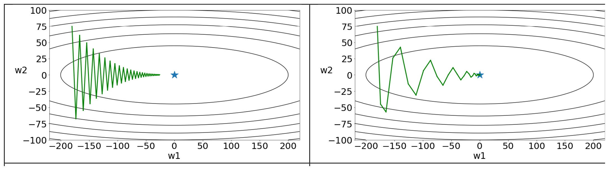

| 问题 | 本文内容 | 具体细节 |
| --- | --- | --- |
| 用什么衡量预测好坏 | 熵、交叉熵、KL/JS 散度、互信息；交叉熵与均方误差损失 | [信息熵](/posts/dl-basics/informationtheory/)、[KL 散度与交叉熵](/posts/dl-basics/kldivergenceandcrossentropy/)、[互信息](/posts/math/transinformation/) |
| 优化什么目标 | 经验风险最小化、结构风险最小化 | 正则化细节见 [线性回归](/posts/dl-basics/linear-regression/) |
| 怎么搜索参数 | 批量 GD、SGD、小批量 SGD、动量、学习率 | [SGD 及其变体](/posts/cs-core/dsml-sgd/)（NAG/AdaGrad/Adam） |
| 模型能表示什么 | Sigmoid、Tanh、ReLU、Leaky ReLU、ELU | [多层感知机与 BP](/posts/dl-basics/nonlinear-mlpclf/) 的激活函数小节 |
| 怎么泛化 | 欠拟合/过拟合的判别与七类对策 | [线性回归](/posts/dl-basics/linear-regression/)（偏差-方差）、[PCA](/posts/dl-basics/pca/)、[核方法](/posts/dl-basics/kernel-methods/) |

本文按主题顺序把五条线串起来，给出公式、直觉和答题口径；已经有专文的细节直接链接过去，不重复展开。

## 信息论视角：熵、交叉熵与 KL

### 熵、联合熵与条件熵

信息熵衡量一个随机变量的平均不确定性：

$$
H(X)=-\sum_x p(x)\log p(x)=\mathbb E[-\log p(X)].
$$

联合熵与条件熵分别是

$$
H(X,Y)=-\sum_{x,y}p(x,y)\log p(x,y),
\qquad
H(X\mid Y)=H(X,Y)-H(Y),
$$

条件熵表示已知 $Y$ 后 $X$ 剩余的不确定性。完整的定义、最大熵定理与例题见 [自信息量、联合熵与条件熵](/posts/dl-basics/informationtheory/)。

### 交叉熵与 KL 散度

设 $P$ 为真实分布、$Q$ 为模型分布，交叉熵

$$
H(P,Q)=-\sum_x p(x)\log q(x)
$$

衡量"用 $Q$ 编码来自 $P$ 的样本"所需的平均编码长度。把它拆开：

$$
H(P,Q)=H(P)+D_{\mathrm{KL}}(P\|Q),
\qquad
D_{\mathrm{KL}}(P\|Q)=\sum_x p(x)\log\frac{p(x)}{q(x)}\ge 0.
$$

因此当真实分布 $P$ 固定时，最小化交叉熵等价于最小化 KL 散度。KL 散度非负、不对称；对调 $P,Q$ 会得到不同的值。这两条性质及离散/连续情形、分类中的交叉熵损失，都在 [KL 散度与交叉熵](/posts/dl-basics/kldivergenceandcrossentropy/) 中展开。

KL 不对称，于是有了对称化的 JS 散度：

$$
D_{\mathrm{JS}}(P\|Q)=\frac12D_{\mathrm{KL}}\left(P\,\Big\|\,\frac{P+Q}{2}\right)
+\frac12D_{\mathrm{KL}}\left(Q\,\Big\|\,\frac{P+Q}{2}\right),
$$

它非负、对称，当且仅当 $P=Q$ 时为零，两个分布时取值不超过 $\log 2$。GAN 的目标函数正是以 JS 散度为理论最优值，推导见 [生成式模型：从 AE/VAE 到 GAN 的范式框架](/posts/dl-basics/generative-paradigms/)。

### 互信息

互信息是已知 $Y$ 后 $X$ 不确定性的减少量：

$$
I(X;Y)=H(X)-H(X\mid Y)=H(X)+H(Y)-H(X,Y)
=D_{\mathrm{KL}}\big(p(x,y)\,\|\,p(x)p(y)\big).
$$

它非负，当且仅当 $X$ 与 $Y$ 独立时为零；决策树 ID3 的信息增益就是 $I(D;A)$，见 [互信息](/posts/math/transinformation/) 与 [决策树](/posts/dl-basics/decisiontree/)。

## 目标函数：经验风险与结构风险

### 经验风险最小化

设训练集 $T=\{(x_1,y_1),\dots,(x_m,y_m)\}$，模型 $f$ 的经验风险是它在训练集上的平均损失：

$$
R_{\mathrm{emp}}(f)=\frac1m\sum_{i=1}^m L\big(y_i,f(x_i)\big),
\qquad
f^*=\arg\min_{f\in\mathcal F}R_{\mathrm{emp}}(f).
$$

经验风险最小化（ERM）认为经验风险最小的模型最优。样本量足够大时它效果不错，极大似然估计就是 ERM 的一个例子：取 $L=-\log p(y_i\mid x_i;\theta)$ 时，最小化负对数似然就是最大化似然。

### 结构风险最小化

样本少、模型复杂时，ERM 会把训练集上的噪声也拟合进去。结构风险最小化（SRM）在经验风险上加一项模型复杂度惩罚：

$$
R_{\mathrm{srm}}(f)=\frac1N\sum_{i=1}^N L\big(y_i,f(x_i)\big)+\lambda J(f),
\qquad
f^*=\arg\min_{f\in\mathcal F}R_{\mathrm{srm}}(f),
$$

其中 $J(f)$ 度量模型复杂度，$\lambda\ge0$ 是权重超参数。最常见的两种取法是 $J(f)=\|\mathbf w\|_2^2$（L2 正则）与 $J(f)=\|\mathbf w\|_1$（L1 正则）。前者把参数整体压小，后者倾向于产生稀疏解；两者的几何解释、闭式解和偏差-方差分析见 [线性回归](/posts/dl-basics/linear-regression/)。

:::note
深度网络的参数量通常远大于样本量，单靠显式的 $J(f)$ 并不足以解释泛化。SGD 的梯度噪声、早停、Dropout、数据增强、权重共享的结构本身，都在隐式地限制模型的有效容量。
:::

## 损失函数：交叉熵与均方误差

### 分类：从 logits 到交叉熵

神经网络的分类流程分三步：

1. 最后一个隐藏层输出 $h_L$，与分类参数 $W_c$ 相乘得到各类得分（logits）
   $$
   S=W_c h_L;
   $$
2. Softmax 归一化成概率分布
   $$
   Q_i=\frac{e^{S_i}}{\sum_j e^{S_j}};
   $$
3. 与真实标签的 one-hot 向量 $P$ 计算交叉熵
   $$
   H(P,Q)=-\sum_i P_i\log Q_i.
   $$

由于 one-hot 只有真实类别 $i$ 的位置为 1，求和后只剩一项：

$$
H(P,Q)=-\log Q_i=-\log\frac{e^{S_i}}{\sum_j e^{S_j}}.
$$

也就是说，多分类交叉熵只惩罚"真实类别的预测概率"——它越小，损失越大。实现中通常把 softmax 与 log 合并成 log-sum-exp 计算，避免 $e^{S_i}$ 上溢；二分类则用二元交叉熵 $-[y\log\hat y+(1-y)\log(1-\hat y)]$，见 [KL 散度与交叉熵](/posts/dl-basics/kldivergenceandcrossentropy/) 与 [逻辑回归](/posts/dl-basics/linear-logistic/)。

### 回归：均方误差

回归任务最常用均方误差：

$$
\mathrm{MSE}(\theta)=\frac1N\sum_{i=1}^N\big(f(x_i;\theta)-y_i\big)^2.
$$

在高斯噪声假设下，最小化 MSE 等价于极大似然估计；这一推导与最小二乘的闭式解见 [线性回归](/posts/dl-basics/linear-regression/)。

### 为什么不能用准确率当损失

准确率、精确率、召回率、F1、ROC 等是**性能度量**，用来评价模型；损失函数则是**优化目标**，需要给梯度下降提供方向。准确率是分段常数的，几乎处处导数为零，无法告诉参数该往哪走；F1 等指标也往往不可微、不可逐样本分解。损失函数不必等于最终指标，但必须足够光滑、可优化。两者的分工与更多指标见 [评价指标](/posts/nlp/05-01-evaluation-metrics/)。

## 梯度下降与学习率

### 三种形式

梯度下降沿目标函数一阶梯度反方向更新参数：

$$
\theta_j\leftarrow\theta_j-\eta\frac{\partial J(\theta)}{\partial\theta_j},
$$

$\eta$ 为学习率。按每次更新使用的样本量分为三种：

| 形式 | 每步样本 | 梯度特点 | 优点 | 缺点 |
| --- | --- | --- | --- | --- |
| 批量梯度下降（BGD） | 全部 $m$ 个 | 精确梯度 | 稳定、方向准 | 每步慢、内存大，易受局部极小与鞍点困扰 |
| 随机梯度下降（SGD） | 1 个 | 无偏但高方差 | 每步快，噪声有助于跳出局部极小 | 震荡明显、收敛慢 |
| 小批量 SGD | $n$ 个 | 方差介于两者之间 | 兼顾速度与稳定，利于并行 | 需要调 batch size |

SGD 的随机梯度是真实梯度的无偏估计：$\mathbb E[\nabla L_i(\theta)]=\nabla R(\theta)$。噪声带来方差，也带来逃离鞍点的可能。三种形式的实现细节、NAG、AdaGrad、Adam 等变体见 [SGD 及其变体](/posts/cs-core/dsml-sgd/)。

### 学习率

学习率控制每步更新幅度：太小则收敛慢、需要更多迭代；太大则在最优点附近震荡甚至发散；合适的学习率才能稳定下降。

调节学习率最常用的方法是动量法。记第 $t$ 步梯度 $g_t=\nabla J(\theta_{t-1})$，动量累积与参数更新为

$$
v_t=g_t+\beta v_{t-1},
\qquad
\theta_t=\theta_{t-1}-\alpha v_t,
$$

其中 $\beta\in[0,1]$ 是动量系数（衰减权重），$\alpha$ 是学习率。动量让参数在梯度方向一致的维度上加速，在反复震荡的维度上相互抵消，从而更快通过狭长谷底。

## 激活函数

如果只有线性层，多层网络仍然是线性映射：$W_2(W_1x)=(W_2W_1)x$，堆多少层都等价于单层线性模型。激活函数提供非线性，使网络能逼近复杂函数。

| 函数 | 表达式 | 导数 | 值域 | 特点 |
| --- | --- | --- | --- | --- |
| Sigmoid | $\sigma(z)=\frac{1}{1+e^{-z}}$ | $\sigma(z)(1-\sigma(z))\le\frac14$ | $(0,1)$ | 可解释为概率；两端饱和，深层易梯度消失，输出非零中心 |
| Tanh | $\frac{e^z-e^{-z}}{e^z+e^{-z}}$ | $1-\tanh^2(z)$ | $(-1,1)$ | 零中心；两端仍饱和 |
| ReLU | $\max(0,x)$ | $1\ (x>0)$，$0\ (x<0)$ | $[0,\infty)$ | 正半轴不饱和、计算便宜、稀疏；负半轴死亡，$x=0$ 不可导 |
| Leaky ReLU | $x\ (x\ge0)$，$ax\ (x<0)$ | $1$ 或 $a$ | $(-\infty,\infty)$ | 给负半轴一个小斜率，缓解死亡 |
| ELU | $x\ (x>0)$，$a(e^x-1)\ (x\le0)$ | $1$ 或 $a e^x$ | $(-a,\infty)$ | 负半轴饱和更平滑，计算稍贵 |

ReLU 及其变体是隐藏层的默认选择；Sigmoid 更多用于二分类输出层或门控结构。各函数的图像与在 BP 中的用法见 [多层感知机与 BP](/posts/dl-basics/nonlinear-mlpclf/)。

## 梯度消失与梯度爆炸

### 成因：连乘

反向传播时，损失对浅层表示的梯度要穿过每一层的雅可比矩阵：

$$
\frac{\partial \mathcal L}{\partial h_1}
=
\frac{\partial \mathcal L}{\partial h_L}
\prod_{l=1}^{L-1}\frac{\partial h_{l+1}}{\partial h_l},
\qquad
\frac{\partial h_{l+1}}{\partial h_l}=W_l\,\mathrm{diag}\big(\sigma'(z_l)\big).
$$

若每层雅可比的尺度都小于 1，连乘结果随深度指数衰减，浅层几乎收不到梯度（消失）；若都大于 1，则指数增长，出现溢出或发散（爆炸）。Sigmoid 的导数最大只有 $1/4$，是梯度消失的典型来源；权重初始化过大则容易引发爆炸。两者可以统一概括为：**较小梯度的多次连乘导致消失，较大梯度的多次连乘导致爆炸**。

### 四类对策

1. **合理的激活函数**：ReLU 在正半轴导数为 1，不再像 Sigmoid 那样每层都乘一个小于 1 的因子。
2. **梯度剪切**：主要针对爆炸。设阈值 $\tau$，
   $$
   g\leftarrow\frac{\tau}{\max(\tau,\|g\|)}\,g,
   $$
   梯度范数超过阈值时按比例缩回。
3. **权重正则化**：L1/L2 限制权重幅度，避免权重过大导致连乘爆炸。
4. **批量标准化（BN）**：对每层激活前的向量做标准化，再缩放平移，
   $$
   \hat h=\frac{h-\mu_B}{\sqrt{\sigma_B^2+\epsilon}},
   \qquad
   y=\gamma\hat h+\beta,
   $$
   以稳定各层分布、改善训练。细节见 [BatchNorm](/posts/cnn/cnn-batchnorm/)。

残差连接（把连乘变成加法通路，梯度可沿恒等映射直接回传，见 [ResNet](/posts/cnn/cnn-resnet/)）、门控结构（LSTM/GRU）、更合理的初始化（Xavier/He）、层归一化。循环网络在时间维度上的同类问题与截断梯度、渗漏单元等做法见 [BPTT 与梯度消失](/posts/rnn/rnn-bptt/)。

## 欠拟合与过拟合

### 判别

- **欠拟合**：模型学习能力不足，训练集和测试集表现都差。常见原因是特征太少、模型太简单，例如只靠颜色区分猫狗。
- **过拟合**：模型把训练集的噪声也学了进去，训练集表现很好、测试集明显变差。常见原因是参数太多、模型太复杂、数据太少，例如训练集里猫都戴铃铛，模型就认为没有铃铛的不是猫。

| 训练集表现 | 验证/测试表现 | 诊断 |
| --- | --- | --- |
| 差 | 差 | 欠拟合 |
| 好 | 差 | 过拟合 |
| 好 | 好 | 暂未观察到明显问题，继续关注两者的差距 |

偏差-方差分解给出了更细的解释：模型太简单时偏差大（欠拟合），太复杂时方差大（过拟合），正则化通过牺牲一点偏差换取方差的下降。推导与 Ridge/Lasso 的对比见 [线性回归](/posts/dl-basics/linear-regression/)。

### 缓解欠拟合

1. 增加新特征；
2. 添加多项式特征；
3. 减小正则化强度（$\lambda$ 调小）；
4. 使用非线性模型（如核 SVM，见 [核方法](/posts/dl-basics/kernel-methods/)）；
5. 使用集成学习把多个弱模型组合成强模型。

核心思路都是**提高模型的有效容量**或降低约束强度。

### 缓解过拟合

1. **约束模型复杂度**：减少特征（人工筛选或特征选择算法）、特征降维（如 [PCA](/posts/dl-basics/pca/)）。
2. **参数正则化**：L1/L2 保留所有特征但压低参数，$\lambda$ 控制强度；几何与偏差-方差分析见 [线性回归](/posts/dl-basics/linear-regression/)，逻辑回归中的用法见 [逻辑回归](/posts/dl-basics/linear-logistic/)。
3. **数据增强**：扩充训练集。包括采集更多真实数据，以及对原样本做不改变标签的变换（旋转、平移、裁剪、翻转、加噪声等）。这是图像任务中最有效的手段之一。
4. **早停**：训练中持续记录验证集表现，验证性能变差时停止，并保留验证集上最好的参数。它相当于用训练步数限制模型的有效容量，是一种隐式正则化。
5. **Dropout**：训练阶段以一定概率临时屏蔽神经元，每次迭代重新随机选择；训练结束后所有神经元恢复使用。它可以看作对指数多个共享权重的子网络做近似集成，减少神经元之间的共适应。
6. **交叉验证**：把训练集划分为 $k$ 折，轮流用其中一折验证，选择验证表现最好的模型/超参数。它主要用于模型选择，不是直接修改损失；核方法中的网格搜索示例见 [核方法](/posts/dl-basics/kernel-methods/)，划分流程与分层抽样的完整整理见 [机器学习概述](/posts/dl-basics/ml-overview/)。
7. **集成学习**：训练多个模型并组合。Bagging（如随机森林）并行训练、主要降低方差；Boosting 串行训练、主要降低偏差。注意集成同时出现在欠拟合与过拟合的清单里并不矛盾：**Bagging 型集成降方差，Boosting 型集成增容量**，要看你用哪一种。

Dropout 的实现通常采用 inverted dropout：训练时以保留概率 $p$ 采样掩码 $m_i\sim\mathrm{Bernoulli}(p)$，前向输出为 $m_i x_i/p$；这样测试时无需再缩放。AlexNet 在全连接层使用 $p=0.5$ 的 Dropout，见 [AlexNet](/posts/cnn/cnn-alexnet/)。
