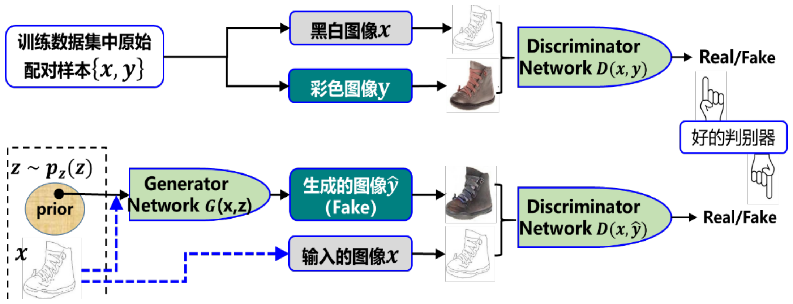
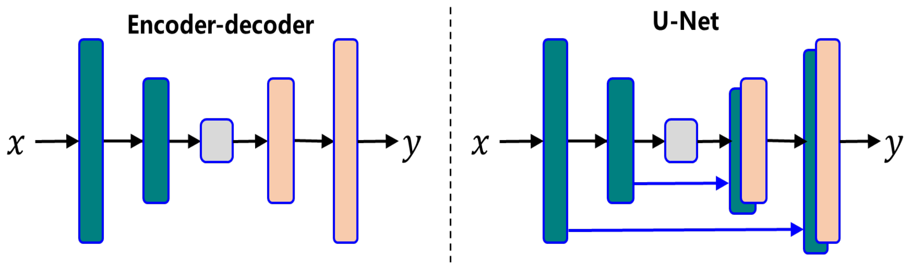
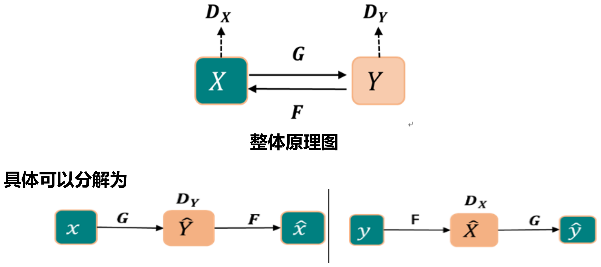
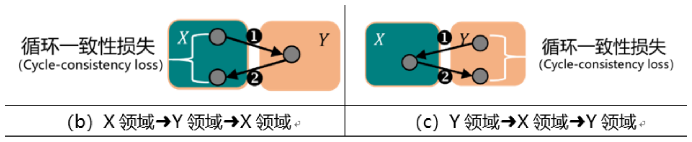
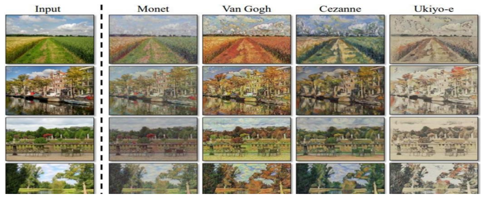

## 从"随机生成"到"按图生成"

前面几篇的生成器都从噪声出发：原始 GAN 学 $G(z)$，cGAN 学 $G(z\mid c)$，$c$ 通常是一个类别标签。生成的目标是"像训练数据"，条件只控制少数属性。

图像翻译（image-to-image translation）把条件换成**整幅输入图像**：输入一张黑白照片，输出它的彩色版本；输入一张语义分割图，输出对应的街景；输入线稿，输出实物图。此时生成器学的是条件分布 $p(y\mid x)$，其中 $x$ 是输入图像、$y$ 是目标图像。典型应用还包括图像修复与超分辨率。

按训练数据的形式，图像翻译分为两类模型：

- **pix2pix**：有监督，训练集是**成对**的 $(x,y)$，例如每张黑白图都配一张彩色图；
- **CycleGAN**：无监督（不成对），只有两个图像域 $X$ 与 $Y$ 的独立样本，例如一批照片和一批莫奈、梵高的画作，二者没有一一对应关系。

两者都建立在 [DCGAN 与 cGAN](/posts/dl-basics/dcgan-cgan/) 的基础上：pix2pix 的生成器本质上是一个条件 GAN，CycleGAN 则把条件 GAN 拆成两对、再用循环一致性把两个方向绑在一起。

## pix2pix：把条件换成整幅图像

### 任务与判别器

pix2pix 是基于生成对抗网络的**图像到图像的有监督转换模型**。训练集由成对样本 $(x,y)$ 组成，生成器接收输入图像 $x$（以及噪声 $z$），输出 $\hat y=G(x,z)$。

判别器是 pix2pix 与普通 GAN 的关键区别：**pix2pix 的判别器 $D$ 判断两个图像之间的关系，因此需要成对图像的输入**。普通 GAN 的 $D(x)$ 只判单幅图真假，cGAN 的 $D(x\mid c)$ 判"图像与标签是否匹配"；pix2pix 的判别器同时看到输入 $x$ 和输出候选 $y$，判断的是"$y$ 是不是 $x$ 的合理翻译"：

$$
D(x,y)\approx P\big(y\ \text{是}\ x\ \text{的真实对应图像}\big).
$$

对应地，对抗损失写成

$$
\mathcal L_{cGAN}(G,D)
=\mathbb E_{x,y}\big[\log D(x,y)\big]
+\mathbb E_{x,z}\big[\log\big(1-D\big(x,G(x,z)\big)\big)\big].
$$

第一项把真实的配对 $(x,y)$ 判为真，第二项把生成器造出的配对 $(x,G(x,z))$ 判为假。这里的"条件"就是输入图像 $x$，所以 pix2pix 本质上是一个以整幅图像为条件的 cGAN——条件从标签换成了图像，但"条件同时进入 $G$ 和 $D$"的结构没有变。

### 生成器：为什么用 U-Net

pix2pix 的理由是：对于图像上色这类应用，**输入和输出关联性较强，应该将输入特征进行共享**，所以在生成器中使用了 U-Net 结构，而不是之前 GAN 中常见的编码器-解码器结构。

差别在于跳连（skip connection）：

- **编码器-解码器**：$x$ 经过编码器逐层压缩到瓶颈，再经解码器逐层恢复到 $y$。输入图像里的边缘、轮廓等细节在压缩过程中可能丢失，解码器只能凭瓶颈表示重新"编"出来。
- **U-Net**：在编码器与解码器**同尺度**的层之间加跳连，把编码阶段的高分辨率特征直接送到解码阶段。上色任务中，颜色是新的，但线条和结构应当保留——跳连让生成器把输入的结构"抄"过来，只学需要改变的部分。

这一设计与 cGAN 中"条件必须进入 $D$"是同一思路的两个层面：条件信息越强、越直接，模型越容易学。pix2pix 让条件不仅在判别器里被检查，还在生成器内部被逐层共享。

### 判别器：PatchGAN

pix2pix 的判别器使用 **PatchGAN**：它不是对图像整体进行真伪判断，而是**将图像分为若干像素块（patch），对每个像素块分别输出预测概率**，因而更关注提升生成图像的细节。

具体实现上，PatchGAN 采用全卷积形式：图像经过多个卷积层后，最后不接全连接层或激活函数，而是再用卷积把结果映射为一个 $N\times N$ 的矩阵，每个数值对应输入图像某个局部区域（该输出位置感受野覆盖的 patch）的真伪概率。训练时对矩阵中每个元素计算对抗损失再取平均，等价于对许多重叠的 patch 分别做真假判断。

为什么这样设计？一张图整体判断真假，判别器很容易被全局色调、结构"骗过"，对局部的模糊和伪影不敏感；而把判断拆到 patch 上，每个局部都必须经得起检查，生成器就被迫改善纹理、边缘等**高频细节**。原论文中的 patch 大小取 $70\times70$（对 $256\times256$ 输入，输出为 $30\times30$ 的矩阵），这是原论文的实现细节。

### 优化目标：对抗损失 + L1 重构

pix2pix 的整体优化目标是

$$
G^*=\arg\min_G\max_D\ \mathcal L_{cGAN}(G,D)+\lambda\,\mathcal L_{L1}(G),
$$

其中

$$
\mathcal L_{L1}(G)=\mathbb E_{x,y,z}\big[\|y-G(x,z)\|_1\big],
$$

$\lambda$ 是权重系数（原论文取 100）。两项的分工很明确：

- **对抗项**：与传统 cGAN 优化目标类似，让生成的图像在判别器看来"像真实翻译"；
- **L1 重构项**：直接约束生成图像与真实图像 $y$ 的像素差异，用来**应对低频成分**。

两项缺一不可：

- 只用对抗损失，生成器只要骗过判别器即可，输出可能在像素上偏离 $y$ 很远（颜色对、结构大致对，但细节位置错乱）；
- 只用 L1，输出会趋向所有可能翻译的平均，得到**模糊**的结果——L1 对低频结构约束很强，却留不住高频纹理，而对抗项正好补上这一块。

所以 pix2pix 的分工是：L1 管"整体结构和颜色大致正确"，PatchGAN 管"局部细节经得起看"。

pix2pix 的局限也很明确：**训练过程需要大量的成对图片**，例如线稿上色需要大量线稿图和与之对应的上色图作为训练集。成对数据在很多任务上昂贵甚至不存在（照片与名画之间就没有配对），这正是 CycleGAN 要解决的问题。另外，原论文发现生成器常常忽略噪声 $z$，实际输出几乎是确定性的，论文通过在生成器若干层加 dropout 来注入随机性——这也是"条件强到一定程度，噪声就没用了"的一个例证。

## CycleGAN：不成对也能翻译

### 两个域，两对"生成器 + 判别器"

CycleGAN 与 pix2pix 类似，也是一种基于生成对抗网络的图像转换模型；主要应用点是**风格迁移**，例如把输入图像赋予莫奈、梵高等名家的绘画风格；关键区别是**不需要建立一对一的源域-目标域成对映射样本**作为训练数据——pix2pix 需要成对（paired）图像，CycleGAN 只需要两个域的独立样本。

设源域为 $X$、目标域为 $Y$，CycleGAN 同时训练两个生成器与两个判别器：

- $G:X\to Y$，把 $X$ 的图像翻译成 $Y$ 的风格；
- $F:Y\to X$，把 $Y$ 的图像翻译回 $X$；
- $D_Y$：判断一幅图是否像 $Y$ 域的真实样本（$G(x)$ 要骗过它）；
- $D_X$：判断一幅图是否像 $X$ 域的真实样本（$F(y)$ 要骗过它）。

于是构成两对独立的对抗：

$$
\mathcal L_{GAN}(G,D_Y,X,Y)
=\mathbb E_{y\sim p_{data}(y)}[\log D_Y(y)]
+\mathbb E_{x\sim p_{data}(x)}[\log(1-D_Y(G(x)))],
$$

$$
\mathcal L_{GAN}(F,D_X,Y,X)
=\mathbb E_{x\sim p_{data}(x)}[\log D_X(x)]
+\mathbb E_{y\sim p_{data}(y)}[\log(1-D_X(F(y)))].
$$

如果不加成对的约束，这两项足以让 $G$ 生成"像 $Y$ 域"的图像，却不保证它保留输入 $x$ 的内容。极端情况下，$G$ 可以把所有照片都翻译成同一张莫奈风格的图——它确实骗过了 $D_Y$，但内容全丢了。**两个对抗损失各自只约束"像不像目标域"，不约束"是不是这张图"**。

### 循环一致性损失

第三项正是为了解决内容保持：**循环一致性损失**（Cycle Consistency Loss）。把翻译走一个来回，应当回到原图：

$$
\mathcal L_{cyc}(G,F)
=\mathbb E_{x\sim p_{data}(x)}\big[\|F(G(x))-x\|_1\big]
+\mathbb E_{y\sim p_{data}(y)}\big[\|G(F(y))-y\|_1\big].
$$

- **前向循环** $x\to G(x)\to F(G(x))\approx x$：照片先变莫奈风格，再变回照片，应当还原；
- **反向循环** $y\to F(y)\to G(F(y))\approx y$：名画先变照片，再变回画，也应当还原。

用 L1 衡量往返误差，迫使 $G$ 在改变风格的同时保留内容——如果 $G$ 把输入内容丢弃，$F$ 就不可能从 $G(x)$ 里恢复出 $x$。

### 总损失

把三项加起来，CycleGAN 的整体损失为

$$
\mathcal L(G,F,D_X,D_Y)
=\mathcal L_{GAN}(G,D_Y,X,Y)
+\mathcal L_{GAN}(F,D_X,Y,X)
+\lambda\,\mathcal L_{cyc}(G,F),
$$

其中 $\lambda$ 为权重因子，是超参数（原论文取 10，并使用最小二乘 GAN 损失）。

训练仍然是交替的对抗训练：更新 $D_X,D_Y$ 提高各自的分辨能力，更新 $G,F$ 同时降低对抗损失（骗过判别器）与循环一致性损失（保持内容）。四个网络的平衡比普通 GAN 更难维持。

### 代价与局限

CycleGAN 用"不成对"换来了数据上的自由，代价是约束变弱：

- 循环一致性只保证**能往返**，不保证翻译在语义上正确；模型可能把信息藏进图像的不可见部分来满足往返约束；
- 对**几何形状变化大**的转换（例如狗变猫，轮廓都不同）效果有限，它更擅长颜色、纹理层面的风格迁移；
- 需要训练四个网络，模式坍塌和训练不稳定的风险与普通 GAN 一样存在，甚至更大；
- 一个模型只对应一个方向、一对域，换任务要重新训练。

## pix2pix 与 CycleGAN 对照

| 维度 | pix2pix | CycleGAN |
| --- | --- | --- |
| 训练数据 | 成对 $(x,y)$，有监督 | 不成对，两个域的独立样本 |
| 生成器 | 1 个 U-Net：$G(x,z)$ | 2 个：$G:X\to Y$、$F:Y\to X$ |
| 判别器 | 1 个 PatchGAN：$D(x,y)$ 判配对关系 | 2 个：$D_X$、$D_Y$ 各判域内真假 |
| 损失 | cGAN 对抗损失 $+\ \lambda\mathcal L_{L1}$ | 两个对抗损失 $+\ \lambda\mathcal L_{cyc}$ |
| 典型任务 | 上色、分割图→照片、线稿→实物 | 风格迁移、照片↔名画、马↔斑马 |
| 主要局限 | 需要成对数据 | 循环一致不保证语义正确，训练更难 |

选择很直接：有配对数据就用 pix2pix，监督信号更强、结果更可控；只有两个域、没有配对关系时用 CycleGAN，用循环一致性替代成对监督。

## 从 GAN 到图像翻译的主线

把这一讲的五个模型串起来，改造的层次很清楚：

| 模型 | 改了什么 |
| --- | --- |
| 原始 GAN | 极小极大博弈，$G(z)$ 从噪声生成 |
| cGAN | 条件 $c$ 同时进入 $G$ 和 $D$，控制生成类别 |
| DCGAN | 用卷积网络与微步幅度卷积替换 MLP |
| pix2pix | 条件换成整幅图像，U-Net 共享特征，PatchGAN 判局部，L1 管低频 |
| CycleGAN | 去掉成对要求，双生成器+双判别器，循环一致性保持内容 |

每一步都保留原始 GAN 的对抗框架，只改其中一项：条件、结构、数据形式或损失组合。

## 答题要点

:::tip[pix2pix 要点]

1. 定位：基于 GAN 的**有监督**图像到图像转换模型，需要成对 $(x,y)$。
2. 生成器：本质是条件 GAN；因输入输出关联性强、需要共享输入特征，采用 **U-Net**（编码器-解码器加同尺度跳连）而不是普通编码器-解码器。
3. 判别器：**PatchGAN**，把图像分成若干像素块分别输出真伪概率，全卷积输出 $N\times N$ 矩阵，更关注细节；判别的是 $(x,y)$ 的配对关系。
4. 目标：$G^*=\arg\min_G\max_D\ \mathcal L_{cGAN}(G,D)+\lambda\mathcal L_{L1}(G)$，L1 项应对低频成分，对抗项补充高频细节。
5. 缺点：需要大量成对图片。

:::

:::tip[CycleGAN 要点]

1. 定位：基于 GAN 的**无监督**（不成对）图像转换模型，主要用于风格迁移。
2. 结构：两个生成器 $G:X\to Y$、$F:Y\to X$，两个判别器 $D_X$、$D_Y$，构成两对"生成器 + 判别器"。
3. 损失：两个对抗损失分别保证翻译结果像目标域；循环一致性损失 $\mathcal L_{cyc}=\mathbb E_x\|F(G(x))-x\|_1+\mathbb E_y\|G(F(y))-y\|_1$ 保证往返能还原内容。
4. 总损失：$\mathcal L=\mathcal L_{GAN}(G,D_Y,X,Y)+\mathcal L_{GAN}(F,D_X,Y,X)+\lambda\mathcal L_{cyc}(G,F)$，$\lambda$ 为超参数。
5. 与 pix2pix 的区别：不需要成对数据；代价是循环一致只约束"能往返"，不保证语义正确。

:::

## 小结

pix2pix 把 cGAN 的条件从标签换成整幅图像，用 U-Net 在生成器内部共享输入特征，用 PatchGAN 把真假判断拆到局部，再用 L1 重构项补上低频结构——三者共同服务于"输出既要像目标域、又要忠实于输入"。CycleGAN 去掉了成对数据的约束，用两个方向和循环一致性把"风格像"与"内容在"拆成两个可优化的目标。至此，生成式这条线上的五个模型全部落地：原始 GAN 给出框架，cGAN 给出控制，DCGAN 给出卷积结构，pix2pix 与 CycleGAN 给出图像翻译的两种数据范式。各主题与文章的对应关系见 [深度学习课程复习索引](/posts/dl-basics/00-course-map/)。
