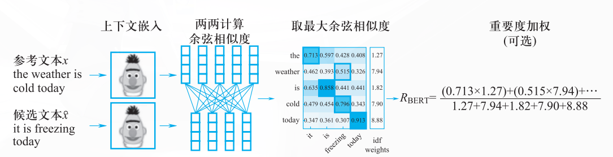
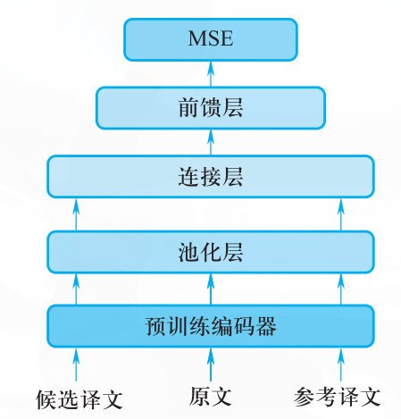
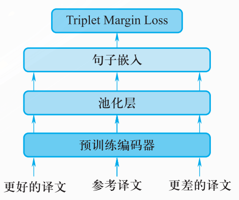

## 评价的三个核心问题

自然语言处理的输出往往没有唯一标准答案，评价需要回答三个问题：

1. **评价数据**：测试集是否与训练集独立？领域、时效性、输入输出格式是否匹配真实场景？
2. **评价方法**：人工评价、基于统计的自动指标，还是用模型自动打分？
3. **评价指标**：输出是标签、分数还是一段文本？不同输出形式需要不同指标。

把数据、任务、指标和基线固定下来，就形成了 **基准测试**（Benchmark）。常见基准包括 GLUE、SQuAD、WMT、CNN/Daily Mail、GSM8K 等。Benchmark 让不同系统可以在同一条件下比较，但也可能带来过拟合基准的问题。

NLP 任务大体分为两类：

- **自然语言理解（NLU）**：文本分类、序列标注、文本蕴含等，输出通常是类别或分数，有相对明确的标准答案；
- **自然语言生成（NLG）**：机器翻译、摘要、对话等，输出是一段文本，通常没有唯一答案。

## NLU 分类任务的评价

### 准确率

准确率是最直观的指标：预测正确的样本占总样本的比例。

$$
\text{Accuracy} = \frac{n_{\text{correct}}}{n_{\text{total}}}
$$

准确率简单，但在类别不平衡时会误导。例如 99% 的样本是负类，一个永远预测负类的模型也能得到 99% 的准确率，却完全没有识别正类的能力。

### 混淆矩阵

二分类的混淆矩阵把预测结果分为四类：

| | 预测正 | 预测负 |
| --- | --- | --- |
| **真实正** | TP（真正例） | FN（假负例） |
| **真实负** | FP（假正例） | TN（真负例） |

- TP：实际为正，预测为正；
- FN：实际为正，预测为负（漏报）；
- FP：实际为负，预测为正（误报）；
- TN：实际为负，预测为负。

由混淆矩阵可以计算：

$$
\text{Accuracy} = \frac{TP + TN}{TP + TN + FP + FN}
$$

### 精确率、召回率与 F1($F_\beta$)

精确率（Precision）回答“被判为正例的样本中有多少是真的正例”，类似可信度：

$$
P = \frac{TP}{TP + FP}
$$

召回率（Recall）回答“真正的正例中有多少被找出来了”，反映系统的发掘能力：

$$
R = \frac{TP}{TP + FN}
$$

两者通常此消彼长。

- 只判断少量高置信样本可以提高精确率，但会漏掉大量正例（漏报）；
- 把所有样本都判为正例可以提高召回率，但会把大量负例判为正例（误报）。

F1 是精确率和召回率的调和平均：

$$
F_1 = \frac{2PR}{P + R}
$$

更一般地，$F_\beta$ 用 $\beta$ 调整召回率的权重：

$$
F_\beta = \frac{(1 + \beta^2)PR}{\beta^2 P + R}
$$

$\beta > 1$ 更看重召回率，$\beta < 1$ 更看重精确率。例如疾病筛查更看重召回率，复查阶段更看重精确率。

### 多分类：宏平均、微平均与加权平均

多分类问题单独讨论某个类别时，事实上就是一个二分类问题，每一个类别都有一个单独的混淆矩阵。用 $C$ 表示类别总数，$P_i, R_i, F1_i$ 分别表示第 $i$ 个类别的精确率、召回率和 F1。

对于第 $i$ 个类别，二分类可以看成“该类别” vs “其他类别”。

$$
P_i = \frac{TP_i}{TP_i + FP_i}, \qquad
R_i = \frac{TP_i}{TP_i + FN_i}, \qquad
F1_i = \frac{2 P_i R_i}{P_i + R_i}
$$

- **宏平均（Macro）**：先对每个类别 $i$ 计算 P/R/F1，再取算术平均。每个类别的权重相同，小类别的影响被放大。

    $$
    \text{Macro-P} = \frac{1}{C}\sum_{i=1}^{C} P_i, \qquad
    \text{Macro-R} = \frac{1}{C}\sum_{i=1}^{C} R_i, \qquad
    \text{Macro-F1} = \frac{2 \cdot \text{Macro-P} \cdot \text{Macro-R}}{\text{Macro-P} + \text{Macro-R}}
    $$

- **微平均（Micro）**：先把所有类别的 TP、FP、FN 相加，再用汇总后的混淆矩阵计算 P/R/F1。每个样本的权重相同，大类别主导结果。

    $$
    \text{Micro-P} = \frac{\sum_{i=1}^{C} TP_i}{\sum_{i=1}^{C} (TP_i + FP_i)}, \qquad
    \text{Micro-R} = \frac{\sum_{i=1}^{C} TP_i}{\sum_{i=1}^{C} (TP_i + FN_i)}, \qquad
    \text{Micro-F1} = \frac{2 \cdot \text{Micro-P} \cdot \text{Micro-R}}{\text{Micro-P} + \text{Micro-R}}
    $$

- **加权平均（Weighted）**：按每个类别的样本数加权平均，介于宏平均和微平均之间。

    $$
    \text{Weighted-P} = \sum_{i=1}^{C} w_i P_i, \qquad
    \text{Weighted-R} = \sum_{i=1}^{C} w_i R_i, \qquad
    \text{Weighted-F1} = \frac{2 \cdot \text{Weighted-P} \cdot \text{Weighted-R}}{\text{Weighted-P} + \text{Weighted-R}}
    $$

如果关心少数类的表现，宏平均更合适；如果关心整体样本的正确率，微平均更合适。

:::tip

有的定义把 F1 的宏平均定义为各类别 F1 的算术平均，而有的定义为先算宏平均 P 和 R，再用调和平均得到宏平均 F1。两者在类别不平衡时可能差异较大。

:::

### ROC 与 AUC

ROC 曲线以假正例率（FPR，判定出所有负例中被误判为正例的比例）为横轴，真正例率（TPR，判定出所有正例中被正确识别的比例）为纵轴：

$$
\text{TPR} = \frac{TP}{TP + FN}, \qquad
\text{FPR} = \frac{FP}{FP + TN}
$$

通过改变分类阈值，可以得到一系列 (FPR, TPR) 点，连成 ROC 曲线。曲线下的面积就是 AUC：

- AUC = 0.5：随机猜测；
- AUC = 1：完美分类；
- AUC 越大，模型在不同阈值下的整体排序能力越强。

AUC 不依赖具体阈值，适合比较模型的排序能力，但在极度不平衡的数据上仍可能给出过于乐观的印象。

## NLU 回归任务的评价

回归任务输出连续值，例如文本相似度、作文评分、质量打分。常用指标包括：

### 平均绝对误差（MAE）

$$
\text{MAE} = \frac{1}{n}\sum_{i=1}^{n}\left|y_i - \hat{y}_i\right|
$$

- 衡量预测值与真实值的平均绝对偏差
- 对离群值不敏感
- 单位与原始数据一致。

### 均方根误差（RMSE）

$$
\text{RMSE} = \sqrt{\frac{1}{n}\sum_{i=1}^{n}\left(y_i - \hat{y}_i\right)^2}
$$

- 衡量预测值与真实值的平均平方偏差，即变化程度
- 对偏离值更敏感
- 误差被平方后再开根号。单位也与原始数据一致，比均方误差（MSE）更容易解释。

### 皮尔逊相关系数

皮尔逊相关系数衡量两个变量的线性相关性：

$$
r = \frac{\operatorname{cov}(X, Y)}{\sigma_X \sigma_Y}
= \frac{\sum_{i=1}^{n}(x_i - \bar{x})(y_i - \bar{y})}
{\sqrt{\sum_{i=1}^{n}(x_i - \bar{x})^2}\sqrt{\sum_{i=1}^{n}(y_i - \bar{y})^2}}
$$

$r \in [-1, 1]$：$r=1$ 完全正相关，$r=-1$ 完全负相关，$r=0$ 没有线性关系。皮尔逊相关系数对离群值敏感，且只能捕捉线性关系。

### 斯皮尔曼相关系数

斯皮尔曼相关系数先对两个变量分别排序，再对秩计算皮尔逊相关系数：

$$
\rho = r(\operatorname{rank}(X), \operatorname{rank}(Y))
$$

它衡量单调关系，对异常值更稳健，常用于排序任务和人工评分一致性分析。

## NLG 任务的评价

生成任务的输出是一段文本，参考译文或参考摘要往往不止一种写法。评价方法可以分为三类：

1. （早期）基于字符串重叠的统计指标：困惑度,BLEU、ROUGE；
2. 基于预训练模型的语义指标：BERTScore、COMET；
3. 基于大模型的评价：LLM-as-a-Judge。

### BLEU

BLEU（Bilingual Evaluation Understudy）

衡量候选译文与参考译文的 n-gram 匹配程度，本质上是**精确率**（Precision）指标

对每个 $n$，计算 **截断的n-gram 共现的准确率**（clipped precision）：

$$
p_n = \frac{\sum_{C \in \mathcal{C}}\sum_{g \in C}\min\left(\operatorname{count}_C(g), \max_{R \in \mathcal{R}}\operatorname{count}_R(g)\right)}
{\sum_{C \in \mathcal{C}}\sum_{g \in C}\operatorname{count}_C(g)}
$$

其中：

- $g$：n-gram；
- $C$：候选译文；
- $R$：参考译文。
- min: 候选译文中的 n-gram 匹配次数不能超过参考译文中该 n-gram 的出现次数，避免单个词刷分。
- 分子是候选译文中 n-gram 的总数，分母是参考在候选译文中 n-gram 的匹配次数。

BLEU 通常取 $n=1,\ldots,4$，用几何平均组合：

$$
\text{BLEU} = \text{BP} \cdot \exp\left(\sum_{n=1}^{N} w_n \log p_n\right)
$$

$w_n$ 通常取 $1/N$。如果某个 $p_n=0$，几何平均会变成 0，实际实现中会做平滑。

BLEU 还有一个 **长度惩罚**（Brevity Penalty, BP），相较于参考译文越短惩罚越重，防止模型通过输出很短的句子获得高精确率：

$$
\text{BP} =
\begin{cases}
1, & c > r \\
\exp\left(1 - \frac{r}{c}\right), & c \le r
\end{cases}
$$

其中：

- $c$：候选译文长度；
- $r$：参考译文长度。

BLEU 的优点和局限：

- **优点**：自动化、可复现、与人工评价在语料级别相关性较高；
- **局限**：只看表面 n-gram 匹配，忽略语义和流畅性，对词序和长距离调序不敏感，且依赖参考译文的质量。

:::tip[一个简短的计算例子]

R: "The cat is on the mat"

C: "The cat the cat on the mat"

$p_1$ 计算： 分母是候选译文的 unigram 总数 6，

- 候选译文中 the(3)、cat(2)、on(1)、mat(1)，
- 参考译文中 the(2)、cat(1)、is(1)、on(1)、mat(1)
- 所以clip后的分子是 the(2)、cat(1)、on(1)、mat(1) ，$p_1 = 4/6 = 2/3$。

$p_2$ 计算：分母是候选译文的 bigram 总数 5，

- 候选译文中 the cat(2)、cat the(1)、cat on(1)、on the(1)、the mat(1)
- 参考译文中 the cat(1)、cat is(1)、is on(1)、on the(1)、the mat(1)
- 所以clip后的分子是 the cat(1)、on the(1)、the mat(1) ，$p_2 = 3/5$。

BP 计算：候选译文长度 $c=6$，参考译文长度 $r=7$，所以 $\text{BP} = \exp(1 - 7/6) \approx 0.85$。

:::

### ROUGE

ROUGE（Recall-Oriented Understudy for Gisting Evaluation）主要用于摘要评价

关注 **召回率**：生成的摘要 $\hat{Y}$ 是否覆盖了参考摘要 $Y$ 的主要内容。

ROUGE-N 计算 n-gram 召回率：

$$
\text{ROUGE-N} = \frac{\sum_{R \in \mathcal{R}}\sum_{g \in R}\min(\operatorname{count}_{\hat{Y}}(g), \operatorname{count}_Y(g))}
{\sum_{R \in \mathcal{R}}\sum_{g \in R}\operatorname{count}_Y(g)}
$$

ROUGE-L 基于最长公共子序列（LCS），同时考虑精确率和召回率:

$$
R_{\text{LCS}} = \frac{\operatorname{LCS}(\hat{Y}, Y)}{|Y|}, \qquad
P_{\text{LCS}} = \frac{\operatorname{LCS}(\hat{Y}, Y)}{|\hat{Y}|}
$$

$$
F_{\text{LCS}} = \frac{(1 + \beta^2)R_{\text{LCS}}P_{\text{LCS}}}{R_{\text{LCS}} + \beta^2 P_{\text{LCS}}}
$$

实际上是最长公共子序列的 F1 值。$\beta$ 通常取得较大，使指标更偏向召回率。ROUGE 还有 ROUGE-W（加权 LCS）、ROUGE-S（skip-gram）等变体。

### BERTScore

BLEU 和 ROUGE 无法识别同义表达。BERTScore 用预训练模型把候选句和参考句编码为上下文向量序列 $\mathbf{h}$ 和 $\mathbf{\hat{h}}$，

$$
\text{参考句} x = [x_1, x_2, \ldots, x_n], \\
\text{候选句} \hat{x} = [\hat{x}_1,\hat{x}_2, \ldots, \hat{x}_m]\\

\mathbf{h}=[h_1, h_2, \ldots, h_n] = \text{BERT}(x)\\
\mathbf{\hat{h}} =[{\hat{h}}_1, {\hat{h}}_2, \ldots, {\hat{h}}_m] = \text{BERT}(\hat{x})
$$

对于候选文本中的每一个 token (对应的向量 $\hat{h}_j$)，计算它与参考文本中每一个 token 的余弦相似度。再做贪心匹配(max)：

$$
R_{\text{BERT}} = \frac{1}{|x|}\sum_{x_i \in x}\max_{\hat{x}_j \in \hat{x}} \cos(h_i, \hat{h}_j)
$$

$$
P_{\text{BERT}} = \frac{1}{|\hat{x}|}\sum_{\hat{x}_j \in \hat{x}}\max_{x_i \in x} \cos(h_i, \hat{h}_j)
$$

$$
F_{\text{BERT}} = \frac{2 P_{\text{BERT}} R_{\text{BERT}}}{P_{\text{BERT}} + R_{\text{BERT}}}
$$

由于停用词可能主导匹配，实际实现常用 IDF 权重降低常见词的影响。

$$
P_{\text{BERT-IDF}} = \frac{\sum_{\hat{x}_j \in \hat{x}} w_j \max_{x_i \in x} \cos(h_i, \hat{h}_j)}{\sum_{\hat{x}_j \in \hat{x}} w_j}, \\
R_{\text{BERT-IDF}} = \frac{\sum_{x_i \in x} w_i \max_{\hat{x}_j \in \hat{x}} \cos(h_i, \hat{h}_j)}{\sum_{x_i \in x} w_i}
$$

IDF 权重 $w_i$ 公式如下：

$$
w_i = \log\frac{N}{n_i + 1}
$$

BERTScore 能捕捉语义相似性，但依赖编码器的语言和领域，计算成本也比 n-gram 指标高。

### COMET

COMET（Crosslingual Optimized Metric for Evaluation of Translation）是专门用于机器翻译的预训练评价模型。它把源文本、候选译文和参考译文一起输入多语言编码器，输出质量分数。

COMET 有两种架构：

#### 估计器模型（Estimator）

输入： 原文、机器译文和人工参考译文

让模型直接预测机器译文的质量分数。直接 **回归** 一个人工标注的质量分数，用 MSE 训练

1. 预训练编码器  
    分别把三个句子输入跨语言预训练模型，例如 XLM-R，得到 Token 级别的上下文表示。
2. Pooling  
    一个句子有多个 Token 的向量，对三个句子的 Token 表示做平均池化，得到句子级别的向量表示。
3. 连接层concat  
    把三个句子向量拼接，作为输入送入 MLP
4. 回归预测  
   前馈层MLP输出一个质量分数。

#### 排序模型（Ranking）

输入：三元组（参考译文、较好译文、较差译文）训练，

让模型学会排序，两个译文相比，哪一个翻译得更好

用 Triplet Margin Loss 训练：

1. 预训练编码器  
    分别把三个句子输入跨语言预训练模型，例如 XLM-R，得到 Token 级别的上下文表示。
2. Pooling  
    一个句子有多个 Token 的向量，对三个句子的 Token 表示做平均池化，得到句子级别的向量表示。
3. 输入Triplet Margin Loss  
   计算较好译文和较差译文的向量表示之间的距离，最小化较好译文与参考译文的距离，最大化较差译文与参考译文的距离。

关于Triplet Margin Loss的公式：

$$
\mathcal{L}_{\text{triplet}} = \max(0, d(f(x, y_w), f(x, y_r)) - d(f(x, y_l), f(x, y_r)) + \text{margin})
$$

- $d$：距离函数，例如欧氏距离或余弦距离
- $f(x, y)$：例如编码器+池化得到的句子向量表示
- $y_w$：较好的译文
- $y_r$：参考译文
- $y_l$：较差的译文
- $\text{margin}$：边界值

:::tip
Ranking在训练时输入是三元组，但是推理时只需要输入源文本和候选译文，计算它们之间的距离或相应的匹配分数，就可以用于评价。
:::

对比维度 |Estimator |Ranking
---|---|---
任务类型 |回归 |排序
训练输入 |S原文、H机器译文、R参考译文 |B更好的译文、R参考译文、W较差的译文
人工标注 |质量分数 |好坏偏好
核心结构 |编码器+池化+回归器 |编码器+池化
损失函数 |MSE |Triplet Margin Loss
学习目标 |预测具体质量分数 |学习相对质量关系
推理输入 |H、R、S |H、R

- **估计器优缺点**：
  - 能给出绝对分数，适合系统比较
  - 但需要高质量人工评分数据；
- **排序模型**：
  - 只需要相对偏好，数据更容易收集，
  - 但不能直接输出绝对分数，需要额外归一化。

### LLM-as-a-Judge

随着生成任务越来越开放，统计指标和预训练指标都难以覆盖所有评价维度。LLM-as-a-Judge 用能力较强的大模型代替人类评价，常见形式包括：

- **打分**：让评委模型按 1–10 分打分；
- **成对比较**：给两个回答，判断哪个更好；
- **多项选择/是非判断**：把评价转化为选择题。

评价流程通常包括：

- 设计指令模板；
- 选择评委模型；
- 解析输出；
- 后处理汇总。

评委模型可以是通用大模型，也可以在评价数据上专门微调。

LLM-as-a-Judge 的优点：

- 灵活；
- 可扩展；
- 能给出理由（评价时使用思维链）。

它的缺点（重点在偏见）：

- **位置偏见**：倾向于选择某个位置的答案；
- **长度偏见**：倾向于给更长的答案更高分；
- **自我偏见**：倾向于给自己或相似模型的答案更高分；
- **稳定性**：模型版本更新会导致结果不可复现；
- **隐私风险**：把待评价内容发送给外部模型可能泄露数据。

常见缓解方法包括：

- 交换答案顺序；
- 控制长度；
- 使用多个评委；
- 人工抽检校准。

MT-Bench 等研究表明，GPT-4 的评价与人类评价一致率可以接近甚至超过人类之间的一致率，但这不意味着可以完全取代人工评价。

## 评价实践中的注意事项

- **测试集污染**：预训练语料可能包含测试集，导致分数虚高；
- **指标饱和**：模型在基准上接近上限后，指标区分度下降；
- **指标与目标不一致**：BLEU 高不代表翻译好，准确率高不代表模型可靠；
- **多重比较**：在多个基准上反复调参，容易过拟合基准；
- **人工评价**：最终仍需人工评估流畅性、事实性、安全性和有用性。

大语言模型的专门评测基准（MMLU、AlpacaEval、Chatbot Arena）见 [大语言模型的评价](/posts/nlp/10-03-llm-evaluation/)。

## 相关阅读

- 词向量的内在评价：[词向量的评价](/posts/nlp/05-02-embedding-evaluation/)
- 交叉熵、KL 散度与困惑度：[KL 散度与交叉熵](/posts/dl-basics/kldivergenceandcrossentropy/)、[困惑度](/posts/dl-basics/perplexity/)
- 机器翻译与文本分类任务：[经典 NLP 任务](/posts/nlp/03-04-classic-tasks/)
- 大模型评测基准：[大语言模型的评价](/posts/nlp/10-03-llm-evaluation/)
