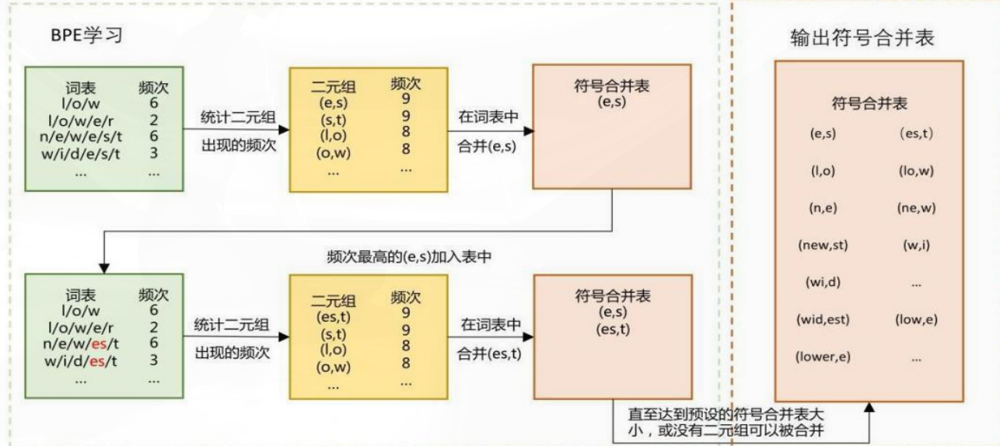

## 词表带来的两个问题

[Word2Vec](/posts/nlp/06-02-word2vec/) 和 [GloVe](/posts/nlp/06-03-glove/) 都为词表中的每个词学习一个独立向量。这带来两个问题：

- **未登录词**：测试时遇到词表外的词（Out-Of-Vocabulary, OOV），模型没有它的向量；
- **形态浪费**：“cat”和“cats”、“help”和“helpful”在词表中是两个独立条目，词根信息无法共享；形态丰富的语言还会导致词表爆炸。

子词（subword）方法把词拆成更小的单位，用有限的子词词表覆盖几乎无限的词。常见方案有两类：

- **子词嵌入**：仍以词为训练单位，但词的向量由其字符 n-gram 组合而成，例如 fastText；
- **子词分词**：先把文本切分为子词 token，再为每个子词学习向量，例如 BPE、WordPiece、SentencePiece。

## fastText：字符 n-gram 表示

fastText 在每个词的首尾加上边界符 `<`、`>`，取出所有长度为 $n$ 的字符 n-gram（常取 $n=3$ 到 $6$），词的向量为这些 n-gram 向量与整词向量之和。

以 “where” 为例，加上边界后为 `<where>`，trigram 包括：

```text
<wh, whe, her, ere, re>
```

$$
\mathbf{v}_{\text{where}} = \mathbf{v}_{\text{<where>}} + \sum_{g \in \text{ngrams}} \mathbf{v}_g
$$

训练目标仍是 Word2Vec 的上下文预测，只是词向量改为上述组合。遇到未登录词时，只要它的字符 n-gram 在词表中，就能拼出一个向量，因此 fastText 对 OOV 和拼写变体更稳健。代价是每个词的表示需要累加多个 n-gram，存储和计算开销更大；它也没有解决“一个词一个静态向量”的问题。

## BPE：字节对编码

核心思想是：**从字符开始，反复合并语料中最高频的相邻符号对**。

确定子词词表 + 将全词切分为子词，或者将子词合并为
全词。

### 训练流程(确定子词词表)

1. **预分词**：按空格、标点等把语料切成词，统计每个词的词频；
2. **初始化**：把每个词拆成字符(字节)序列，并在词尾加上结束标记 `</w>`。初始词表是所有出现过的字符加 `</w>`；
3. **统计相邻对**：对每个词内部的相邻符号对计数，计数乘以该词的词频，不跨词统计；
4. **合并**：选出频率最高的符号对，合并为新符号，加入词表并记录合并规则；
5. **重复**：更新所有词的符号序列，回到第 3 步，直到词表达到预设大小。

例如语料为：

```text
low     5
lower   2
newest  6
widest  3
```

初始化后：

```text
l o w </w>          5
l o w e r </w>      2
n e w e s t </w>    6
w i d e s t </w>    3
```

合并过程：

- 最高频的相邻对是 `e s`，出现 $6+3=9$ 次，合并为 `es`；
- 随后 `es t` 出现 9 次，合并为 `est`；
- 再合并 `est </w>` 等。

若干轮后，常见词会被切成：

```text
lower  → low er </w>
newest → new est </w>
widest → wid est </w>
```



### 用学到的规则分词(将全词切分为子词)

训练结束后只保留有序的合并规则。对新文本分词时，先拆成字符，再按学习到的顺序依次应用合并规则。不同实现的细节略有差异：

- 原始 BPE 按规则顺序合并；
- 现代实现常按合并优先级反复合并当前最优对；
- GPT-2 使用**字节级 BPE**：先把文本转为 UTF-8 字节，再在字节上做 BPE，因此不存在 OOV，任何字符串都能表示。

BPE 的优点和局限：

- **优点**：简单、可逆、能平衡词表大小与序列长度；
- **局限**：合并只看频率，可能产生不理想的切分，且分词结果依赖预分词规则。

## WordPiece

WordPiece 是 BERT 使用的分词算法，流程与 BPE 类似，但选择合并对的标准不同：BPE 选频率最高的对，WordPiece 选**使训练数据似然提升最大**的对。一个常用的近似打分是

$$
\text{score}(a, b) = \frac{\operatorname{count}(ab)}
{\operatorname{count}(a)\,\operatorname{count}(b)}
$$

它偏好“共同出现得比偶然预期更频繁”的相邻片段。WordPiece 用 `##` 标记非词首子词，例如：

```text
unaffable → un ##aff ##able
```

分词时采用**最长匹配优先**：从当前位置开始，尝试匹配词表中能匹配的最长子词，匹配不到时回退到更短的片段或 `[UNK]`。

## Unigram、SentencePiece 与字节级方案

### Unigram 语言模型

Unigram 走相反的方向：先构造一个较大的候选词表，用 EM 算法估计每个子词的概率，再逐步删除“删掉后对语料似然影响最小”的子词，直到词表达到目标大小。给定一种切分 $S$，其概率为各子词概率的乘积：

$$
P(S) = \prod_{t \in S} P(t)
$$

分词时选择概率最大的切分（可用 Viterbi 算法）。与 BPE 的贪心合并相比，Unigram 的分词结果更全局。

### SentencePiece

SentencePiece 是一个语言无关的分词工具，直接处理原始文本，不依赖预先的空格切分。它把空格也当作普通字符，用 `▁` 表示词首空格，因此中文、日文等不用空格分词的语言也能直接使用。由于所有字符都被显式编码，SentencePiece 的分词是**可逆的**：把 token 直接拼接即可还原原文。

SentencePiece 支持 BPE 和 Unigram 两种模型，T5、LLaMA 等模型使用其 Unigram 或 BPE 变体。

### 字节级分词

字节级 BPE（如 GPT-2）把文本编码为 UTF-8 字节后再合并。词表只需覆盖 256 个字节及常见字节组合，就不存在 OOV；代价是同一个字符在不同 UTF-8 字节序列下可能被切成不同 token，非英文文本的序列也会变长。

## 词表大小的取舍

词表大小 $V$ 与嵌入层、输出层参数量 $V \times d$ 直接相关，同时影响序列长度：

- 词表小：参数量少、稀有词能被拆成子词共享，但序列更长，注意力计算和推理成本上升；
- 词表大：序列更短、常见词是单个 token，但嵌入矩阵更大，低频 token 训练不充分。

现代 LLM 的词表通常在 $3\times10^4$ 到 $2\times10^5$ 之间，具体取决于语种、模型规模和训练语料。

## 相关阅读

- 静态词向量：[Word2Vec](/posts/nlp/06-02-word2vec/)、[GloVe](/posts/nlp/06-03-glove/)
- 神经语言模型：[NNLM 与 RNNLM](/posts/nlp/06-05-nnlm-rnnlm/)
- 上下文相关表示：[ELMo](/posts/nlp/06-06-elmo/)、[BERT](/posts/nlp/06-07-bert/)
- 子词表示对词向量评价的影响：[词向量的评价](/posts/nlp/05-02-embedding-evaluation/)
