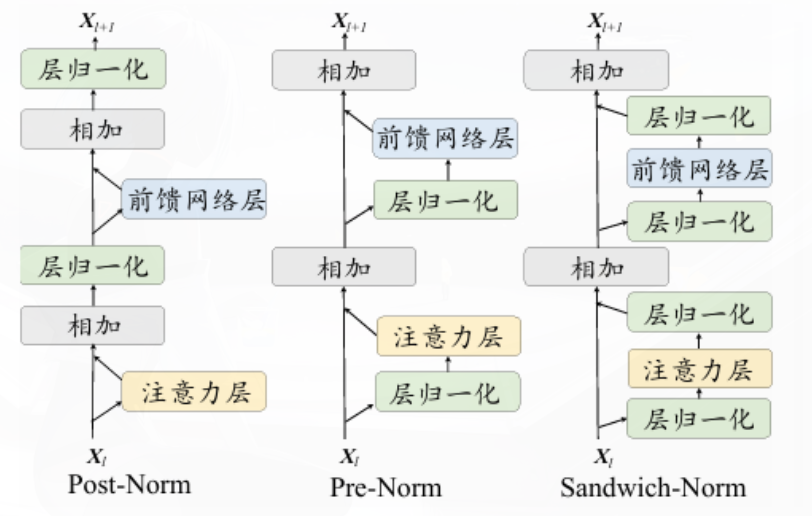
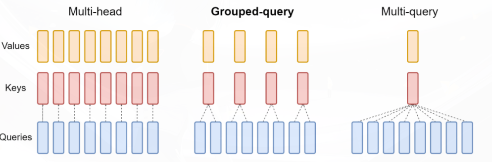

## 三阶段训练流程

当前主流大语言模型通常经历三个阶段：

| 阶段 | 数据 | 目标 | 主要作用 |
| --- | --- | --- | --- |
| 预训练PreTraining | 海量无标注文本 | 预测下一个 token | 获得语言能力与世界知识 |
| 有监督微调SFT | 指令—回答标注数据 | 拟合目标回答 | 学会遵循指令、适配任务格式 |
| 强化学习对齐RLHF | 人类偏好数据 | 最大化奖励模型分数 | 更符合人类偏好与价值观 |

预训练解决“会不会说、知不知道”，SFT 解决“听不听得懂指令”，RLHF 解决“回答是否更有用、更诚实、更无害”。三个阶段的数据量、算力和目标都不同，后续文章分别展开：预训练见本文与 [训练系统](/posts/nlp/07-02-llm-training-systems/)，SFT 见 [LLM 有监督微调](/posts/nlp/08-01-llm-sft/)，对齐见 [RLHF 与 PPO](/posts/nlp/09-01-rlhf-ppo/)。

预训练的目标是标准的自回归语言模型：

$$
\mathcal{L}_{\text{pretrain}} =
-\sum_{t=1}^{T} \log P(w_t \mid w_1,\dots,w_{t-1})
$$

训练数据不需要人工标注，下一个词就是标签，因此属于自监督学习。模型在预测下一个词的过程中，被迫学习语法、事实、推理模式和上下文依赖。

## Decoder-only 成为主流

大模型沿用 [Decoder-only Transformer](/posts/transformer/decoder-only-transformer/)：堆叠若干层带因果掩码的自注意力与前馈网络，每个位置只能看到自己和左侧 token。

GPT 系列的演进体现了“同一架构 + 规模扩展”的路线：

| 模型 | 参数量 | 主要变化 |
| --- | --- | --- |
| GPT-1 | 117M | 首次用 decoder-only 做生成式预训练 + 下游微调 |
| GPT-2 | 1.5B | 扩大规模，调整归一化与残差连接的位置 |
| GPT-3 | 175B | 进一步扩展规模，展现上下文学习能力 |

LLaMA 等开源模型也采用 decoder-only，并吸收了 GPT-3、PaLM 等模型的工程改进。相比 encoder-only 的 BERT 和 encoder-decoder 的 T5，decoder-only 结构简单、训练目标与生成一致，更容易扩展到超大参数量；代价是每个位置不能同时看到右侧上下文，理解类任务需要依赖双向编码的模型或额外的训练目标。

## 现代组件

大模型与原始 Transformer 的差异主要集中在位置编码、归一化、注意力和前馈网络四处。各组件在 [现代 LLM 组件](/posts/transformer/modern-llm-components/) 中有详细推导，这里只说明它们在预训练语境下的作用。

### 位置编码：从绝对到旋转

原始 Transformer 用正弦位置编码，BERT/GPT 用可学习的位置嵌入。绝对位置编码的问题是：同一子结构出现在不同位置时，内部表示会随绝对位置变化；可学习嵌入还受最大长度限制。

相对位置编码让注意力只依赖两个 token 的相对距离。**RoPE（Rotary Position Embedding）** 把 query 和 key 向量视为复数，按位置旋转一个角度：

$$
\tilde{\mathbf{q}}_m = R_m \mathbf{q}, \qquad
\tilde{\mathbf{k}}_n = R_n \mathbf{k}
$$

旋转后两者的点积只与相对位置 $m-n$ 有关，因此既能编码相对距离，又不需要额外的位置向量。RoPE 已成为 LLaMA、Qwen 等模型的标准配置。

### 归一化：RMSNorm 与层前归一化

大模型中通常采用层后归一化和层前归一化（Pre-LN），以及 RMSNorm 替代 LayerNorm。

**RMSNorm** 只按均方根缩放，不减去均值：

$$
\operatorname{RMSNorm}(\mathbf{x}) =
\frac{\mathbf{x}}{\sqrt{\frac{1}{d}\sum_{i=1}^{d}x_i^2 + \epsilon}} \odot \mathbf{g}
$$

相比 LayerNorm，它少了均值计算，速度更快，训练也更稳定。

归一化的位置同样重要：

- **Post-Norm**：`x + Sublayer(x)` 后再归一化，是原始 Transformer 的做法，深层训练需要预热；
- **Pre-Norm**：先归一化再进子层，残差通路干净，深层训练更稳定，是现代大模型的默认选择；
- **Sandwich-Norm**：在子层前后都加归一化，进一步稳定超深模型。

### 注意力：MHA、MQA 与 GQA

标准多头注意力（MHA）为每个头维护独立的 query、key、value。推理时需要用 KV Cache 保存历史 key/value，显存随头数增长。

- **MQA（Multi-Query Attention）多查询注意力机制**：所有 query 头共享一组 key/value，KV Cache 降为原来的 $1/H$，但效果可能下降；
- **GQA（Grouped-Query Attention）群查询注意力机制**：把 query 头分组，每组共享一组 key/value，在 MHA 的效果和 MQA 的效率之间折中。若共有 $H$ 个头、分成 $G$ 组，KV Cache 约为 MHA 的 $G/H$。

GQA可以看作是 MHA 和 MQA 的中间方案，既能降低显存占用，又能保持较好的性能。

### 前馈网络与激活

Transformer 的 FFN 通常先升维再降维，中间维度约为隐藏维度的 4 倍。LLaMA 使用 **SwiGLU**：

$$
\operatorname{FFN}(x) = \big(\operatorname{Swish}(xW_1) \odot xW_3\big)W_2
$$

门控结构让模型能选择性地传递信息，通常配合略小的中间维度以控制参数量。

## 预训练与规模

预训练是在大规模语料上反复做下一词预测。模型规模、数据量和计算量之间存在经验性的缩放关系：在固定计算预算下，参数量和数据量需要同步增长，单纯放大其中一项收益会递减。这也是“小模型多数据”和“大模型多数据”两条路线分歧的来源。

关于训练需要多少显存、如何把模型切到多张卡上，以及预训练语料如何收集和清洗，见 [大模型训练系统](/posts/nlp/07-02-llm-training-systems/)。

## 相关阅读

- Decoder-only 结构：[Decoder-only Transformer](/posts/transformer/decoder-only-transformer/)
- RoPE、RMSNorm、SwiGLU、GQA 的细节：[现代 LLM 组件](/posts/transformer/modern-llm-components/)
- 分布式训练与数据：[大模型训练系统](/posts/nlp/07-02-llm-training-systems/)
- 指令微调：[LLM 有监督微调](/posts/nlp/08-01-llm-sft/)
- 人类偏好对齐：[RLHF 与 PPO](/posts/nlp/09-01-rlhf-ppo/)
