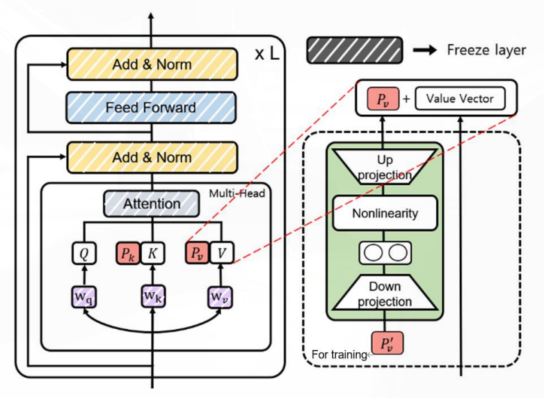
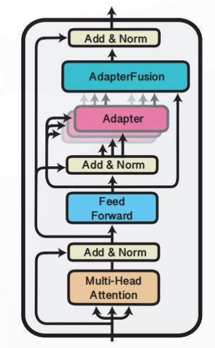
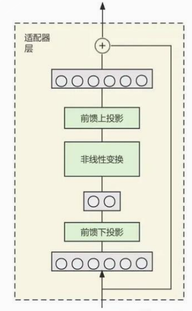

## 全量微调的成本

[LLM 有监督微调](/posts/nlp/08-01-llm-sft/) 可以直接更新模型全部参数。对一个 $N$ 参数的模型，全量微调需要保存参数、梯度、Adam 优化器状态和激活值，显存往往是模型权重的数倍；每个下游任务还要保存一份完整副本，部署多个任务时存储成本成倍增长。

参数高效微调（Parameter-Efficient Fine-Tuning, PEFT）的思路是：**冻结预训练模型的大部分参数，只训练少量新增参数或低秩增量**。这样显存需求大幅下降，多个任务可以共享同一份基座模型，只切换很小的适配模块。

常见的三类方法：

- **Prefix Tuning**：在每层的 key/value 前拼接可训练的前缀向量；
- **Adapter**：在 Transformer 层中插入小型瓶颈模块；
- **LoRA**：用低秩矩阵表示权重更新量。

## Prefix Tuning

Prefix Tuning 在输入序列前增加一段可训练的**前缀向量**。这些向量不对应任何真实词，而是作为虚拟上下文存在。

具体做法是在每一层为 key 和 value 引入前缀：

$$
\mathbf{K}' = [\mathbf{P}_K; \mathbf{K}], \qquad
\mathbf{V}' = [\mathbf{P}_V; \mathbf{V}]
$$

其中：

- $\mathbf{P}_K$：key 的可训练前缀矩阵；
- $\mathbf{P}_V$：value 的可训练前缀矩阵。

注意力计算时，真实 token 的 query 可以关注这些前缀，从而在不改变原模型参数的情况下调整行为。

前缀长度 $l$ 和维度 $m$ 控制参数量，总参数量约为 $2 \times L \times d \times l$，其中：

- $L$：层数；
- $d$：隐藏维度。

前缀的局限：

- 占用输入长度，过长会挤占真实上下文；
- 与全量微调相比，效果通常略低。

## Adapter

Adapter 在 Transformer 的每个子层后插入一个小型瓶颈模块：

每个 Adapter 模块由两个前馈子层组成：

$$
\mathbf{h}' = \mathbf{h} + f(\mathbf{h}\mathbf{W}_{\text{down}})\mathbf{W}_{\text{up}}
$$

- $\mathbf{W}_{\text{down}} \in \mathbb{R}^{d \times m}$ 第一个前馈子层将 Transformer 块的输出作为输入，将原始输入维度 d（高维特征） 投影到 m（低维特征），通过控制 m 的大小来限制 Adapter 模块的参数量
- 非线性激活后，$\mathbf{W}_{\text{up}} \in \mathbb{R}^{m \times d}$ 通过第二个前馈子层还原输入维度，再投影回 $d$ 维；
- 残差连接保证初始状态下模块接近恒等映射。

Adapter 只训练新增的两个投影矩阵，参数量约为 $2dm$ 每层。缺点是增加了网络深度，推理时带来额外延迟；在没有模型并行时开销更明显。

## LoRA

LoRA（Low-Rank Adaptation）假设**权重更新量可以用低秩矩阵近似**。对预训练权重 $\mathbf{W}_0 \in \mathbb{R}^{d \times k}$，微调后的权重为

$$
\mathbf{W} = \mathbf{W}_0 + \Delta \mathbf{W}
= \mathbf{W}_0 + \mathbf{B}\mathbf{A}
$$

其中：

- $\mathbf{B} \in \mathbb{R}^{d \times r}$：低秩更新的左因子；
- $\mathbf{A} \in \mathbb{R}^{r \times k}$：低秩更新的右因子；
- $r$：秩，$r \ll \min(d,k)$。

LoRA方法可以应用于不同的模块：一般只对每层的SelfAttention的部分做微调

更新参数量的变化：

- 不用lora：$d \times k$；
- 用lora：$r(d+k)$。

秩 $r$ 的选择

- 矩阵维度越高，训练参数也越多，模型对新数据的适应能力越强，但也增加了计算和内存的需求，可能导致过拟合
- 矩阵维度越小，训练参数也越小，减少了计算和内存的需求，但是可能会影响模型性能

前向传播变为

$$
\mathbf{h} = \mathbf{W}_0 \mathbf{x} + \frac{\alpha}{r}\mathbf{B}\mathbf{A}\mathbf{x}
$$

$\alpha/r$ 是缩放因子，用于在不同秩下保持更新幅度可比。初始化时 $\mathbf{A}$ 用随机高斯，$\mathbf{B}$ 置零，因此训练开始时 $\Delta\mathbf{W}=0$，模型行为与预训练模型完全一致。

### 为什么有效

- **参数量**：原本需要更新 $d \times k$ 个参数，现在只需 $r(d+k)$。例如 $d=k=1000$、$r=10$ 时，从 100 万降到 2 万；
- **推理无额外延迟**：训练完成后可以把 $\mathbf{B}\mathbf{A}$ 合并回 $\mathbf{W}_0$，推理时仍是原来的矩阵乘法；
- **多任务切换**：每个任务只保存一个低秩增量，基座模型共享；
- **接近全量微调**：在多数下游任务上，LoRA 的效果与全量微调接近，明显优于只调分类头。

### 关键超参数

- **秩 $r$**：越大表达能力越强，但参数更多、更容易过拟合；常见取值 8、16、32、64；
- **应用模块**：通常作用于 self-attention 的 query/value 投影，也可以扩展到所有线性层；
- **缩放 $\alpha$**：常取 $r$ 或 $2r$；
- **dropout**：在 LoRA 分支上加 dropout，缓解小数据过拟合。

### 变体

**AdaLoRA** 认为不同层、不同模块的重要性不同，不应使用统一的秩。它动态调整各权重矩阵的秩，把参数预算分配给更重要的模块。

**QLoRA** 在 LoRA 基础上量化基座模型：

- **NF4**：4-bit NormalFloat 数据类型，针对正态分布权重设计；
- **双重量化**：对量化常数再量化，进一步压缩显存；
- **分页优化器**：把优化器状态在显存和 CPU 内存之间分页，避免显存峰值溢出。

QLoRA 让 65B 模型可以在单张 48GB GPU 上微调，效果接近 16-bit 全量微调。

## 方法对比

| 特性 | 全量微调 | Prefix Tuning | Adapter | LoRA |
| --- | --- | --- | --- | --- |
| 训练参数量 | 100% | 0.1%–10% | 2%–5% | 0.1%–1% |
| 是否修改原参数 | 是 | 否 | 否 | 否 |
| 计算开销 | 高 | 中等 | 中等 | 低 |
| 推理延迟 | 无 | 略增 | 略增 | 几乎无 |
| 效果 | 最佳 | 略低于全量 | 略低于全量 | 接近全量 |

选择方法时主要看资源、任务数量和延迟要求：

- 资源充足、追求极致效果：全量微调；
- 多任务、需要快速切换：LoRA；
- 显存极小、基座模型很大：QLoRA；
- 不想改模型结构、可接受少量延迟：Prefix Tuning 或 Adapter。

## 相关阅读

- SFT 与指令数据：[LLM 有监督微调](/posts/nlp/08-01-llm-sft/)
- 模型架构与显存：[大模型预训练](/posts/nlp/07-01-llm-architecture/)、[大模型训练系统](/posts/nlp/07-02-llm-training-systems/)
- 量化与推理优化：[量化、蒸馏与推理优化](/posts/nlp/11-02-quantization-distillation/)
- 人类偏好对齐：[RLHF 与 PPO](/posts/nlp/09-01-rlhf-ppo/)
