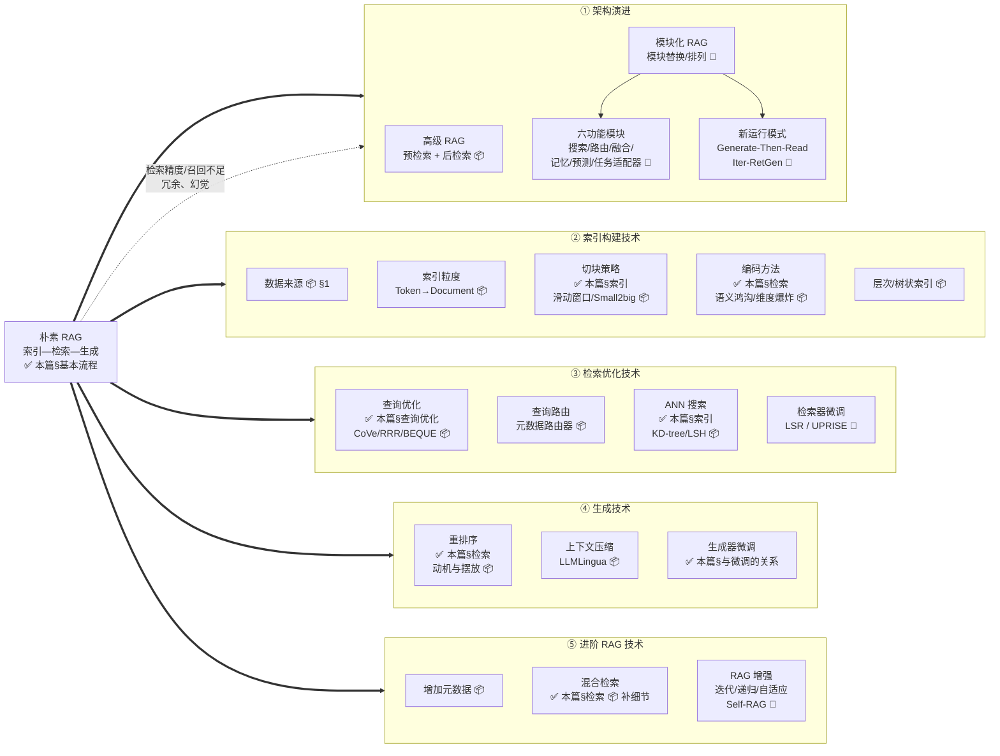

## RAG 解决什么问题

大模型的知识固定在参数里，存在三个限制：

- 训练语料有截止日期，无法回答最新事实；
- 私有文档和领域知识没有进入预训练,专业领域表现不佳；
- 产生幻觉、缺乏可解释性。

检索增强生成（Retrieval-Augmented Generation, RAG）为大语言模型构建了一个 **搜索引擎**，可以让预训练好的大语言模型访问外部动态信息，获取预训练过程中未学习到的知识与信息

在 **生成前** 先从外部知识库检索相关片段，把片段作为 **上下文** 交给模型，让模型**基于证据回答**。它不改变模型参数，更新知识只需更新索引。

RAG 与 [知识增强](/posts/nlp/10-02-knowledge-enhanced-llm/) 的“知识外用”路线一致；区别在于 RAG 特指“检索文档片段 + 生成”的工程流程。

与微调相比，RAG 的三项优势：**灵活性**（知识更新只需更新数据库，无须重训模型；接领域知识库+提示即得领域能力）、**安全性**（数据层面做权限划分，比微调模型的权限管理更清晰）、**可解释性**（答案来自数据库，可溯源核实）。

### 发展主线（三个阶段）

1. **早期**：为预训练语言模型 **整合额外知识**（Transformer 兴起之时）；
2. **ChatGPT 之后**：LLM 展现上下文学习能力，研究转向 **推理阶段** 提供更丰富的信息，解决知识密集问题；
3. **现阶段**：不再局限于推理阶段，开始与 **微调技术融合**——这正是 [模块化 RAG 篇](/posts/nlp/12-06-rag-modular/) “检索器/生成器两段式微调”一节的历史背景。

## 知识图谱：朴素 RAG 之外的深入方向



1. **主线（本篇）**：RAG 是什么、解决什么问题、索引-检索-生成怎么跑、怎么评——回答"整套流程"类问题；
2. **[高级 RAG：预检索与后检索优化](/posts/nlp/12-05-rag-advanced/)**：元数据、粒度、Small2big、树状索引、编码互补、混合检索、ANN、查询侧 CoVe/RRR/BEQUE/路由、重排序、LLMLingua——回答"哪里能优化、怎么优化"类问题，当工具箱查；
3. **[模块化 RAG 与 RAG 增强](/posts/nlp/12-06-rag-modular/)**：三阶段架构坐标、六模块、新运行模式、迭代/递归/自适应（Self-RAG）、检索器/生成器两段式微调——回答"架构怎么演化"类问题

## 基本流程（朴素 RAG 架构）

朴素 RAG 架构代表了最早的方法论，遵循最基础的 RAG 流程，即建立索引－检
索—生成，也称作“检索—读取”框架。

RAG 通常分为离线和在线两条链路：

```text
离线：文档 → 清洗 → 切块 → 向量化 → 索引
在线：问题 → 改写/向量化 → 检索 → 重排 → 拼接上下文 → 生成
```

### 1. 索引

1. **文档清洗**：去掉导航、广告、重复页眉页脚，保留正文和结构；
2. **切块（chunking）**：把长文档切成适合检索和放入上下文的片段。块太小缺乏上下文，块太大检索不精确且挤占提示长度。
   - 检索粒度由细到粗分 Token/Phrase/Sentence/Proposition/Chunks/Document 几档，粗细各有代价，展开见 [高级 RAG §索引粒度](/posts/nlp/12-05-rag-advanced/)；
   - 常见做法是按段落或标题切分，设置 10%–20% 的重叠，保留跨块语义；定长切块会截断句子，滑动窗口、Small2big（小粒度检索、大粒度召回）等补救见高级 RAG 篇；

3. **文档块向量化**：用嵌入模型把每个块编码为 **文档块向量** $\mathbf{d}$
   - 向量化之后向量能体现块之间的相似度和类比性质，见 [词向量基础](/posts/nlp/06-01-word-representation/) 和 [词向量的评价](/posts/nlp/05-02-embedding-evaluation/)；

4. **建索引**：用向量数据库或近似最近邻（ANN）索引（如 HNSW、IVF）支持快速相似度检索。
   - ANN 的动机（高维大规模下精确解不可算 + 语义检索只需“足够接近”）与方法分类（KD-tree、LSH）见 [高级 RAG §ANN](/posts/nlp/12-05-rag-advanced/)；
   - 可为块附加**元数据**（日期、章节、关键词）参与过滤，或建**父子/树状层次索引**提高检索效率，均见高级 RAG 篇。

### 2. 检索

1. **查询向量化**：在接收到用户的查询后，RAG 系统使用与 **索引阶段相同** 的嵌入模型将查询转化为 **查询向量** $\mathbf{q}$；

2. **相似度检索**：根据查询向量和文档块向量之间的相似度进行检索。
    - **稀疏检索**基于词项匹配，代表是 BM25：
        $$
        \operatorname{score}(q,d) =
        \sum_{t \in q} \operatorname{IDF}(t)
        \cdot \frac{f(t,d)(k_1+1)}
        {f(t,d) + k_1(1-b+b|d|/\operatorname{avgdl})}
        $$
        它擅长精确匹配专有名词、数字和代码，但无法处理同义改写。
        稀疏编码的两大病根——**语义鸿沟**（词间相似度算不出）和**维度爆炸**（向量维度与词典等长）——正是稠密编码出现的理由，详见 [高级 RAG §编码方法](/posts/nlp/12-05-rag-advanced/)。
    - **稠密检索**把问题和文档编码为向量，用余弦相似度或内积检索：
        $$
        \operatorname{sim}(q,d) = \frac{\mathbf{e}_q^T \mathbf{e}_d}
        {\|\mathbf{e}_q\|\|\mathbf{e}_d\|}
        $$
        它能捕捉语义相似，但可能忽略精确关键词。
    - **混合检索**把稀疏和稠密分数加权融合，兼顾两者：稀疏模型先缩小搜索范围，还能增强稠密模型的零样本能力、兜底**稀有实体**查询。

检索到候选后，根据相似度选出 Top-K 个文本块，或用重排序模型（如 cross-encoder）对候选块进行精排。
重排除了筛噪声，还负责**摆放位置**：LLM 偏信提示的开头结尾、忽略中间，重要块应放两头，见 [高级 RAG §重排序](/posts/nlp/12-05-rag-advanced/)。

### 3. 生成

将检索到的文本块与用户问题一起组织成 Prompt。

```text
请仅根据以下资料回答问题。资料中没有的信息，请回答“资料未提及”。
资料：
[1] ...
[2] ...
问题：...
```

常见约束包括：

- 要求引用片段编号，便于追溯；
- 明确“不知道”时不要编造；
- 控制片段数量和长度，避免超出上下文窗口；
- 对冲突资料要求说明分歧。

## 查询优化

用户问题往往不适合直接检索，可以在检索前做改写：

- **查询改写**：把口语化问题改写成包含关键词的检索式。除提示驱动外，还有专职小模型做重写，如 **RRR**（Rewrite-Retrieve-Read）和 **BEQUE**；
- **多查询**：生成多个不同角度的查询，合并检索结果。扩写出来的查询需经 LLM 验证可靠性，即**验证链（CoVe）**；
- **查询路由**：按元数据/关键字先把不相关的索引区滤掉，只把查询导向相关数据块（**元数据路由器**）；
- **HyDE**：先让模型生成一个假设答案，再用假设答案的向量去检索，适合问题和文档表述差异较大的场景；
- **递归/多跳检索**：先检索一部分，根据结果生成下一步查询，适合多跳问答。完整的迭代/递归/自适应（Self-RAG）三策略见 [模块化 RAG 与 RAG 增强](/posts/nlp/12-06-rag-modular/)。

这些方法能提高召回，但会增加延迟和调用次数。各方法的细节展开在 [高级 RAG §查询优化](/posts/nlp/12-05-rag-advanced/)。

## 评价

RAG 的评价要分开看检索和生成：

| 环节 | 指标 |
| --- | --- |
| 检索 | Recall@k、Precision@k、MRR、NDCG |
| 生成 | 答案正确性、忠实性（是否只依据资料）、相关性、引用准确性 |
| 端到端 | 任务成功率、人工评分、延迟与成本 |

**忠实性**尤其重要：答案可能正确，但依据的是模型自身知识而不是检索资料；也可能引用了错误片段。评价时需要区分“答案对不对”和“有没有依据”。

## 常见问题

- **切块不当**：关键信息被切断，检索到的片段不完整；
- **检索不到**：问题与文档表述差异大，或嵌入模型不适配领域；
- **上下文噪声**：检索片段过多，模型忽略关键信息，或出现“中间丢失”（长上下文中间部分利用率低）；
- **知识冲突**：多个片段说法不一致，模型需要判断或说明；
- **索引过期**：文档更新后未重新索引，回答仍是旧知识；
- **提示注入**：检索到的网页或文档可能包含恶意指令，不能当作可信指令执行；
- **端到端归因困难**：答案错误时，难以判断是检索错了还是生成错了。

## 与微调的关系

RAG 和微调解决不同问题：

- **RAG**：补充外部、实时、私有知识，知识可更新、可追溯；
- **微调**：改变模型的行为、格式、风格和领域能力，知识内化到参数。

两者可以结合：先用 SFT/LoRA 让模型学会领域术语和回答格式，再用 RAG 提供具体事实。对于频繁更新的知识，优先用 RAG；对于稳定的任务模式，优先用微调。

注意微调在 RAG 系统里有**两处**：这里说的是**生成器微调**；**检索器（嵌入模型）同样可以微调**——注入领域知识、并用生成结果作监督信号与生成器对齐（LSR/UPRISE），见 [模块化 RAG 与 RAG 增强 §两段式微调](/posts/nlp/12-06-rag-modular/)。

## 相关阅读

- 深入技巧（预检索/后检索工具箱）：[高级 RAG：预检索与后检索优化](/posts/nlp/12-05-rag-advanced/)
- 架构跃迁（模块化/增强/两段式微调）：[模块化 RAG 与 RAG 增强](/posts/nlp/12-06-rag-modular/)
- 知识增强的整体思路：[知识增强的大语言模型](/posts/nlp/10-02-knowledge-enhanced-llm/)
- 知识图谱作为外部知识源：[知识图谱](/posts/nlp/10-01-knowledge-graph/)
- 提示构建：[提示工程](/posts/nlp/12-01-prompt-engineering/)
- 智能体中的检索与工具调用：[基于大语言模型的智能体](/posts/nlp/12-04-agent/)
- 检索与生成评价：[NLP 评价指标](/posts/nlp/05-01-evaluation-metrics/)
