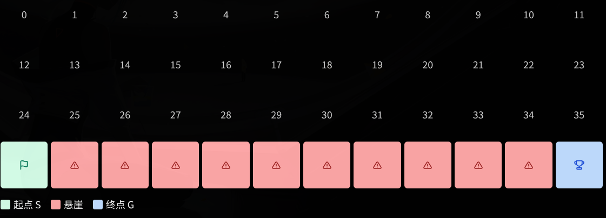

## 从评价到控制

被动 RL 问的是"这个策略怎么样"，主动 RL 问的是"应该采取什么策略"。二者的根本区别在于**策略是否固定**：

| | 被动强化学习 | 主动强化学习 |
| --- | --- | --- |
| 策略 | 预先给定、固定 | 需要学习和改进 |
| 任务目标 | 策略评价 | 策略控制 / 策略优化 |
| 要学的量 | $V^\pi(s),Q^\pi(s,a)$ | $Q^*(s,a),\pi^*$ |
| 探索与利用 | 不涉及 | 核心问题 |
| 典型方法 | MC 评价、TD(0) | SARSA、Q-learning、DQN |

主动 RL 的骨架是**广义策略迭代（GPI）**：评价与改进交替进行，形成闭环——

$$
\pi\ \xrightarrow{\text{评价}}\ Q^\pi\ \xrightarrow{\text{贪心改进}}\ \pi'(s)=\arg\max_a Q^\pi(s,a)\ \xrightarrow{\text{评价}}\ Q^{\pi'}\ \to\ \cdots
$$

数据修正价值，价值改变策略，策略又决定下一步采集什么数据。学习目标也从固定策略的 $V^\pi$ 逐渐变成最优的 $V^*$，从 $Q^\pi$ 变成 $Q^*$。

## 探索与利用的矛盾

一旦策略要靠自己的选择去采集数据，一个被动 RL 中不存在的矛盾就出现了。

设智能体在状态 $s$ 有两个动作，已经试过很多次 $a_1$，估计 $Q(s,a_1)=8$；只试过一次 $a_2$，估计 $Q(s,a_2)=5$。现在该选哪个？

- 选 $Q$ 值大的 $a_1$，叫**利用（Exploitation）**：用已知信息获取当前最大收益；
- 但 $a_2$ 只试过一次，估计很可能不准，它真实的价值也许是 $Q^*(s,a_2)=12$。要发现这一点，就必须再去试试 $a_2$，这叫**探索（Exploration）**。

> **被动 RL** 策略固定、动作不是智能体选的，它无从决定"要不要试试别的"

### 平衡策略： ε-greedy

最常用的平衡办法是 **ε-greedy**：以大概率利用当前最优动作，以小概率 $\varepsilon$ 随机探索：

$$
a_t=\begin{cases}
\text{在 }\mathcal{A}(s_t)\text{ 中均匀随机选择}, & \text{以概率 }\varepsilon\ \text{（探索）}\\[4pt]
\arg\max_a Q(s_t,a), & \text{以概率 }1-\varepsilon\ \text{（利用）}
\end{cases}
$$

- **注意一下**，选当前最优动作的概率不是 $1-\varepsilon$，而是 $1-\varepsilon+\dfrac{\varepsilon}{|\mathcal{A}(s)|}$，因为随机探索也可能选到当前最优动作。

## SARSA：同策略时序差分控制

时序差分方法可以从状态价值函数扩展到动作价值函数,评价 $V$ 的思路从"评价"推广到"控制"：改为估计 $Q$，并在估计的同时用 $\varepsilon$-greedy 不断改进策略。

SARSA 的名字来自一次更新涉及的五个量 $(S_t,A_t,R_t,S_{t+1},A_{t+1})$。在当前状态执行 $A_t$ ，再**按行为策略在下一状态实际选出** $A_{t+1}$ (如果用 $\varepsilon$-greedy 策略可能选到用于探索的动作)，用它构造目标：

$$
Y_t^{\mathrm{SARSA}}=R_t+\gamma Q(S_{t+1},A_{t+1}),
$$

$$
Q(S_t,A_t)\leftarrow Q(S_t,A_t)+\alpha
\left[Y_t^{\mathrm{SARSA}}-Q(S_t,A_t)\right].
$$

若 $S_{t+1}$ 是终止状态，则 $Y_t^{\mathrm{SARSA}}=R_t$。

**为什么是 on-policy？**

SARSA 构造目标 $Y_{t}^{\mathrm{SARSA}}$ 用 **实际按行为策略选出的** $A_{t+1}$ ，执行动作的策略和被评估改进的策略是 **同一个** ，因此称为 **同策略（on-policy）** 。它学到的是"当前这个带探索的策略"的价值，风格上相对保守。

## Q-learning：离策略时序差分控制

Q-learning 只把 TD 目标里的下一动作换成**贪心的最大值**：

$$
Y_t^{\mathrm{Q}}=R_t+\gamma\max_{a'\in\mathcal{A}(S_{t+1})}Q(S_{t+1},a'),
$$

$$
Q(S_t,A_t)\leftarrow Q(S_t,A_t)+\alpha
\left[Y_t^{\mathrm{Q}}-Q(S_t,A_t)\right].
$$

若下一状态为终止状态，则 $Y_t^{\mathrm{Q}}=R_t$。

**为什么是 off-policy？**

采集数据时可以用 $\varepsilon$-greedy 等带探索的**行为策略**，但目标里用的是 $\arg\max_{a'}Q(S_{t+1},a')$ 对应的**贪心目标策略**——这个动作不需要真的执行。行为策略与目标策略可以不同，所以是**离/异策略（off-policy）**。它直接逼近最优 $Q^*$，但训练中的 $\max$ 操作也可能带来 **$Q$ 值过估计**问题。

伪代码：

:::pseudo
1: 初始化 $Q(s,a)$
2: for episode = 1, M do
4: &emsp;for t = 0, T-1 do
5:         按 $\varepsilon$-greedy 策略选择动作 $A_t$
6:         执行动作 $A_t$，观察奖励 $R_t$
7:         观察下一个状态 $S_{t+1}$
8:         计算 TD 目标 $Y_t^{\mathrm{Q}}=R_t+\gamma\max_{a'}Q(S_{t+1},a')$
9:         更新 $Q(S_t,A_t)\leftarrow Q(S_t,A_t)+\alpha[Y_t^{\mathrm{Q}}-Q(S_t,A_t)]$
10:        $S_t\leftarrow S_{t+1}$
11:    end for
12: end for
:::

## Q:learning实例1：Cliff Walking

CliffWalking 是一个网格世界。智能体从起点出发，目标是走到终点，但不能掉进悬崖。

4 行 × 12 列的网格。起点在左下角，终点在右下角，起点与终点之间是悬崖。格子里的数字是状态编号示意。



约定奖励设置：

- 每走一步，奖励 $R_t=-1$；
- 掉进悬崖，奖励 $-100$，并回到起点。
- 终点回合结束，奖励 $R_t=0$。

### Q表的构建

状态 $s$ 用编号 $0\sim 47$ 表示，动作 $a$ 用编号 $0\sim 3$ 表示，分别对应上、右、下、左。$Q$ 表是一个 $48\times 4$ 的矩阵，初始全为 0。

### Q表的更新

```python
# 初始化
Q = zeros((48, 4))
alpha = 0.1       # 学习率
gamma = 0.99      # 折扣因子
epsilon = 0.1     # 探索概率

for episode in range(num_episodes):
    s = env.reset()
    done = False

    while not done:
        # 1. epsilon-greedy 选择动作
        if random() < epsilon:
            a = random_action()
        else:
            a = argmax(Q[s])

        # 2. 与环境交互
        s_next, r, terminated, truncated, info = env.step(a)
        done = terminated or truncated

        # 3. 计算 Q-learning 目标
        if terminated:
            target = r
        else:
            target = r + gamma * max(Q[s_next])

        # 4. 只更新表格中的一个元素
        Q[s, a] += alpha * (target - Q[s, a])

        # 5. 进入下一个状态
        s = s_next
```

## SARSA 与 Q-learning 对比

两者共享同一更新骨架 $Q(S_t,A_t)\leftarrow Q(S_t,A_t)+\alpha[Y_t-Q(S_t,A_t)]$，唯一的区别就在 TD 目标 $Y_t$：

| 对比项 | SARSA | Q-learning |
| --- | --- | --- |
| TD 目标 | $R_t+\gamma Q(S_{t+1},A_{t+1})$ | $R_t+\gamma\max_{a'}Q(S_{t+1},a')$ |
| $A_{t+1}$ 从哪来 | 行为策略实际采样得到 | 不必执行，直接取最大 |
| 学的是谁的价值 | 当前实际执行的策略 | 贪心最优策略 |
| 策略关系 | on-policy（同策略） | off-policy（异策略） |
| 直觉 | "按我现在真实执行的策略走下去，未来收益是多少？" | "假设从下一步起永远选当前最好的动作，未来收益是多少？" |
| 已知问题 | 相对保守，考虑探索的风险 | 容易 $Q$ 值过估计 |

Q-learning 在有限表格 MDP、满足充分探索和合适学习率等条件时，可以收敛到最优动作价值函数。

## 从表格到神经网络：通向 DQN

以上所有 $Q(s,a)$ 都存成一张表格。但当状态空间很大（如围棋、图像输入）时，表格根本存不下，也无法泛化到没见过的状态。**DQN** 的思路是用神经网络替代表格：

$$
Q(s,a)\ \longrightarrow\ Q(s,a;\theta).
$$

表格算法的更新目标（Q-learning 的 TD 目标）不变，只是把"直接改表格里的一个数"换成"用 TD 误差算梯度、更新网络参数 $\theta$"。做到输入一个状态 $s$，输出最优动作的 $Q(s,a)$，就可以在大状态空间里实现强化学习。
