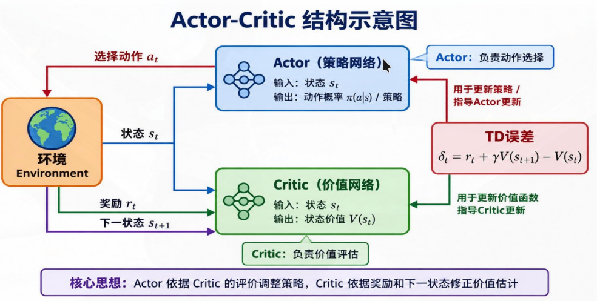
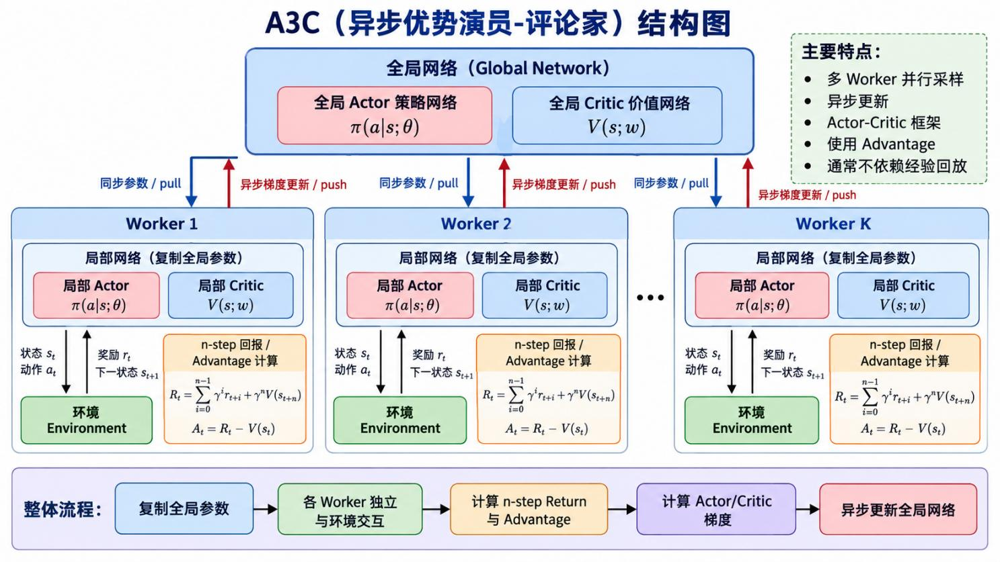

Actor-Critic 是一类架构：**Actor 学策略，Critic 学价值，Critic 的输出被用来给 Actor 的策略梯度当权重**。结合策略梯度的骨架

1. 权重信号用什么？
2. 权重怎么学？

$$
\nabla_\theta J(\theta)=\mathbb E\Big[\sum_t \text{权重}_t\,\nabla_\theta\log\pi_\theta(a_t\mid s_t)\Big].
$$

Policy里面用 $G_t$ 作为权重，Actor-Critic 用 Critic 的输出作为权重。Critic 的输出可以是 baseline、优势函数、TD 误差或 GAE。

## 从 REINFORCE 的方差问题说起

REINFORCE 的梯度估计是

$$
\nabla_\theta J(\theta)=\mathbb E_{\tau\sim\pi_\theta}\Big[\sum_{t=0}^{T-1}G_t\,\nabla_\theta\log\pi_\theta(a_t\mid s_t)\Big].
$$

$\nabla_\theta\log\pi_\theta(a_t\mid s_t)$ 给出"怎样让这个动作更容易被选中"的方向，$G_t$ 给出"这个方向该走多远"的权重。权重方差大的原因是：

$G_t=\sum_k\gamma^kR_{t+k}$ 把

1. **策略随机性**
2. **转移随机性**
3. **奖励随机性**
4. 沿整条轨迹 **累积** 进来；轨迹越长，$\mathrm{Var}(G_t)$ 越大，训练越震荡。

所以需要换掉权重，而不是换掉策略梯度的骨架。

## Baseline：与动作无关的参照物

引入只依赖状态的基线 $b(s)$，把梯度估计改为

$$
\nabla_\theta J(\theta)=\mathbb E_{\tau\sim\pi_\theta}\Big[\sum_{t=0}^{T-1}\big(G_t-b(s_t)\big)\nabla_\theta\log\pi_\theta(a_t\mid s_t)\Big].
$$

它不改变梯度的期望，因为固定 $s$ 后

$$
\mathbb E_{a\sim\pi_\theta(\cdot\mid s)}\big[b(s)\nabla_\theta\log\pi_\theta(a\mid s)\big]
=b(s)\sum_a\nabla_\theta\pi_\theta(a\mid s)
=b(s)\nabla_\theta\underbrace{\sum_a\pi_\theta(a\mid s)}_{=1}
=0.
$$

- 关键条件是 **$b$ 只依赖状态、不依赖动作**；$b$ 是否依赖 $\theta$ 不是本质条件。实践中通常用独立的价值网络 $V_w(s)$ 作 baseline。
- 这和 REINFORCE 篇的"因果性替换"是同一个技巧：与动作无关的项，在期望下对梯度的贡献为零，去掉只会降方差、不会引偏差。

## 优势函数：动作比平均水平好多少

定义状态价值、动作价值与优势函数：

$$
V^\pi(s)=\mathbb E_\pi[G_t\mid S_t=s],\qquad
Q^\pi(s,a)=\mathbb E_\pi[G_t\mid S_t=s,A_t=a],
$$

$$
A^\pi(s,a)=Q^\pi(s,a)-V^\pi(s).
$$

- $V^\pi(s)$：从状态 $s$ 出发，按 $\pi$ 走下去的期望回报。
- $Q^\pi(s,a)$：在 $s$ 执行 $a$，之后按 $\pi$ 走下去的期望回报。
- $A^\pi(s,a)$：这个动作比该状态下的平均动作好多少。

把 $G_t$ 当作 $Q^\pi(s_t,a_t)$ 的样本、把 $V^\pi(s_t)$ 当作 baseline，就有

$$
\mathbb E\big[G_t-V^\pi(S_t)\mid S_t=s,A_t=a\big]
=Q^\pi(s,a)-V^\pi(s)=A^\pi(s,a).
$$

因此 $G_t-V^\pi(s_t)$ 是 $A^\pi(s_t,a_t)$ 的**蒙特卡洛无偏估计**（前提是 $V^\pi$ 已知）。理想情况下，Actor 的更新权重就是优势：

$$
\nabla_\theta J(\theta)=\mathbb E_{\tau\sim\pi_\theta}\Big[\sum_t A^\pi(s_t,a_t)\nabla_\theta\log\pi_\theta(a_t\mid s_t)\Big].
$$

但真实 $V^\pi$ 未知，$G_t$ 又要等回合结束，所以需要 Critic。

## Actor-Critic 架构

Actor-Critic 用两个网络分工：

- **Actor** $\pi_\theta(a\mid s)$：输出动作分布，沿策略梯度更新。
- **Critic** $V_w(s)$：估计状态价值，给 Actor 提供 baseline 或优势。
- Critic 输入状态 $s_t$，输出标量 $V_w(s_t)$：从该状态起按当前策略继续运行的期望累计回报。

两个损失：

$$
L^{\text{actor}}(\theta)=-\mathbb E_t\big[\hat A_t\log\pi_\theta(a_t\mid s_t)\big],
\qquad
L^{\text{critic}}(w)=\mathbb E_t\big[(V_w(s_t)-V_t^{\text{target}})^2\big].
$$

- $L^{\text{actor}}$ 的权重 $\hat A_t$ 是"策略更新方向"；实际实现常再加熵正则 $-c_e\mathcal H(\pi_\theta(\cdot\mid s_t))$。
- $L^{\text{critic}}$ 的目标 $V_t^{\text{target}}$ 是"训练价值网络"；
- 实现中优势通常 detach：Actor 损失只更新 $\theta$，Critic 损失只更新 $w$。
- TD/n-step 目标里的 $V_w(S_{t+1})$ 通常也 detach，只对 $V_w(s_t)$ 求梯度。

Critic 的目标有三种常见选法：

| 目标 | 形式 | 偏差 | 方差 | 更新时机 |
| --- | --- | --- | --- | --- |
| MC | $G_t$ | 无偏 | 高 | 回合结束 |
| TD(0) | $R_t+\gamma V_w(S_{t+1})$ | 有偏 | 低 | 每步 |
| n-step | $\sum_{k=0}^{n-1}\gamma^kR_{t+k}+\gamma^nV_w(S_{t+n})$ | 中间 | 中间 | 每 $n$ 步 |

- Critic 也可以学 $Q_w(s,a)$：Actor 可以直接用 $Q_w$ 当权重，或再减去 $V_w$ 得到优势；课件主线是学 $V_w$，本文也以 $V$ 为主。
- Actor-Critic 通常是 **on-policy**：数据由当前 $\pi_\theta$ 采集。A2C/A3C 都是 on-policy

## TD 误差：一步优势估计

Critic 用 TD 方法学习时，贝尔曼期望方程给出

$$
V^\pi(s)=\mathbb E\big[R_t+\gamma V^\pi(S_{t+1})\mid S_t=s\big],
$$

$$
Q^\pi(s,a)=\mathbb E\big[R_t+\gamma V^\pi(S_{t+1})\mid S_t=s,A_t=a\big].
$$

定义 TD 误差

$$
\delta_t=R_t+\gamma V_w(S_{t+1})-V_w(S_t).
$$

它和优势的关系要说准确：

- 当 $V_w=V^\pi$ 时，

$$
\mathbb E[\delta_t\mid S_t=s,A_t=a]
=\mathbb E[R_t+\gamma V^\pi(S_{t+1})\mid s,a]-V^\pi(s)
=Q^\pi(s,a)-V^\pi(s)=A^\pi(s,a).
$$

- 所以 $\delta_t$ 是 $A^\pi(s_t,a_t)$ 的**一步样本估计**；$V_w$ 不准确时它**有偏**。**不能说 $\delta_t$ 严格等于优势**。

:::tip[从贝尔曼方程到 TD 误差]
贝尔曼方程与 TD 误差不是两套公式，后者是前者的**样本残差**：

1. **同一个方程**：固定 $S_t=s$ 后，随机性只有 $A_t\sim\pi(\cdot\mid s)$ 与 $(R_t,S_{t+1})\sim p(\cdot,\cdot\mid s,a)$，所以显式求和

    $$
    V^\pi(s)=\sum_a\pi(a\mid s)\Big[R(s,a)+\gamma\sum_{s'}p(s'\mid s,a)V^\pi(s')\Big]
    $$
    就是紧凑写法 $\mathbb E[R_t+\gamma V^\pi(S_{t+1})\mid S_t=s]$。Q 版同理，条件里再加 $A_t=a$，动作求和随之消失。若教材把奖励记作 $R_{t+1}$，只是整条式子下标平移。
2. **移项得到零均值残差**：真实价值是贝尔曼算子的不动点 $T^\pi V^\pi=V^\pi$，即

    $$
    \mathbb E\big[R_t+\gamma V^\pi(S_{t+1})-V^\pi(s)\mid S_t=s\big]=0.
    $$
    把 $V^\pi$ 换成估计 $V_w$、期望换成一条样本 $(S_t,R_t,S_{t+1})$，就得到 $\delta_t=\hat V_t-V_w(S_t)$。它的条件期望是贝尔曼残差 $(T^\pi V_w)(s)-V_w(s)$，$V_w=V^\pi$ 时才为零；Critic 最小化 $\tfrac12\mathbb E[\delta_t^2]$ 就是在把残差压到零，target 中的 $V_w(S_{t+1})$ 要 detach（半梯度 TD）。
3. **条件到动作才成优势**：用 Q 版贝尔曼方程，当 $V_w=V^\pi$ 时

    $$
    \mathbb E[\delta_t\mid s,a]=Q^\pi(s,a)-V^\pi(s)=A^\pi(s,a).
    $$
    若只条件到 $S_t=s$，对动作平均后残差为零，量不出"这个动作比平均好多少"。
    :::

    把 $\delta_t$ 当作 Actor 的权重，就得到一步 Actor-Critic：

    $$
    \nabla_\theta J(\theta)\approx\mathbb E_t\big[\delta_t\nabla_\theta\log\pi_\theta(a_t\mid s_t)\big].
    $$

- 好处：只含一步奖励的随机性，方差小；走一步就能更新，不必等回合结束。
- 代价：Critic 没学准时有偏；Actor 的训练质量高度依赖 Critic。

## GAE：在 MC 与 TD 之间调档

单步 $\delta_t$ 偏差大，MC 优势 $G_t-V_w(s_t)$ 方差大。GAE 用 $\lambda$ 把两者连起来：

$$
\hat A_t^{\mathrm{GAE}(\gamma,\lambda)}
=\sum_{l=0}^{T-t-1}(\gamma\lambda)^l\delta_{t+l}.
$$

- $\lambda=0$：只剩 $\delta_t$，低方差、有偏。
- $\lambda=1$：退化为 $G_t-V_w(s_t)$，即 MC 优势（$V_w$ 准确时无偏），高方差。
- $\lambda\in(0,1)$：偏差与方差折中；$(\gamma\lambda)^l$ 让远处的 $\delta$ 指数衰减，有效视野约为 $1/(1-\gamma\lambda)$。

GAE 不是新算法，只是一个**优势估计器**；A2C/PPO 都可以直接用它。实践中常取 $\lambda\in[0.9,0.98]$。

## 动作空间：Softmax 与高斯

动作空间是另一个正交维度：它决定 Actor 输出什么分布，不改变优势估计与并行方式。

| 动作空间 | 策略分布 | Actor 输出 | 探索来源 |
| --- | --- | --- | --- |
| 离散 | Softmax：$\pi_\theta(a_i\mid s)=\frac{\exp z_i}{\sum_j\exp z_j}$ | logits $z$ | 采样 + 熵正则 |
| 连续 | 高斯：$a\sim\mathcal N(\mu_\theta(s),\sigma_\theta^2(s))$ | 均值 $\mu$ 与方差 $\sigma^2$（或 $\log\sigma$） | 采样噪声 + 方差/熵控制 |

- 两种策略都套同一个 Actor 损失 $-\hat A_t\log\pi_\theta(a_t\mid s_t)$，区别只在 $\log\pi$ 的形式与梯度。
- 连续动作的方差参数通常用 $\log\sigma$ 或 $\sigma=\exp(\eta)$ 表示，保证方差为正。
- A2C/A3C 与动作空间正交：它们只规定怎么采样、怎么更新，不规定策略一定是 Softmax 还是高斯。
- 具体梯度推导见 [策略学习与 REINFORCE](/posts/reinforcement-learning/rl_policylearning/)。

## A2C：多环境同步采样

A2C = **Advantage Actor-Critic**。这里的 "A" 是 advantage，不是"两个 Critic"。

典型流程：

1. 同时运行 $N$ 个环境，每个环境用当前策略采样 $n$ 步。
2. 对每个时间步计算 n-step 优势。
3. 汇总所有环境的梯度，同步更新一次全局 Actor/Critic。
4. 用新参数继续下一轮采样。

n-step 优势与 Critic 目标：

$$
\hat A_t^{(n)}=\sum_{k=0}^{n-1}\gamma^kR_{t+k}+\gamma^nV_w(S_{t+n})-V_w(S_t),
$$

$$
V_t^{(n)}=\sum_{k=0}^{n-1}\gamma^kR_{t+k}+\gamma^nV_w(S_{t+n}).
$$

若这 $n$ 步内到达终止状态，就把 $\gamma^nV_w(S_{t+n})$ 去掉（终止后价值为 0）。n-step 优势可以看成 GAE 在 $\lambda=1$ 时的截断版本：只累加 $n$ 步 TD 误差，逐项相消后正好得到上面的形式。

- 为什么 A2C 常用 n-step：单步 TD 偏差大、MC 方差大，n-step 在两者之间折中；多环境并行又能高效收集 n 步数据。
- Critic 学 $V_t^{(n)}$，Actor 用 $\hat A_t^{(n)}=V_t^{(n)}-V_w(S_t)$——两者共享同一个 n-step 回报，只是 Actor 又减了一次 baseline。

A2C 的损失通常写成（以最小化为目标）：

$$
L(\theta,w)
=-\mathbb E_t\big[\hat A_t^{(n)}\log\pi_\theta(a_t\mid s_t)\big]
+c_v\mathbb E_t\big[(V_w(s_t)-V_t^{(n)})^2\big]
-c_e\mathbb E_t\big[\mathcal H(\pi_\theta(\cdot\mid s_t))\big].
$$

A2C 与一步 Actor-Critic 的区别：

| | 一步 Actor-Critic | A2C |
| --- | --- | --- |
| 环境数 | 1 | 多个并行环境 |
| 权重 | $\delta_t$ | n-step 优势或 GAE |
| 更新 | 每步 | 每 $n$ 步批量同步 |
| 方差 | 较高 | 通常更低 |
| 实现 | 简单 | 需要并行采样与汇总 |

A2C 的优点：比纯 MC 策略梯度方差低；能利用多环境并行；Actor/Critic 可端到端训练；离散/连续动作都适用。局限：Critic 误差会传给 Actor；Actor 与 Critic 同时学习可能震荡；单次更新过大仍可能破坏策略——这正是 PPO 要解决的问题。

## A3C：多 Worker 异步更新

A3C = **Asynchronous Advantage Actor-Critic**。

- 多个 Worker，每个 Worker 持有 Actor/Critic 的**局部副本**，各自与一个环境交互。
- 每个 Worker 采样一段 rollout，计算 n-step 优势与梯度。
- Worker 不等其他 Worker，直接把自己的梯度写到**共享全局参数**上。
- 局部参数定期从全局参数同步。

A3C 的"异步"指的是 **Worker 对全局参数的更新是异步的**，不是 Actor 与 Critic 之间异步，也不是状态与动作之间异步。

- 不需要 Experience Replay Buffer，仍然是 on-policy。
- 异步更新会带来**参数陈旧**：局部参数可能落后于全局参数；短 rollout 和频繁更新可以让偏差有界。
- 优点：能利用多 CPU 核心；不同 Worker 的数据更多样；n-step 与熵正则常用。
- 局限：异步实现复杂；陈旧梯度会影响稳定性；Critic 误差仍会传给 Actor。

A2C 与 A3C 的对比：

| | A2C | A3C |
| --- | --- | --- |
| 更新方式 | 同步 | 异步 |
| Worker 等待 | 等所有 Worker 完成 | 各自完成即更新 |
| 梯度 | 汇总平均后更新 | 直接异步写全局 |
| 稳定性 | 通常更稳、易复现 | 有参数陈旧 |
| 硬件倾向 | GPU 友好 | CPU 多核友好 |

## 名词分层与总结

把方法放回各自的维度：

| 方法 | 权重信号 | Critic 目标 | 采样/更新 | 一句话 |
| --- | --- | --- | --- | --- |
| REINFORCE | $G_t$ | 无 | 单环境，回合更新 | 无 Critic 的策略梯度 |
| 一步 Actor-Critic | $\delta_t$ | TD(0) | 单环境，每步 | 用 TD 误差当优势 |
| A2C | n-step 优势 / GAE | n-step return | 多环境同步 | 并行采样 + 批量更新 |
| A3C | n-step 优势 / GAE | n-step return | 多 Worker 异步 | 异步更新全局参数 |
| PPO | GAE | n-step / GAE return | 批量采样 + Clip | 限制更新幅度 |

名词速查：

| 名词 | 一句话 |
| --- | --- |
| Actor | 策略网络 $\pi_\theta(a\mid s)$ |
| Critic | 价值网络 $V_w(s)$，也可学 $Q_w(s,a)$ |
| Baseline | 只依赖状态的参照，不改变梯度期望 |
| Advantage | $A=Q-V$，动作比状态平均好多少 |
| TD 误差 | $R_t+\gamma V_w(S_{t+1})-V_w(S_t)$，一步优势估计 |
| GAE | $\lambda$ 加权的 TD 误差和，偏差-方差可调 |
| A2C | 多环境同步采样的 Advantage Actor-Critic |
| A3C | 多 Worker 异步更新全局参数的 Advantage Actor-Critic |

六个核心公式：

1. $V^\pi(s)=\mathbb E[R_t+\gamma V^\pi(S_{t+1})\mid S_t=s]$
2. $Q^\pi(s,a)=\mathbb E[R_t+\gamma V^\pi(S_{t+1})\mid S_t=s,A_t=a]$
3. $A^\pi(s,a)=Q^\pi(s,a)-V^\pi(s)$
4. $\delta_t=R_t+\gamma V_w(S_{t+1})-V_w(S_t)$
5. $L^{\text{critic}}(w)=\mathbb E[(V_w(S_t)-V_t^{\text{target}})^2]$
6. $\theta\leftarrow\theta+\alpha\hat A_t\nabla_\theta\log\pi_\theta(a_t\mid s_t)$

一句话：**Actor 用优势调概率，Critic 用 TD 学价值；A2C/A3C 是并行采样方式（常配 n-step 优势），PPO 是更新约束。**
