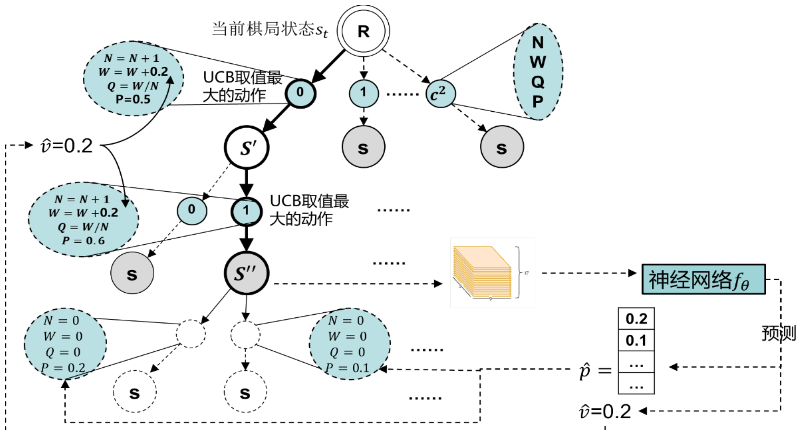
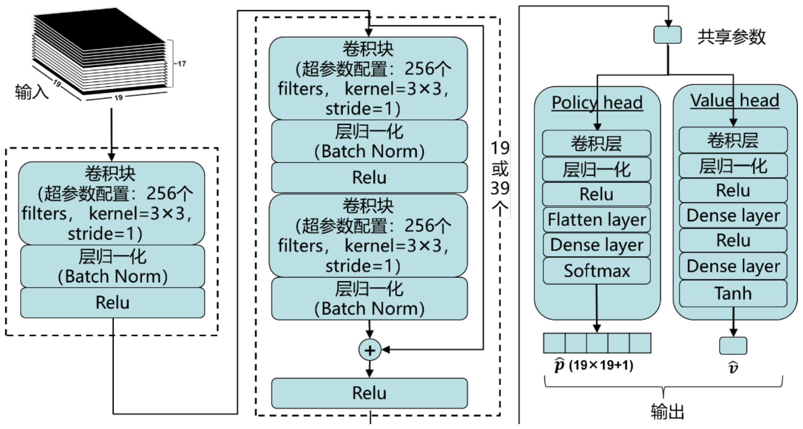
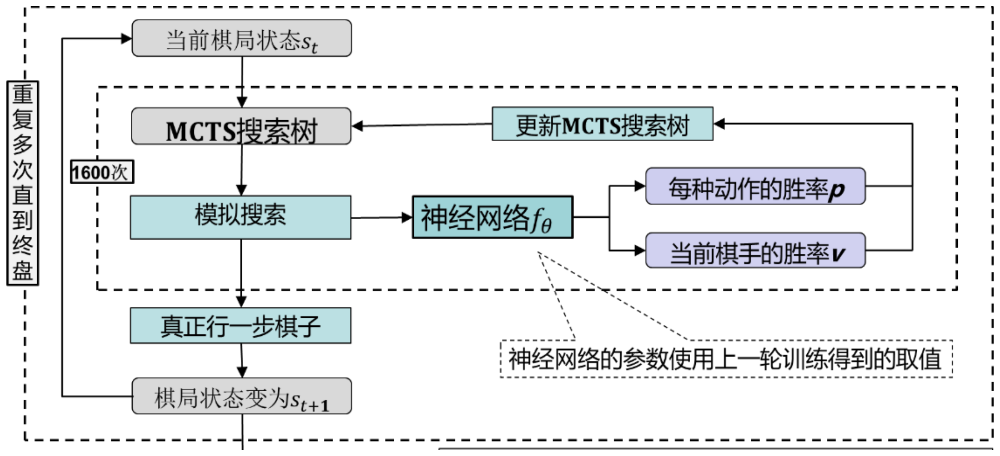

| 要回答的问题 | 一句话答案 | 关键公式 / 设置 |
| --- | --- | --- |
| 搜索什么 | MCTS 从当前局面选择性展开博弈树 | 每步落子前 1600 次模拟 |
| 先验从哪来 | 策略头给每个走法一个概率 | $P(s,a)=p_\theta(s)_a$ |
| 叶节点怎么估 | 价值头直接预测胜率，不做随机走子 | $v_\theta(s)\in(-1,1)$ |
| 怎么选动作 | PUCT 平衡胜率、先验与探索 | $U=Q+c_{\text{puct}}P\frac{\sqrt{\sum_b N(s,b)}}{1+N(s,a)}$ |
| 搜索结束怎么落子 | 按访问次数采样 | $\pi(a\mid s)\propto N(s,a)^{1/\tau}$ |
| 训练数据从哪来 | 自我对弈 + MCTS 分布 | $(s_t,\pi_t,z_t)$ |
| 网络怎么训练 | 价值回归 + 策略交叉熵 | $L=(v-z)^2-\pi^\top\log p+c\|\theta\|_2^2$ |
| 为什么能持续变强 | 搜索与网络互相供数 | 网络→MCTS→样本→网络 |

## 问题规模与两条线

围棋棋盘 $19\times19$，第一手 361 种走法，第二手 360 种，依次类推；一局两百多手，分支因子始终在几百的量级。穷举不可行，只能**选择性搜索**：把算力集中到少数有希望的走法上。

AlphaGo 系列用两条线解决这个问题：

- **搜索线**：蒙特卡洛树搜索（MCTS）负责"往哪里看"。它从当前局面出发反复模拟，把访问次数分配给看起来更好的走法。
- **学习线**：神经网络负责"看多远、值多少"。策略头提供每个走法的先验概率，价值头直接预测当前局面的胜率，替代传统 MCTS 的随机走子到底。

两条线的接口是：网络给搜索提供**先验 $P$** 和**叶节点估值 $v$**，搜索给网络提供**更高质量的策略目标 $\pi$** 和训练样本。AlphaGo Zero 的"零"指不使用人类棋谱，初始网络随机，全部知识来自自我对弈。

## MCTS：选择、扩展、评估、回溯

### 边：N、W、Q、P

搜索树的每个节点是一个局面，每条边 $(s,a)$ 代表在局面 $s$ 选择动作 $a$，边上存四个量：

| 符号 | 含义 | 说明 |
| --- | --- | --- |
| $N(s,a)$ | 访问次数 | 1600 次模拟中这条边被经过的次数 |
| $W(s,a)$ | 总价值 | 每次经过累加网络预测的 $\hat v$ |
| $Q(s,a)$ | 平均价值 | $Q=W/N$，即胜率估计 |
| $P(s,a)$ | 先验概率 | 网络策略输出 $p_\theta(s)$ 中动作 $a$ 的分量 |

$P$ 是先验，不是你最终要执行的策略；最终策略来自访问次数 $N$。

### 选择：PUCT

从当前节点 $s$ 往下选动作时，取 $U(s,a)$ 最大的一条边：

$$
U(s,a)=Q(s,a)+c_{\text{puct}}P(s,a)\frac{\sqrt{\sum_b N(s,b)}}{1+N(s,a)}.
$$

- 第一项利用：$Q=W/N$，当前估计的胜率；
- 第二项探索：先验 $P$ 越大越值得尝试；分母 $1+N(s,a)$ 随访问次数增加而衰减，防止一直重复同一条边；
- 分子 $\sqrt{\sum_b N(s,b)}$ 是当前节点所有动作的访问总数，根节点做满 1600 次模拟时它就是 1600；
- $c_{\text{puct}}$ 是探索系数。

把老虎机上的 UCB 公式 $Q+c\sqrt{\ln t/N}$ 换成这里的形式，核心变化有两点：**用网络先验 $P$ 加权**，以及**用当前节点的总访问数代替 $\ln t$**。UCB 的推导见 [探索机制与内在奖励](/posts/reinforcement-learning/rl_exploration/)。

自我对弈时，根节点的先验还会混入少量 Dirichlet 噪声，避免搜索只盯着网络当前最看好的走法。

### 扩展与评估

从根一路按 PUCT 走到叶节点 $s_L$：

- 若 $s_L$ 是终局，直接取终局胜负作为价值；
- 若是非终局的新局面，调用网络 $f_\theta(s_L)$，得到策略 $\hat p$ 与价值 $\hat v$，并创建子边：新边的 $N=W=Q=0$，先验 $P(s_L,a)=\hat p[a]$。

**网络只在叶节点被调用一次**。1600 次模拟产生 1600 个叶节点评估，而不是对整棵搜索树做一次评估。

### 回溯

把叶节点的价值 $\hat v$ 沿刚才的路径回传，路径上每条边更新：

$$
N(s,a)\leftarrow N(s,a)+1,\qquad
W(s,a)\leftarrow W(s,a)+\hat v,\qquad
Q(s,a)\leftarrow\frac{W(s,a)}{N(s,a)}.
$$

一次模拟只扩展一个节点、更新一条路径；1600 次模拟逐步把搜索树的统计量积累起来。

图中每个椭圆对应一条边上的 $N,W,Q,P$；虚线圆是刚扩展、尚未访问的新节点；网络输出的 $\hat p$ 成为新边的先验，$\hat v$ 沿路径回传。

### 落子：访问次数就是策略

1600 次模拟结束后，根节点每条边的访问次数构成一个分布：

$$
\pi(a\mid s_t)=\frac{N(s_t,a)^{1/\tau}}{\sum_b N(s_t,b)^{1/\tau}},
$$

$\tau$ 是温度参数。自我对弈的前 30 步取 $\tau=1$，鼓励探索；之后 $\tau$ 逐渐趋近 0，等价于选择访问次数最多的走法。对局评估时同样取 $\tau\to0$。

注意温度作用在**真实落子**上，不是 MCTS 内部的 PUCT；MCTS 内部的选择始终由 $U(s,a)$ 决定。

### 一次模拟的数值感受

以空盘开局、第一次模拟选中 $a_{15}$ 为例，网络给出 $\hat v=-1$：

| 事件 | 更新 |
| --- | --- |
| 新建 $a_{15}$ 的边，$P$ 取自网络 | $N=0,\ W=0,\ Q=0$ |
| 第一次模拟经过 $a_{15}$，得到 $\hat v=-1$ | $N=1,\ W=-1,\ Q=-1$ |
| 第二次模拟又从 $a_{15}$ 深入到 $a_{29}$ | $a_{29}$：$N=1,\ W=-1,\ Q=-1$；回溯 $a_{15}$：$N=2,\ W=-2,\ Q=-1$ |

访问次数增加会降低探索项 $1/(1+N)$，搜索自然转向其他少访问的走法。

## 神经网络：一个主干，两个头

### 输入：19×19×17

网络的输入是 17 个 $19\times19$ 的平面：

- 黑方当前棋子位置 1 层 + 最近 7 手黑方棋子位置 7 层；
- 白方同样 8 层；
- 第 17 层是当前行棋方指示，黑方行棋全 1、白方全 0（或相反约定）。

只输入原始棋盘与近期历史，不使用气数、提子数等手工特征——这是与 2016 版 AlphaGo 的重要区别。

### 结构与输出

主干是卷积残差网络：$3\times3$ 卷积（256 个滤波器，步长 1）→ 批归一化 → ReLU → 19 或 39 个残差块。之后分成两个头：

| 头 | 结构 | 输出 |
| --- | --- | --- |
| 策略头 | 卷积 → BN → ReLU → 展平 → 全连接 → Softmax | $\hat p\in\mathbb R^{362}$，覆盖 $19\times19$ 个落点加 pass |
| 价值头 | 卷积 → BN → ReLU → 全连接 → ReLU → 全连接 → Tanh | $\hat v\in(-1,1)$，当前行棋方的胜率 |

两个头共享主干参数，联合训练。策略头的输出**只是先验**，服务于 MCTS 的 $P$；真正执行的策略是搜索后的 $\pi$。价值头的输出用于叶节点评估与回溯，替代 2016 版 AlphaGo 的快速走子。

## 自我对弈与训练

### 样本：$(s_t,\pi_t,z_t)$

自我对弈的每一步：

1. 以当前局面 $s_t$ 为根，用当前网络做 1600 次 MCTS 模拟；
2. 根节点访问计数给出 $\pi_t$，按 $\pi_t$ 采样真实落子 $a_t$；
3. 对局结束后得到终局结果，把每一步记为样本 $(s_t,\pi_t,z_t)$。

$z_t$ 是终局胜负换算到**该步行棋方**视角的标签：赢 $+1$，输 $-1$，和棋 $0$。因为行棋方交替，同一盘棋相邻两步的 $z_t$ 符号相反；同一盘棋的所有样本共享同一个终局结果。

样本里的策略标签是 **MCTS 产生的 $\pi_t$**，不是实际执行的那一手 $a_t$。$\pi_t$ 包含 1600 次模拟的全部统计信息，比单个动作监督更丰富；这正是"把搜索能力蒸馏进网络"的关键。

### 损失：价值回归 + 策略蒸馏

$$
L(\theta)=\big(v_\theta(s)-z\big)^2-\pi^\top\log p_\theta(s)+c\|\theta\|_2^2.
$$

| 项 | 作用 |
| --- | --- |
| $(v_\theta(s)-z)^2$ | 价值回归：让价值头预测终局胜负 |
| $-\pi^\top\log p_\theta(s)$ | 策略交叉熵：让策略头逼近 MCTS 的访问分布 $\pi$ |
| $c\|\theta\|_2^2$ | L2 正则 |

用梯度下降最小化 $L$，更新后的网络进入下一轮自我对弈。训练目标不是人类棋谱的落子，也不是"这一手赢了还是输了"，而是**搜索之后才知道的更好策略**。

### 闭环

闭环的四个环节：

1. 用当前网络 $f_\theta$ 指导 MCTS，得到每步的搜索策略 $\pi$；
2. 按 $\pi$ 自我对弈，收集 $(s_t,\pi_t,z_t)$；
3. 用样本训练网络，得到新参数；
4. 新网络让下一轮 MCTS 更强，产生更高质量的 $\pi$ 和数据。

网络参数在一整盘自我对弈中保持固定；自我对弈与网络训练可以使用上一轮的参数并行进行。

### 1600 次模拟在买什么

模拟次数越多，访问计数对"哪个走法更好"的估计越准，$\pi_t$ 的质量越高，落子也越强。但每次模拟都要走一遍树并在叶节点调用网络，成本随次数线性增长。1600 是计算预算与搜索质量之间的折中，不是理论上的特殊数字。

## AlphaGo、AlphaGo Zero、AlphaZero 对照

### AlphaGo（2016）的四个组件

- **监督学习策略网络** $p_\sigma$：用约 3000 万个人类棋谱局面训练，预测人类落子；
- **强化学习策略网络** $p_\rho$：从 $p_\sigma$ 出发，用策略梯度与历史版本对弈，提升胜率；
- **价值网络** $v_\theta$：用自我对弈局面回归终局胜负；
- **快速走子策略** $p_\pi$：低成本地走子到终局，得到蒙特卡洛估计。

MCTS 评估叶节点时，把价值网络与快速走子的结果加权混合，例如 $\lambda v_\theta+(1-\lambda)z$，常取 $\lambda=0.5$；选择时使用带先验的 UCT。

### 三代对照

| 维度 | AlphaGo（2016） | AlphaGo Zero（2017） | AlphaZero（2018） |
| --- | --- | --- | --- |
| 人类棋谱 | 用于监督预训练 | 不使用 | 不使用 |
| 网络结构 | 策略网络、价值网络、快速走子策略分开 | 单一网络，策略/价值双头共享主干 | 与 Zero 相同 |
| 叶节点评估 | 价值网络 + 快速走子混合 | 只用价值网络 | 只用价值网络 |
| 搜索选择 | 带先验的 UCT | PUCT | PUCT |
| 输入特征 | 手工特征 | 原始棋盘 17 层 | 原始棋盘 + 棋种规则平面 |
| 训练数据 | 人类棋谱 + 自我对弈 | 纯自我对弈，MCTS 分布作策略目标 | 纯自我对弈 |
| 代表结果 | 4:1 胜李世石 | 100:0 胜 AlphaGo | 围棋、国际象棋、将棋通用 |

从 2016 版到 Zero，三个关键删减：删掉人类棋谱、删掉快速走子、删掉手工特征；同时把策略网络与价值网络合并成一个双头网络。AlphaZero 再进一步，同一套算法不加棋类专属知识地推广到国际象棋与将棋。

## 与 DQN、策略梯度的关系

| 方法 | 学什么 | 数据来源 | 是否搜索 | 训练目标 |
| --- | --- | --- | --- | --- |
| DQN | $Q(s,a)$ | 与环境交互 + 经验回放 | 否 | TD 误差 |
| REINFORCE / PPO | 策略（可配价值函数） | 按策略采样轨迹 | 否 | 策略梯度 / 截断目标 |
| AlphaGo Zero | 先验策略 $p_\theta$ + 价值 $v_\theta$ | 自我对弈 + MCTS | 是，每步 1600 次模拟 | 价值回归 + 对 $\pi$ 的交叉熵 |

AlphaGo Zero 不是纯反应式的无模型方法：围棋规则已知，MCTS 用规则做前向模拟，属于**已知模型上的规划 + 学习**。它也不直接学 $Q(s,a)$，价值头估计的是状态价值，动作的好坏由搜索统计量 $Q=W/N$ 在树内给出。

## 易错点

1. **$\pi$ 与 $p$ 不要混**：$p_\theta$ 是网络的先验；$\pi$ 是 MCTS 访问计数归一化后的搜索策略。落子用 $\pi$，训练时 $\pi$ 作标签、$p_\theta$ 作预测。
2. **$P$ 不是胜率**：先验 $P$ 只表示"这个走法值得先看"，胜率估计在 $Q=W/N$，二者在 PUCT 里各占一项。
3. **网络只在叶节点调用**：每次模拟扩展一个叶节点；1600 次模拟对应 1600 次叶评估，不是对整棵树做一次大评估。
4. **1600 次是每次真实落子前**，不是每局 1600 次，也不是 1600 盘棋。
5. **温度 $\tau$ 用于落子采样**：前 30 步 $\tau=1$ 加强探索，之后 $\tau\to0$；它不改变 MCTS 内部的 PUCT 选择。
6. **价值视角要统一**：$\hat v$ 和 $z$ 都是"当前行棋方"的胜负；跨越一手时视角交替，同一终局对黑白双方符号相反。答题时先声明视角约定，再谈累加或取负。
7. **价值目标来自搜索而非人类**：策略标签 $\pi_t$ 是 1600 次模拟的统计结果，这是 Zero 能从零学起的核心机制。

## 答题要点

:::tip[AlphaGo Zero 基本原理（按顺序复述）]

1. 用网络 $f_\theta(s)=(p_\theta(s),v_\theta(s))$ 同时给出走法先验与局面胜率，两个头共享残差主干。
2. 每步落子前以当前局面为根做 1600 次 MCTS 模拟：PUCT 选择、叶节点扩展、网络评估、回溯更新 $N/W/Q$。
3. 用根节点访问计数得到搜索策略 $\pi(a\mid s)\propto N(s,a)^{1/\tau}$，按 $\pi$ 采样落子完成自我对弈。
4. 终局得到胜负 $z$，构造样本 $(s_t,\pi_t,z_t)$；用 $L=(v-z)^2-\pi^\top\log p+c\|\theta\|_2^2$ 训练网络。
5. 新网络进入下一轮自我对弈，形成"网络越强→搜索越强→数据越好→网络更强"的闭环。

:::

:::tip[击败人类冠军的秘诀（三句话版）]

1. **搜索有方向**：神经网络为先验与估值，MCTS 把算力集中在有希望的走法上，兼有前瞻与全局观。
2. **搜索会蒸馏**：训练目标不是人类棋谱，而是 MCTS 搜索后的访问分布，网络不断吸收更高水平的搜索知识，反过来让下一轮搜索更强。
3. **数据自给自足**：完全自我对弈，不需要人类棋谱，也不受人类棋风与认知偏见限制；配合大规模算力，能力可以持续自我提升。

:::

## 复习检查清单

1. 默写 PUCT 公式，并解释 $N,W,Q,P$ 四个量；说明探索项为什么随 $N$ 增大而减小。
2. 复述一次 MCTS 模拟的四个阶段，并说明网络在哪一步被调用、调用几次。
3. 写出训练损失的三项，说明 $\pi$ 与 $p_\theta$ 的区别；解释为什么策略标签用 MCTS 的 $\pi$ 而不是实际落子。
4. 说出 AlphaGo Zero 相对 2016 版 AlphaGo 的三处关键删减。
5. 用三句话回答"AlphaGo Zero 为什么能击败人类冠军"。
