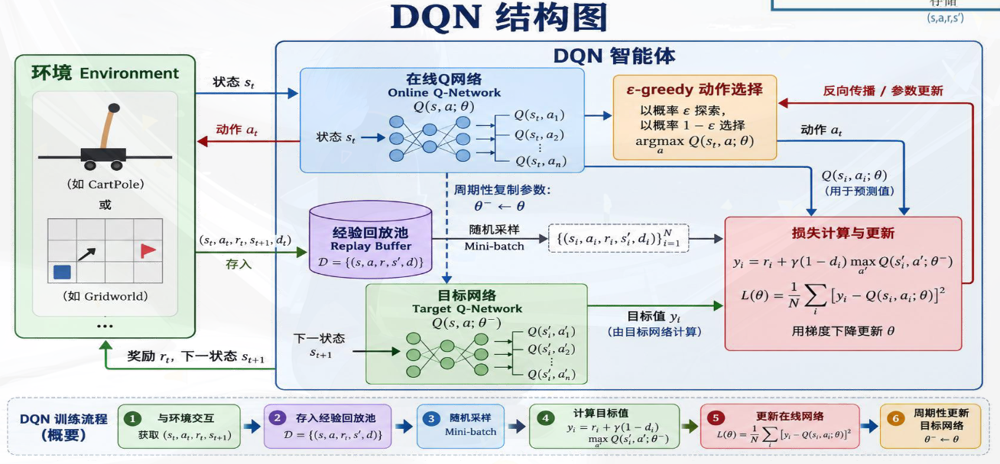

基于Q表更新的Q-learning在状态空间大的时候存储代价高，连续状态空间则无法表示，Q表也没有泛化能力

## DQN网络

DQN学习一个函数 $Q(s,a;\theta)\approx Q^*(s,a)$，用神经网络来逼近Q函数

- 输入：网络接受输入当前状态 $S_t=s$
- 输出： **预测的** **每个**动作的Q值 $Q(s,a_1;\theta), Q(s,a_2;\theta), \ldots, Q(s,a_n;\theta),a_i\in\mathcal{A}(s)$

- $\theta$ 是在线网络（online network)的参数。

### 目标值(由目标网络计算)

用目标网络来计算TD目标值，$S_t=s\xrightarrow{a_t=\epsilon-greedy,r_t} S_{t+1}=s'$：

$$
Y_t=r_t+\gamma(1-d_t) \max_{a'} Q(s',a';\theta^-)
$$

- 其中 $\theta^-$ 是目标网络(target network)的参数。目标网络相较于在线网络是延迟更新的，防止网络自己追着自己学，训练不稳定，甚至发散。
- $d_t$ 是终止标志，若当前状态是终止状态，则 $d_t=1$，否则 $d_t=0$。
- $a'$ 是下一个状态的动作，$\max_{a'} Q(s',a';\theta^-)$ 是目标网络输出的最大Q值。
- DQN的**训练目标本身也来自网络对未来价值的估计**，因此它并不是普通的、拥有固定标签的数据集训练

### 损失函数

用MSE作为损失函数，计算预测值和目标值之间的差距：

$$
\mathcal{L}(\theta)=\frac{1}{2}[Y_t-Q(s,a;\theta)]^2
$$

### 参数更新

$$
\theta\leftarrow \theta-\alpha\nabla_\theta \mathcal{L}(\theta)
$$

## 直接用神经网络逼近Q函数的缺点

1. **样本之间的相关性**：强化学习中，智能体与环境交互产生的样本是 **时间相关** 的，直接用这些样本训练神经网络会导致网络过拟合，收敛速度慢，甚至发散。
2. **目标值的非平稳性**：如果不区分目标/在线网络，深度强化学习的目标是和要训练的网络一起更新的，用一个网络会导致网络自己追着自己学，训练不稳定，甚至发散。
3. **参数共享带来的全局耦合**：参数变化导致输出的Q值同时变化，导致训练不稳定，甚至发散。

## 经验回放

解决样本之间的相关性问题

- 一个不断接收新经验、同时淘汰旧经验的固定容量数据结构。
- 不是从小到大无限增长，而是先增长到容量上限，之后就循环覆盖最早的数据。

每次智能体执行一个动作，环境就会产生一条新的经验，一条经验的数据结构如下：

$$
(S_t,A_t,R_t,S_{t+1},d_t)
$$

- $d_t$ 是终止标志，若当前状态是终止状态，则 $d_t=1$，否则 $d_t=0$。
- 一般会有warmup阶段，先收集一些经验再开始训练。

在训练时，不按时间顺序拿最新的几十条，而是随机从池子中抽一个mini-batch

:::tip
经验复用：一条经验不是用一次就扔掉，而是可以被多次抽中、多次学习对强化学习非常重要，因为环境交互往往比一次网络反向传播更昂贵。尤其是真实机器人、无人机或者工业系统，每一次采样都有时间和成本。
:::

## 目标网络

解决目标值的非平稳性问题

:::tip

如果用一个网络容易自己追自己，那延迟一下不就好了？

:::

顾名思义，目标网络的参数记作 $\theta^-$，用于计算TD目标值 $y_t=R(s,a)+\gamma(1-d_t) \max_{a'} Q(s',a';\theta^-)$ 里面的 $\max_{a'} Q(s',a';\theta^-)$，剩下的用于输出预测Q值的叫做在线网络

- 目标网络和在线网络的结构，初始化完全相同
- 目标网络的参数 $\theta^-$ 是在线网络参数 $\theta$ 的延迟拷贝，通常每隔 $M$ 步才更新一次：将在线网络的参数复制给目标网络
- 目标网络的参数在一段时间内保持不变，避免了训练目标变化的问题

:::pseudo[算法 1：DQN]
1: 初始化在线网络参数 $\theta$，目标网络参数 $\theta^-=\theta$ 和更新频率 $M$ 初始化经验回放池 $D$，容量为 $N$
2: for episode = 1,2,...,M do
3: &emsp;for time step t = 1,2,...,T do
4: &emsp;&emsp;#智能体与环境交互
5: &emsp;&emsp;根据当前 $s_t$ 计算 $Q(s_t,a_i;\theta)|_{i=1}^|\mathcal{A}|$
6: &emsp;&emsp;使用 $\epsilon$-贪心策略选择动作 $a_t$ 并执行，得到奖励 $r_t$ 和下一个状态 $s_{t+1}$，终止标志 $d_t$
7: &emsp;&emsp;将经验 $(s_t,a_t,r_t,s_{t+1},d_t)$ 存入经验回放池 $D$
8: &emsp;&emsp;#上述可能在前期需要 warmup 阶段，先收集一些经验再开始训练
9: &emsp;&emsp;从经验回放池中随机采样一个 mini-batch 的经验 $(s_j,a_j,r_j,s_{j+1},d_j)$
10: &emsp;&emsp;计算目标值 $y_j=r_j+\gamma(1-d_j)\max_{a'}Q(s_{j+1},a';\theta^-)$ 和预测值 $Q(s_j,a_j;\theta)$
11: &emsp;&emsp;计算损失函数 $\mathcal{L}(\theta)=\frac{1}{2}[y_j-Q(s_j,a_j;\theta)]^2$
12: &emsp;&emsp;梯度下降更新在线网络参数 $\theta\leftarrow \theta-\alpha\nabla_\theta \mathcal{L}(\theta)$
13: &emsp;&emsp;每隔 M 步将在线网络参数 $\theta$ 复制给目标网络参数 $\theta^-$
14: &emsp;end for
15: end for
:::

图示如下

