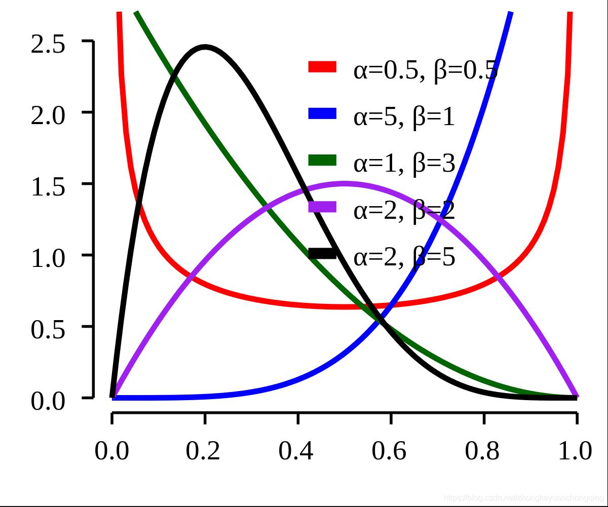

强化学习与监督学习最大的差别之一：**训练数据不是事先固定的**。当前策略决定智能体访问哪些状态、执行哪些动作，这些交互数据又反过来决定价值函数、策略或模型能学到什么。

用 $\pi$ 表示当前策略，状态—动作样本来自策略诱导的状态访问分布：

$$
(s,a)\sim d^\pi(s)\pi(a\mid s),
$$

形成闭环：

> 当前策略 → 状态访问分布 → 训练数据 → 价值/策略/模型更新 → 新策略。

如果策略永远只重复当前认为最好的行为，数据分布就会固化，价值估计的误差永远无法暴露。探索机制就是用来打破这个闭环的。

## 探索—利用权衡

利用（exploitation）：根据当前知识，选择预计回报最高的动作。

$$
a_t=\arg\max_a Q_t(s,a).
$$

探索（exploration）：主动尝试尚未充分了解的状态或动作，牺牲短期奖励换取信息。

探索—利用权衡（exploration–exploitation trade-off）：**既不能只利用当前知识，也不能无目的地随机探索**。

## 多臂老虎机：最简单的探索模型

多臂老虎机（Multi-Armed Bandit, MAB）没有状态转移，只有 $K$ 个动作（老虎机的臂）：

$$
\mathcal A=\{1,2,\dots,K\},
\qquad
R_t\sim p(\cdot\mid a).
$$

每个动作有未知的真实期望奖励

$$
q^*(a)=\mathbb E[R_t\mid A_t=a].
$$

智能体通过反复试验估计 $Q_t(a)\approx q^*(a)$，目标是在 $T$ 轮内最大化累计期望奖励。

### 样本平均与增量更新

若动作 $a$ 已经被选择 $N_t(a)$ 次，奖励为 $R_1,\dots,R_{N_t(a)}$，样本平均估计为

$$
Q_t(a)=\frac{1}{N_t(a)}\sum_{i=1}^{N_t(a)}R_i.
$$

它的递推形式是

$$
Q_{n+1}=Q_n+\frac{1}{n+1}\big(R_{n+1}-Q_n\big).
$$

在非平稳问题中，可以用固定步长给近期样本更大权重：

$$
Q_{t+1}(a)=Q_t(a)+\alpha\big(R_t-Q_t(a)\big).
$$

### 后悔值

探索要付出短期代价。设最优动作的期望奖励为

$$
q^*=\max_a q^*(a),
$$

则 $T$ 轮内的累计后悔值为

$$
\mathcal R_T=Tq^*-\mathbb E\Big[\sum_{t=1}^T R_t\Big]
=\sum_{t=1}^T\big(q^*-q^*(A_t)\big).
$$

它表示"如果一开始就知道最优动作，本可以多拿多少奖励"。好的探索算法要让 $\mathcal R_T$ 增长尽可能慢。

## ε-greedy：大部分时间利用，小部分时间探索

$$
A_t=
\begin{cases}
\text{随机选择一个动作}, & \text{概率 }\varepsilon,\\
\arg\max_{a\in\mathcal A}Q_t(a), & \text{概率 }1-\varepsilon.
\end{cases}
$$

数值例题：一个状态有四个动作，当前价值分别为向上 $8.0$、向下 $3.0$、向左 $5.0$、向右 $2.0$，贪心动作为"向上"。取 $\varepsilon=0.2$，随机探索时从四个动作中均匀抽取，则

$$
P(A_t=\text{向上})=1-\varepsilon+\frac{\varepsilon}{4}
=0.8+0.05=0.85,
$$

其余三个动作各为

$$
P(A_t=a_i)=\frac{\varepsilon}{4}=0.05.
$$

关键：**$\varepsilon$ 是进入"随机选择模式"的概率，不是"选择非贪心动作"的精确概率**。贪心动作也可能被随机模式抽中。

$\varepsilon$ 常随训练衰减：

$$
\varepsilon_t=\max\big(\varepsilon_{\min},\varepsilon_0\lambda^t\big),
\qquad
0<\lambda<1,
$$

或

$$
\varepsilon_t=\varepsilon_{\min}+(\varepsilon_0-\varepsilon_{\min})e^{-\kappa t}.
$$

衰减过快会过早停止探索，陷入次优策略；衰减过慢则后期仍大量无意义随机动作。

**局限**：$\varepsilon$-greedy 对"试过 1000 次、已确认较差"的动作和"只试过 1 次、完全未知"的动作一视同仁。它解决的是"偶尔别贪心"，但没有回答"哪个未知动作最值得探索"。

## 乐观初始化：先假设未知动作很好

真实单步奖励通常位于 $[0,1]$，可以故意把初始价值设得很高，例如 $Q_0(a)=5$。

如果所有动作初始价值都是 $5$，执行某个动作后实际奖励只有 $1$，它的估计会下降；未尝试动作仍保持 $5$。于是贪心策略自然转向尚未尝试的动作：

> 未知 → 乐观估计 → 主动尝试 → 用真实数据修正。

局限：深度强化学习用函数逼近，难以对所有未见状态—动作对维持合理的乐观估计；奖励尺度未知或动态变化时，乐观值也难设定。

## UCB：把不确定性写进打分

上置信界（Upper Confidence Bound, UCB）同时考虑"价值估计"和"尝试不足"：

$$
A_t=\arg\max_a\left[Q_t(a)+c\sqrt{\frac{\ln t}{N_t(a)}}\right],
$$

其中 $t$ 是已选总次数，$N_t(a)$ 是动作 $a$ 被选次数，$c\ge 0$ 控制探索强度。

$$
\text{综合评分}=\underbrace{Q_t(a)}_{\text{利用项}}+\underbrace{c\sqrt{\frac{\ln t}{N_t(a)}}}_{\text{探索项 }B_t(a)}.
$$

$N_t(a)$ 越少，探索项越大；动作被反复尝试后，探索项逐渐减小。$c=0$ 时退化为纯贪心。

数值例题：$t=100$，$c=1$，三个动作的统计为 $(Q,N)=(0.9,50),(0.8,10),(0.6,2)$，且 $\ln 100\approx 4.605$：

| 动作 | $c\sqrt{\ln t/N_t(a)}$ | UCB 得分 | LCB 得分 |
| --- | --- | --- | --- |
| $a_1$ | $\sqrt{4.605/50}\approx0.304$ | $1.203$ | $0.597$ |
| $a_2$ | $\sqrt{4.605/10}\approx0.679$ | $1.479$ | $0.121$ |
| $a_3$ | $\sqrt{4.605/2}\approx1.517$ | $2.117$ | $-0.917$ |

**UCB 选 $a_3$**：虽然它的当前平均奖励最低，但样本最少、探索项最大。这正是"高价值动作值得利用，低置信动作值得进一步了解"。

### LCB：悲观版本

把探索项前面的加号换成减号，就得到下置信界（Lower Confidence Bound, LCB）：

$$
A_t=\arg\max_a\left[Q_t(a)-c\sqrt{\frac{\ln t}{N_t(a)}}\right].
$$

在上面的数据中，LCB 得分为 $0.597$、$0.121$、$-0.917$，**选 $a_1$**：它在"下界里最好"，是最保守的选择。

| | UCB | LCB |
| --- | --- | --- |
| 打分 | $Q+c\sqrt{\ln t/N}$ | $Q-c\sqrt{\ln t/N}$ |
| 倾向 | 乐观：不确定性是奖励 | 悲观：不确定性是风险 |
| 选谁 | 访问最少、可能被低估的动作 | 下界最高、最稳的动作 |
| 典型场景 | 探索、 regret 最小化 | 安全 RL、鲁棒规划、基于模型的下界优化 |

经典 UCB 公式最自然地适用于 MAB。在一般 MDP 中，动作价值受状态转移和长期回报影响，还要考虑状态—动作访问次数或更复杂的置信边界，不能把老虎机公式直接当成通用解。

## Thompson Sampling：从后验分布采样

### 伯努利奖励与 Beta 先验

设动作 $a$ 的成功概率为未知参数 $\theta_a$，奖励

$$
R\sim\mathrm{Bernoulli}(\theta_a),
\qquad
P(R=1\mid\theta_a)=\theta_a.
$$

用 Beta 分布描述对 $\theta_a$ 的不确定性：

$$
\theta\sim\mathrm{Beta}(\alpha,\beta),
\qquad
p(\theta\mid\alpha,\beta)
=\frac{1}{B(\alpha,\beta)}\theta^{\alpha-1}(1-\theta)^{\beta-1}.
$$

均值和方差为

$$
\mathbb E[\theta]=\frac{\alpha}{\alpha+\beta},
\qquad
\mathrm{Var}(\theta)=\frac{\alpha\beta}{(\alpha+\beta)^2(\alpha+\beta+1)}.
$$

Beta 是伯努利似然的**共轭先验**。先验 $\mathrm{Beta}(\alpha_0,\beta_0)$，观测到 $S$ 次成功、$F$ 次失败后：

$$
\theta_a\mid\mathcal D\sim\mathrm{Beta}(\alpha_0+S,\beta_0+F).
$$

因此可以增量更新：

$$
\text{成功：}\alpha\leftarrow\alpha+1,
\qquad
\text{失败：}\beta\leftarrow\beta+1.
$$

均匀先验 $\mathrm{Beta}(1,1)$ 表示初始阶段对 $[0,1]$ 内的成功概率没有偏好。

### 算法

1. 对每个动作初始化 $\alpha_a=1,\beta_a=1$。
2. 对每个动作从后验采样 $\tilde\theta_a\sim\mathrm{Beta}(\alpha_a,\beta_a)$。
3. 选择采样值最大的动作 $a_t=\arg\max_a\tilde\theta_a$。
4. 执行动作，观察真实奖励 $r\in\{0,1\}$。
5. 成功则 $\alpha_{a_t}\leftarrow\alpha_{a_t}+1$，失败则 $\beta_{a_t}\leftarrow\beta_{a_t}+1$。
6. 重复。

注意：**不是选后验均值最大的动作，而是先采样再选最大**。探索来自后验的随机性，而不是额外的 $\varepsilon$。

### 两台老虎机的例题

A、B 都使用均匀先验 $\mathrm{Beta}(1,1)$。历史数据：

| 统计量 | 机器 A | 机器 B |
| --- | --- | --- |
| 尝试次数 | 10 | 5 |
| 成功次数 | 7 | 4 |
| 失败次数 | 3 | 1 |
| 样本平均奖励 | 0.700 | 0.800 |

后验分布：

$$
\theta_A\mid\mathcal D\sim\mathrm{Beta}(8,4),
\qquad
\theta_B\mid\mathcal D\sim\mathrm{Beta}(5,2).
$$

后验均值：

$$
\mathbb E[\theta_A]=\frac{8}{12}=\frac23\approx0.667,
\qquad
\mathbb E[\theta_B]=\frac57\approx0.714.
$$

后验方差：

$$
\mathrm{Var}(\theta_A)=\frac{8\times4}{12^2\times13}\approx0.0171,
\qquad
\mathrm{Var}(\theta_B)=\frac{5\times2}{7^2\times8}\approx0.0255.
$$

B 的后验均值更高，但方差也更大——数据更少，认识更不确定。方差大不等于真实价值高。

一次采样若得到 $\tilde\theta_A=0.72$、$\tilde\theta_B=0.61$，则本轮选 A，尽管 B 的后验均值更高。另一次采样也可能让 B 获胜。

若本轮选择 B 并观察到成功，则

$$
\mathrm{Beta}(5,2)\to\mathrm{Beta}(6,2),
\qquad
\mathbb E[\theta_B]=\frac68=0.75.
$$

若观察到失败，则为 $\mathrm{Beta}(5,3)$，均值 $5/8=0.625$。**后验更新取决于环境真实返回的奖励，而不是采样值。**

### 探索方法对比

| 方法 | 动作选择机制 | 不确定性处理 | 主要特点 |
| --- | --- | --- | --- |
| 纯贪心 | 选估计价值最高 | 不考虑 | 容易因早期数据陷入次优 |
| ε-greedy | 以概率 $\varepsilon$ 随机，否则贪心 | 用随机概率体现 | 简单，但不区分不同动作的不确定性 |
| UCB | 最大化 $Q$ 加探索项 | 乐观上界 | 评分直观，需要设置 $c$ |
| LCB | 最大化 $Q$ 减探索项 | 悲观下界 | 保守，适合安全/鲁棒场景 |
| Thompson | 从后验采样，选采样值最大 | 由后验分布体现 | 贝叶斯解释清晰，探索随数据自适应 |

## 从动作随机性到状态新颖性

前面的方法主要回答"应该尝试哪个动作"。在大型状态空间中，更关键的问题常常是"应该去哪里"。

机器人在大型建筑里，即使每一步都做 ε-greedy，也可能长期在入口附近几个房间随机移动，到不了更深层区域。因此要区分：

> **Action Diversity ≠ State-Space Exploration**（动作多样性不等于状态空间探索）。

动作熵很高，不代表访问了足够多的新状态。稀疏奖励、大型迷宫和机器人未知空间探索需要"状态新颖性驱动"的机制。

## 外在奖励与内在奖励

外在奖励 $r_t^{\mathrm{ext}}$ 由任务定义：到达目标 $+100$，碰撞 $-10$，每步 $-0.01$。它回答"任务希望智能体做什么"。

内在奖励 $r_t^{\mathrm{int}}$ 由算法根据状态新颖性、预测误差、不确定性或信息增益构造：

$$
r_t=r_t^{\mathrm{ext}}+\beta r_t^{\mathrm{int}},
\qquad
\beta\ge0.
$$

它回答"在完成任务之前，哪些状态值得主动了解"。

稀疏奖励有多稀疏？一个 $50\times50$ 的迷宫，只有到达终点才给 $r=1$，其他时刻 $r=0$。一条失败的 500 步轨迹可能满足

$$
r_1=r_2=\cdots=r_{500}=0.
$$

仅凭外在奖励，算法几乎无法区分"发现新走廊"和"在旧区域反复绕圈"。

## 基于访问次数的探索

设 $N_t(s)$ 为截至 $t$ 时刻状态 $s$ 的访问次数，定义计数奖励

$$
r_t^{\mathrm{int}}=\frac{\eta}{\sqrt{N_t(s_{t+1})+1}},
\qquad
\eta>0.
$$

$\eta=1$ 时：

| 历史访问次数 $N$ | 0 | 1 | 3 | 8 | 24 |
| --- | --- | --- | --- | --- | --- |
| $r^{\mathrm{int}}$ | $1.000$ | $0.707$ | $0.500$ | $0.333$ | $0.200$ |

若区域 A、B、C 的访问次数分别为 $100,9,0$，则

$$
r_A^{\mathrm{int}}=\frac1{101}\approx0.10,
\qquad
r_B^{\mathrm{int}}=\frac1{10}\approx0.316,
\qquad
r_C^{\mathrm{int}}=1.
$$

C 获得最高的新颖性奖励。

连续状态空间不能直接计数：$x=1.000$ 和 $x=1.001$ 若当成两个状态，几乎每次访问都是"新状态"。实际要用离散化、聚类、哈希、特征空间计数或伪计数。

还要记住：

> **Novelty ≠ Task Utility**（新颖性不等于任务价值）。

一个从未去过的小角落和一条可能通向目标的新走廊，可能有相似的新颖性奖励，但任务价值完全不同。内在奖励只能是辅助信号。

## 预测误差驱动的好奇心

训练环境模型预测下一状态：

$$
\hat s_{t+1}=f_\theta(s_t,a_t),
\qquad
r_t^{\mathrm{int}}=\eta\|s_{t+1}-\hat s_{t+1}\|_2^2.
$$

预测误差大的状态转移意味着模型还没学会，值得继续收集数据。同一个环境模型因此有**双重作用**：

> 在 Model-Based RL 中用来预测未来和规划；在好奇心探索中用来度量认知不足。

数值例子：第一次进入某区域，模型预测 $2.0$ m，实际 $2.8$ m：

$$
r^{\mathrm{int}}=\eta(2.8-2.0)^2=0.64\eta.
$$

反复学习后预测改善为 $2.75$ m：

$$
r^{\mathrm{int}}=\eta(2.8-2.75)^2=0.0025\eta.
$$

模型掌握该区域后，内在奖励自然下降。

### Noisy-TV：不可预测不等于值得学习

如果机器人旁边有一台显示随机噪声的电视，下一帧几乎不可预测，预测误差会长期保持很高。若内在奖励与预测误差正相关，机器人可能一直停在电视前。这就是 **noisy-TV 问题**：

> 不可预测 ≠ 值得学习。

解决办法是看**学习进度**（learning progress），而不只看当前误差：

$$
\Delta\mathrm{PE}_t=\mathrm{PE}_{t-k}-\mathrm{PE}_t.
$$

若 $\Delta\mathrm{PE}_t>0$，说明模型近期确实在进步；若误差长期很高但不再下降，可能是不可约随机性，而不是知识不足。真正值得探索的是"通过数据可以减少的不确定性"。

## ICM：在特征空间做预测

直接预测整幅图像容易受光照、纹理、阴影和随机视觉噪声影响。ICM（Intrinsic Curiosity Module）先把状态编码成特征：

$$
z_t=\phi(s_t),
$$

再预测下一状态特征：

$$
\hat z_{t+1}=f_\theta(z_t,a_t),
\qquad
L_f=\frac12\|z_{t+1}-f_\theta(z_t,a_t)\|_2^2.
$$

内在奖励与前向预测误差相关：

$$
r_t^{\mathrm{int}}=\eta L_f.
$$

经典 ICM 还包含一个逆向模型，从 $(z_t,z_{t+1})$ 预测动作 $a_t$，迫使特征保留"由动作引起的变化"，忽略与动作无关的视觉噪声。

## RND：随机网络蒸馏

RND（Random Network Distillation）有两个网络：

- 固定的随机目标网络 $f_{\mathrm{target}}$；
- 可训练的预测网络 $f_{\mathrm{pred}}$。

$$
z_t^{\mathrm{target}}=f_{\mathrm{target}}(s_t),
\qquad
z_t^{\mathrm{pred}}=f_{\mathrm{pred}}(s_t).
$$

预测网络通过训练逼近固定随机目标：

$$
L_{\mathrm{RND}}=\big\|f_{\mathrm{pred}}(s_t)-f_{\mathrm{target}}(s_t)\big\|_2^2.
$$

内在奖励：

$$
r_t^{\mathrm{int}}
=\eta\big\|f_{\mathrm{pred}}(s_{t+1})-f_{\mathrm{target}}(s_{t+1})\big\|_2^2.
$$

固定随机网络可以理解为"状态指纹生成器"：常见状态被反复训练，预测网络逐渐拟合；新状态还没拟合，误差大。因此误差近似表示状态新颖程度。

| 比较维度 | ICM | RND |
| --- | --- | --- |
| 是否显式学习状态转移 | 是 | 否 |
| 核心误差 | 动作条件下的特征预测误差 | 固定随机目标预测误差 |
| 是否使用逆向模型 | 经典形式使用 | 不需要 |
| 更强调 | 新状态转移 | 新状态本身 |
| 结构复杂度 | 较高 | 相对简单 |

## 信息增益驱动的探索

访问次数问"我来过这里多少次"，预测误差问"我能否预测这里"，信息增益问：**如果我去这里，能减少多少关于环境的不确定性？**

设环境有未知参数 $\theta$，当前认知为 $p(\theta\mid h_t)$。执行动作并观察到 $o_{t+1}$ 后，后验变为 $p(\theta\mid h_t,o_{t+1})$。一次观测的信息增益用 KL 散度表示：

$$
I_t=D_{\mathrm{KL}}\big(p(\theta\mid h_t,o_{t+1})\,\|\,p(\theta\mid h_t)\big).
$$

动作选择时更关心**期望信息增益**：

$$
\mathbb E_{o_{t+1}\sim p(\cdot\mid h_t,a_t)}
\big[D_{\mathrm{KL}}\big(p(\theta\mid h_t,o_{t+1})\,\|\,p(\theta\mid h_t)\big)\big].
$$

从熵的角度看，就是观测前后不确定性的减少：

$$
I_t=H_{\mathrm{before}}-H_{\mathrm{after}}.
$$

机器人面对两个候选区域：A 近但已经清楚，B 远但可能看到一条从未探测的走廊。纯距离策略倾向 A，信息增益策略可能倾向 B。但真正合理的评价还要考虑移动代价、风险和任务相关性，所以实际系统常用多目标评价，而不是单独最大化信息增益。

### 用 ensemble 分歧近似不确定性

训练 $K$ 个环境模型 $f_{\theta_1},\dots,f_{\theta_K}$，预测

$$
\hat s_{t+1}^{(k)}=f_{\theta_k}(s_t,a_t),
\qquad
\bar s_{t+1}=\frac1K\sum_{k=1}^K\hat s_{t+1}^{(k)}.
$$

模型分歧：

$$
U_t=\frac1K\sum_{k=1}^K\big\|\hat s_{t+1}^{(k)}-\bar s_{t+1}\big\|_2^2,
\qquad
r_t^{\mathrm{int}}=\eta U_t.
$$

多个模型预测一致，$U_t$ 小；差异大，说明该区域数据不足。这是把"不确定性"直接变成探索奖励。

## 各种内在奖励方法的比较

| 方法 | 探索依据 | 优点 | 典型局限 |
| --- | --- | --- | --- |
| 访问次数 | 少访问状态更有新颖性 | 简单、直观 | 连续空间难直接计数 |
| 预测误差 | 难预测的状态转移 | 与环境模型自然结合 | 易受随机噪声影响（Noisy-TV） |
| ICM | 动作相关特征预测误差 | 强调可控变化 | 依赖特征表示质量 |
| RND | 对固定随机目标的预测误差 | 结构较简单 | 新颖性未必等于任务价值 |
| 信息增益 | 预计减少的不确定性 | 理论解释清晰 | 需要概率/不确定性模型，计算复杂 |
| Ensemble 分歧 | 模型间预测差异 | 可直接接 Model-Based RL | 需要训练多个模型 |

没有唯一正确的内在奖励形式。它们都是"探索价值"的代理指标，有效性依赖任务、状态表示、环境随机性和奖励尺度。

## 内在奖励如何进入现有算法

### Q-learning

标准更新：

$$
Q(s_t,a_t)\leftarrow Q(s_t,a_t)+\alpha\big[r_t+\gamma\max_{a'}Q(s_{t+1},a')-Q(s_t,a_t)\big].
$$

把 $r_t=r_t^{\mathrm{ext}}+\beta r_t^{\mathrm{int}}$ 代进去：

$$
Q(s_t,a_t)\leftarrow Q(s_t,a_t)+\alpha\big[r_t^{\mathrm{ext}}+\beta r_t^{\mathrm{int}}
+\gamma\max_{a'}Q(s_{t+1},a')-Q(s_t,a_t)\big].
$$

**算法结构没有改变，改变的是奖励信号。**

数值例子：$r_t^{\mathrm{ext}}=-0.01$，$r_t^{\mathrm{int}}=0.8$，$\beta=0.2$：

$$
r_t=-0.01+0.2\times0.8=0.15.
$$

虽然还没到终点，进入新区域仍获得正的学习信号。

### Actor-Critic / PPO

TD 误差加入内在奖励：

$$
\delta_t=r_t^{\mathrm{ext}}+\beta r_t^{\mathrm{int}}+\gamma V(s_{t+1})-V(s_t).
$$

它进一步影响优势 $A_t$，最终影响策略梯度：

$$
\nabla_\theta J=\mathbb E\big[\nabla_\theta\log\pi_\theta(a_t\mid s_t)A_t\big].
$$

因此内在奖励不仅改变价值函数，也改变策略学习方向。

## 策略熵不等于探索

策略梯度与 PPO 常加熵正则。离散动作策略的熵为

$$
H(\pi(\cdot\mid s))=-\sum_a\pi(a\mid s)\log\pi(a\mid s),
$$

目标写成

$$
J_{\mathrm{total}}=J_{\mathrm{reward}}+\beta_H\mathbb E_{s\sim d^\pi}\big[H(\pi(\cdot\mid s))\big].
$$

熵奖励鼓励**动作概率分布保持随机**；内在奖励鼓励**访问有新颖性、不确定性或信息价值的状态**。两者不是一回事：

> 策略随机性 ≠ 有效状态空间探索。

机器人在同一个房间里不断随机转向，动作熵可以很高，但没有探索任何新空间。

## 内在奖励过强与奖励错位

总奖励是

$$
r_t=r_t^{\mathrm{ext}}+\beta r_t^{\mathrm{int}}.
$$

若 $\beta$ 太大，智能体可能把"不断寻找新颖状态"当成最终目的，忽略真实任务。例如任务要求找到出口，但到达出口会结束 Episode；如果探索新房间持续产生高内在奖励，智能体甚至可能学会"尽量不要结束任务"。

这就是**奖励错位（reward misalignment）**。常见处理方式：

- 减小 $\beta$；
- 训练过程中衰减 $\beta_t=\beta_0e^{-\lambda t}$；
- 对内在奖励做标准化；
- 分别学习外在价值 $Q^{\mathrm{ext}}$ 与内在价值 $Q^{\mathrm{int}}$，再在决策阶段融合。

奖励标准化的常见形式：

$$
\tilde r_t^{\mathrm{int}}=\frac{r_t^{\mathrm{int}}}{\sigma+\epsilon},
$$

$\sigma$ 是内在奖励的标准差，$\epsilon$ 防止除零。

### Episodic 与 lifelong 新颖性

| 类型 | 含义 | 用途 |
| --- | --- | --- |
| Episodic novelty | 当前 Episode 内没见过的状态 | 鼓励单次任务覆盖更多区域 |
| Lifelong novelty | 整个训练历史中很少见的状态 | 鼓励长期持续发现新状态 |

在机器人探索中两者可能同时有意义：前者减少单次探索的重复访问，后者促进跨地图、跨任务的持续学习。

## 长时一致探索与分层

高维状态空间中，单步随机动作效率很低。机器人必须连续执行

$$
\text{前进}\to\text{前进}\to\text{左转}\to\text{前进}\to\text{前进}
$$

才能进入新房间。如果每一步都独立随机，形成这种有意义序列的概率很低。

因此更高级的探索强调**时间上一致的探索意图**（temporally coherent exploration）：在一段时间内保持"向东侧未探索区域移动"这样的意图，而不是每步都独立随机。这自然连接到分层强化学习、Options、goal-conditioned RL 和高层目标探索。

分层结构下，高层策略选择子目标

$$
g_t=\text{"探索某个未知区域"},
$$

低层策略 $\pi_{\mathrm{low}}(a\mid s,g)$ 负责到达。探索对象从"每一步动作"提升为"高层目标或技能"，长时序探索的一致性显著提高。

## 双重探索与统一的探索价值

机器人自主探索中存在两层探索：

| | RL exploration | Physical exploration |
| --- | --- | --- |
| 探索什么 | 状态—动作区域，寻找更优策略 | 未知空间本身，建图、找目标 |
| 目的 | 改进策略 | 扩大覆盖、减少环境不确定性 |
| 典型动作 | 选择不同动作或子目标 | 选择 frontier 或未知区域 |

单机器人未知空间探索同时包含两者：高层策略要探索"策略空间"，目标本身又是"物理空间探索"。

很多探索方法可以统一写成

$$
a_t=\arg\max_a\big[Q(s_t,a)+\beta B(s_t,a)\big],
$$

其中 $B(s,a)$ 是探索价值，可由访问次数、不确定性、预测误差、模型分歧、新颖性或信息增益构造。这揭示了一个共同思想：**给"当前不确定但可能有价值"的行为增加额外价值**。

也可以区分两类价值：

$$
Q^{\mathrm{ext}}(s,a)=\mathbb E\Big[\sum_{k=0}^\infty\gamma^kr_{t+k}^{\mathrm{ext}}\Big],
$$

以及信息价值 $Q^{\mathrm{info}}(s,a)$：这个动作对减少认知不确定性、扩大数据覆盖或改善模型的贡献。

一个动作可能短期任务价值低，但信息价值高。例如绕路去看一条未知走廊，没有立即接近终点，却可能发现更短路径。真正智能的探索需要同时考虑 **reward value** 和 **information value**。

## 课堂实验：10×10 GridWorld

环境设计：

- 起点 S、终点 G、若干障碍；
- 一条明显但较长的路径，一条隐蔽的短路径；
- 动作 $\{\uparrow,\downarrow,\leftarrow,\rightarrow\}$；
- 外在奖励：普通移动 $-0.01$，碰撞 $-0.1$，到达目标 $+10$。

三组方法：

| 方法 | 设置 | 观察 |
| --- | --- | --- |
| A：纯 ε-greedy Q-learning | $\varepsilon\in\{0.01,0.1,0.3\}$ | 训练速度、最终路径、成功率、种子稳定性 |
| B：访问次数内在奖励 | $r^{\mathrm{int}}=1/(N(s_{t+1})+1)$，$\beta\in\{0,0.05,0.2,1.0\}$ | 覆盖率、是否更早发现隐蔽短路径、$\beta$ 过大是否过度探索 |
| C：预测误差内在奖励 | $r^{\mathrm{int}}=\eta\|s_{t+1}-\hat s_{t+1}\|_2^2$ | 确定性网格中误差应随模型学会而下降 |

### 评价指标

外在累计奖励与内在累计奖励：

$$
R_{\mathrm{ext}}=\sum_t r_t^{\mathrm{ext}},
\qquad
R_{\mathrm{int}}=\sum_t r_t^{\mathrm{int}},
\qquad
R_{\mathrm{total}}=R_{\mathrm{ext}}+\beta R_{\mathrm{int}}.
$$

状态覆盖率：

$$
C=\frac{N_{\mathrm{visited}}}{N_{\mathrm{reachable}}}.
$$

成功率：

$$
\mathrm{SR}=\frac{N_{\mathrm{success}}}{N_{\mathrm{episodes}}}.
$$

重复访问比例：

$$
\mathrm{RR}=1-\frac{N_{\mathrm{unique}}}{T},
$$

$T$ 为一个 Episode 的总步数。

### 典型现象与诊断

| 现象 | 表现 | 可能原因 |
| --- | --- | --- |
| 探索不足 | 覆盖率低，早期奖励上升后停滞在次优 | $\varepsilon$ 衰减太快，或内在奖励太弱 |
| 探索过度 | 覆盖率高，但成功率下降、路径变长 | $\beta$ 过大，或探索正则不衰减 |
| 总奖励上升但任务变差 | $R_{\mathrm{total}}$ 增加，$R_{\mathrm{ext}}$ 和成功率下降 | 内在奖励刷分，必须分开报告 |

> 探索能力强 ≠ 决策能力强。

### 如何科学评价

至少从四个维度：

- **任务性能**：外在奖励、成功率、最终路径质量；
- **探索效率**：状态覆盖率、新状态发现速度、信息增益；
- **样本效率**：达到目标性能需要多少真实交互；
- **鲁棒性**：不同随机种子、地图、环境参数下是否稳定。

多随机种子（如 $n=5$）报告均值和标准差：

$$
\mu=\frac1n\sum_{i=1}^nR_i,
\qquad
\sigma=\sqrt{\frac{1}{n-1}\sum_{i=1}^n(R_i-\mu)^2}.
$$

不能用一次训练成功证明算法稳定。

## 名词速查与核心公式

| 名词 | 一句话 |
| --- | --- |
| 探索—利用权衡 | 在"当前最好"和"可能更好"之间折中 |
| MAB | 无状态转移的探索模型，只有多个臂和随机奖励 |
| 后悔值 | 因为不知道最优动作而少拿的累计奖励 |
| ε-greedy | 以概率 $\varepsilon$ 随机，否则贪心 |
| 乐观初始化 | 初值故意设高，逼智能体尝试未知动作 |
| UCB | 价值估计加上探索项，乐观面对不确定性 |
| LCB | 价值估计减去探索项，悲观、保守地决策 |
| Thompson Sampling | 从后验采样，选采样值最大的动作 |
| 外在奖励 | 任务本身定义的奖励 |
| 内在奖励 | 由新颖性、预测误差、不确定性或信息增益构造的辅助奖励 |
| Noisy-TV | 不可预测但无学习价值的刺激，会让好奇心失效 |
| 奖励错位 | 内在奖励过强，智能体把探索本身当成任务 |
| 信息增益 | 一次观测能减少多少关于环境的不确定性 |

核心公式：

1. $\varepsilon$-greedy：$P(a^*)=1-\varepsilon+\varepsilon/\lvert\mathcal A\rvert$，其余动作各 $\varepsilon/\lvert\mathcal A\rvert$。
2. $\mathrm{UCB}$：$a_t=\arg\max_a\big[Q_t(a)+c\sqrt{\ln t/N_t(a)}\big]$。
3. $\mathrm{LCB}$：$a_t=\arg\max_a\big[Q_t(a)-c\sqrt{\ln t/N_t(a)}\big]$。
4. Thompson 后验：$\theta_a\mid\mathcal D\sim\mathrm{Beta}(\alpha_0+S_a,\beta_0+F_a)$。
5. 计数奖励：$r_t^{\mathrm{int}}=\eta/\sqrt{N_t(s_{t+1})+1}$。
6. 预测误差：$r_t^{\mathrm{int}}=\eta\|s_{t+1}-\hat s_{t+1}\|_2^2$。
7. 总奖励：$r_t=r_t^{\mathrm{ext}}+\beta r_t^{\mathrm{int}}$。
8. 信息增益：$I_t=D_{\mathrm{KL}}(p(\theta\mid h_t,o_{t+1})\|p(\theta\mid h_t))$。

一句话：**探索是主动获取有价值的数据；ε-greedy/UCB/Thompson 解决"试哪个动作"，内在奖励解决"去哪个状态"；所有探索奖励都只是任务价值的代理，必须服务于外在任务，不能反客为主。**

## 课后思考题

1. 为什么纯贪心策略可能找不到最优动作？给出一个 MAB 或迷宫例子。
2. 为什么 ε-greedy 无法区分"从未尝试过的动作"和"已经确认较差的动作"？
3. UCB 的探索项为什么随访问次数增加而下降？
4. 连续状态空间为什么不能直接计数？有哪些替代方案？
5. Noisy-TV 问题的本质是什么？学习进度如何缓解它？
6. ICM 为什么在特征空间而不是原始像素空间做预测？
7. RND 为什么能近似反映状态新颖程度？
8. 信息增益与预测误差有什么区别？
9. 内在奖励过大会怎样扭曲任务目标？如何缓解？
10. 为什么评价探索算法时必须分别报告外在奖励与内在奖励？
11. RL 中的策略探索与机器人物理空间探索有什么区别与联系？

延伸阅读：[主动强化学习、SARSA 与 Q-learning](/posts/reinforcement-learning/rl_activerl/)（ε-greedy 的第一个例子）、[基于模型的强化学习](/posts/reinforcement-learning/rl_modelbased/)（环境模型与 ensemble 分歧）、[信息论](/posts/dl-basics/informationtheory/)（熵）、[KL 散度与交叉熵](/posts/dl-basics/kldivergenceandcrossentropy/)（信息增益）。
