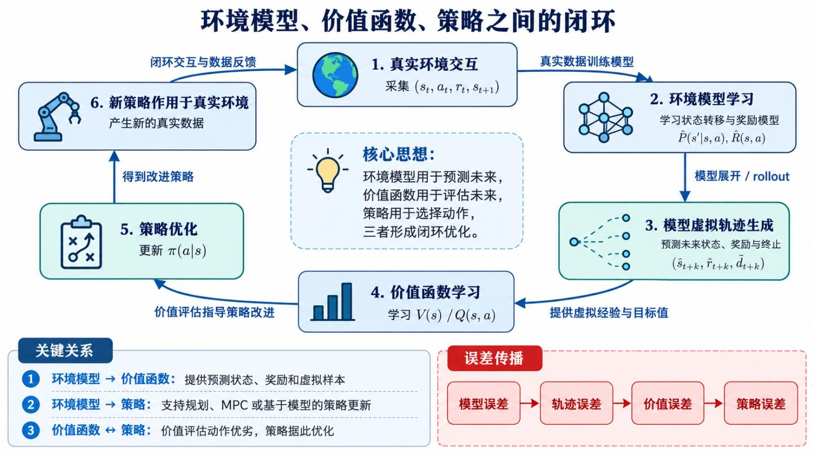

前面几篇的 Q-learning、DQN、REINFORCE、A2C 都在做同一件事：**直接从真实交互中学习价值函数或策略**，并不显式写出环境会怎样变化。这类方法统称 **Model-Free RL**。

基于模型的强化学习（Model-Based RL, MBRL）多学一个东西：环境模型。它先回答"执行动作后环境会变成什么样"，再用这个模型在内部推演未来，减少真实交互。

> Model-Free：从过去的经验学价值或策略。
> Model-Based：先学环境规律，再用模型推演未来。

## 环境模型到底是什么

MDP 是 $M=(\mathcal S,\mathcal A,P,R,\gamma)$。Model-Free 方法把 $P,R$ 当作黑箱；MBRL 则显式建模它。

| 分量 | 常见形式 | 回答的问题 |
| --- | --- | --- |
| 状态转移模型 | $P_\theta(s_{t+1}\mid s_t,a_t)$ | 在 $s_t$ 执行 $a_t$，下一状态可能是什么 |
| 奖励模型 | $R_\theta(s_t,a_t)$ 或 $R_\theta(s_t,a_t,s_{t+1})$ | 这次转移能拿到多少即时奖励 |
| 终止模型 | $P_\theta(d_t\mid s_t,a_t)$ | 这一步之后回合是否结束 |

或者同时建模下一个状态和奖励： $P_\theta(s_{t+1},r_t\mid s_t,a_t)$。

无论如何，都是在描述 $(s_t,a_t)\to(s_{t+1},r_t,d_t)$ 的分布规律。

**区分 Model-Based 与 Model-Free 的关键，不是有没有神经网络，而是是否显式建立并利用环境变化模型**。模型可以是物理动力学方程、查找表、概率转移矩阵、线性函数、决策树、神经网络，或潜在空间中的世界模型。

有了模型就能做 **model rollout**（模型推演）：

$$
s_t\to a_t\to \hat s_{t+1}\to a_{t+1}\to \hat s_{t+2}\to\cdots
$$

注意 $\hat s_{t+1}$ 上带帽子：它是模型预测，不是真实环境返回的状态。所有 MBRL 的收益和风险都来自这个区别。

## 为什么需要环境模型

基于模型强化学习最重要的优势之一就是： 提高真实环境样本效率

Model-Based 方法实际上是： 用更多内部计算换取更少真实环境交互

## 模型学习的三个视角

### 系统辨识：从输入输出数据估计动力学

控制理论里的 **System Identification**（系统辨识）假设真实系统满足

$$
x_{t+1}=f(x_t,u_t)+w_t,
$$

其中 $x_t$ 是状态，$u_t$ 是控制输入，$w_t$ 是过程噪声。若状态不能直接观测，还有测量模型

$$
y_t=h(x_t)+v_t,
$$

$v_t$ 是测量噪声。系统辨识要解决的问题是：根据输入输出数据 $(u_t,y_t)_{t=0}^T$ 估计未知动力学。

这和 MBRL 的环境模型学习高度重合，但**目标不同**：

- 系统辨识关心：模型能否准确解释和预测系统动态。
- MBRL 关心：模型能否支持正确的规划和长期决策。

### 监督学习：模型学习是 RL 系统里的一个子模块

智能体与真实环境交互后得到 transition $(s_t,a_t,r_t,s_{t+1},d_t)$。只学状态模型时，构造数据集

$$
\mathcal D=\{(s_i,a_i,s_{i+1})\}_{i=1}^N,
$$

输入 $(s_i,a_i)$、标签 $s_{i+1}$，就是标准的监督学习。若同时学奖励模型，数据变成 $(s_i,a_i,r_i,s_{i+1})$。

这意味着：**强化学习系统内部可以包含一个监督学习模块**。RL 的困难不在能不能把下一状态预测准，而在于：

> 学出来的模型，能不能在策略**不断变化**的情况下支持未来预测和决策？

**分布偏移**：模型是在行为策略 $\pi_\beta$ 采集的数据上训练的，但 rollout 时用的是当前策略 $\pi_\theta$。走到在训练数据中没见过的状态，模型预测可能会很差。即使模型在训练集上表现很好，也不保证在 **变策略** rollout 时能预测准确。

### 强化学习：模型只是中间变量

模型学习的价值不在预测本身。模型最终不是为了当状态预测器，而是为了**改善当前的长期决策**。所以评价模型好坏的标准，最终要落回策略的回报，而不是验证集上的 MSE。

## 确定性动力学：从黑箱到残差

最简单的做法是纯黑箱：

$$
s_{t+1}=f_\theta(s_t,a_t),
$$

让神经网络从数据中学到全部动力学。损失为

$$
L(\theta)=\frac1N\sum_{i=1}^N\big\|f_\theta(s_i,a_i)-s_{i+1}\big\|^2.
$$

但很多工程系统已经有大量先验知识。以无人机为例，质量、惯量、重力、基本刚体运动学、推力模型通常已知；真正难建模的只是空气动力扰动、桨叶气动耦合、电机非线性、时变载荷、地面效应、风场和参数误差。没有必要让网络把整个动力学重新学一遍。

### 残差动力学模型

- **名义模型** $f_0(s_t,a_t)$，它可能来自解析物理模型、系统辨识、低阶线性模型、经验模型或仿真器。

- **名义预测**为 $\bar s_{t+1}=f_0(s_t,a_t)$
- **模型残差**：真实状态 $s_{t+1}$ 与名义预测 $\bar s_{t+1}$ 的差值，表示 **名义动力学模型没有解释掉的那部分状态变化**

$$
\delta_t^{\mathrm{dyn}}=s_{t+1}-f_0(s_t,a_t),
$$

再训练一个参数化模型专门预测这个残差：

$$
g_\theta(s_t,a_t)=\hat{\delta}^\mathrm{dyn}\approx \delta_t^{\mathrm{dyn}},
\qquad
\hat{s}_{t+1}=f_0(s_t,a_t)+g_\theta(s_t,a_t)\approx s_{t+1}.
$$

核心思想可以概括成

$$
\text{真实动力学}=\text{已知动力学}+\text{未知残差动力学}.
$$

对每个真实样本先算 $\delta_i=s_{i+1}-f_0(s_i,a_i)$，把原始数据 $(s_i,a_i,s_{i+1})$ 转成监督数据 $(s_i,a_i,\delta_i)$，再最小化

$$
L_{\mathrm{res}}(\theta)=\frac1N\sum_{i=1}^N\big\|g_\theta(s_i,a_i)-\delta_i\big\|^2.
$$

残差通常**幅值更小、函数更简单、变化更平滑、物理意义更集中**。

一个前提：**名义模型不能太差**。如果 $f_0$ 存在严重结构错误，残差网络实际上又得学很大一部分真实动力学，残差学习的优势会明显下降。合理的要求是 $f_0$ 能描述系统的主要动力学结构。

:::tip[两种"残差"写法]

- 对下一状态做修正：$\delta_t^{\mathrm{dyn}}=s_{t+1}-f_0(s_t,a_t)$，模型写成 $s_{t+1}=f_0+g_\theta$。
- 对状态增量做修正：$\Delta s_t=s_{t+1}-s_t$，名义增量为 $\Delta s_t^0=f_0(s_t,a_t)-s_t$，残差为 $\delta_t=\Delta s_t-\Delta s_t^0$，模型写成 $s_{t+1}=s_t+\Delta s_t^0+g_\theta(s_t,a_t)$。

把第二式的 $\Delta s_t^0$ 展开，$s_t$ 抵消，得到的仍是 $s_{t+1}=f_0+g_\theta$。区别只在实现时网络学的是"绝对修正量"还是"增量修正量"，不要把它们当成两套不同的动力学。
:::

### 概率残差模型

真实残差不一定确定。可以让网络输出分布：

$$
\delta_t\sim\mathcal N\big(\mu_\theta(s_t,a_t),\Sigma_\theta(s_t,a_t)\big),
\qquad
s_{t+1}=f_0(s_t,a_t)+\delta_t.
$$

这样既预测名义偏差的均值，也表达偏差的不确定性。采样一次 $\delta_t$ 就是一条模型轨迹。

### Ensemble 残差模型

训练 $K$ 个残差模型 $g_{\theta_1},\dots,g_{\theta_K}$，分别预测 $\delta_t^{(1)},\dots,\delta_t^{(K)}$，用均值作为预测：

$$
\bar\delta_t=\frac1K\sum_{k=1}^K\delta_t^{(k)},
\qquad
s_{t+1}=f_0(s_t,a_t)+\bar\delta_t.
$$

模型之间的差异可以表示 **epistemic uncertainty**（认知不确定性）：

$$
U(s_t,a_t)=\frac1K\sum_{k=1}^K\big\|\delta_t^{(k)}-\bar\delta_t\big\|^2.
$$

$U$ 大说明这个区域的模型没见过足够数据，预测不可靠。规划时可以惩罚 $U$ 大的动作，或把它当作探索奖励。

### 在线学习

真实系统的动力学可能变化：电池电压下降、负载变化、摩擦变化、空气密度变化、机械磨损。残差模型可以在线更新：执行后拿到新数据 $(s_t,a_t,s_{t+1})$，计算新残差 $\delta_t=s_{t+1}-f_0(s_t,a_t)$，加入数据集，再做一步梯度更新

$$
\theta_{k+1}=\theta_k-\alpha\nabla_\theta L_{\mathrm{res}}.
$$

模型因此能持续适应实际系统。这也是"先验知识 + 真实数据 + 在线修正"的结构，适合机器人、无人机、飞行器等有明显物理规律的控制问题。

## 误差传播：一步准不等于长期准

设真实动力学 $s_{t+1}=f(s_t,a_t)$，学到的模型 $\hat s_{t+1}=f_\theta(\hat s_t,a_t)$（rollout 用模型自己的预测作为下一步输入）。定义状态预测误差

$$
e_t=\hat s_t-s_t.
$$

则

$$
e_{t+1}=f_\theta(\hat s_t,a_t)-f(s_t,a_t)
=\underbrace{f_\theta(\hat s_t,a_t)-f_\theta(s_t,a_t)}_{\text{旧误差继续传播}}
+\underbrace{f_\theta(s_t,a_t)-f(s_t,a_t)}_{\text{当前新产生的模型误差}}.
$$

当 $e_t$ 较小时，对 $f_\theta$ 在 $s_t$ 处做一阶 Taylor 展开：

$$
f_\theta(s_t+e_t,a_t)\approx f_\theta(s_t,a_t)+J_t e_t,
\qquad
J_t=\frac{\partial f_\theta(s,a_t)}{\partial s}\Big|_{s=s_t}.
$$

于是得到局部误差传播关系

$$
e_{t+1}\approx J_t e_t+\varepsilon_t,
\qquad
\varepsilon_t=f_\theta(s_t,a_t)-f(s_t,a_t).
$$

继续展开两步：

$$
e_{t+2}\approx J_{t+1}J_t e_t+J_{t+1}\varepsilon_t+\varepsilon_{t+1}.
$$

若短时间内近似 $J_t\approx J$，且 rollout 从真实状态开始 $e_0=0$，则 $H$ 步后

$$
e_H\approx\sum_{k=0}^{H-1}J^{H-1-k}\varepsilon_k.
$$

**长期误差不是各步误差简单相加**：越早产生的 $\varepsilon_k$ 会被后续动力学反复变换，乘上更多次 $J$。

### 用 Lipschitz 常数看长期上界

若模型关于状态满足 Lipschitz 条件

$$
\|f_\theta(s_1,a)-f_\theta(s_2,a)\|\le L\|s_1-s_2\|,
$$

且一步模型误差满足 $\|f_\theta(s,a)-f(s,a)\|\le\varepsilon$，则

$$
\|e_{t+1}\|\le L\|e_t\|+\varepsilon.
$$

从 $e_0=0$ 递推 $H$ 步：

$$
\|e_H\|\le\varepsilon\sum_{k=0}^{H-1}L^k
=
\begin{cases}
\varepsilon\dfrac{L^H-1}{L-1}, & L\neq 1,\\[2mm]
H\varepsilon, & L=1.
\end{cases}
$$

三种情形：

| $L$ | 长期误差 | 含义 |
| --- | --- | --- |
| $L<1$ | 有界 | 动力学收缩，旧误差逐渐衰减 |
| $L\approx 1$ | 近似线性增长 | 误差稳步累积 |
| $L>1$ | 指数增长 | 误差快速放大，长 rollout 不可信 |

所以**两个模型即使一步 MSE 相同，长期 rollout 性能也可能完全不同**。选择模型时真正要看的是"模型误差 × 动力学敏感性"，而不只是验证集误差。

### 从状态误差到回报误差

模型最终是为决策服务的。设奖励函数关于状态也满足 Lipschitz 条件：

$$
|r(s_1,a)-r(s_2,a)|\le L_r\|s_1-s_2\|.
$$

则第 $k$ 步的奖励误差满足

$$
|\Delta r_{t+k}|=|r(\hat s_{t+k},a_{t+k})-r(s_{t+k},a_{t+k})|
\le L_r\|e_{t+k}\|,
$$

$H$ 步累计回报误差满足

$$
|\Delta J_H|
=\Big|\sum_{k=0}^{H-1}\gamma^k\Delta r_{t+k}\Big|
\le L_r\sum_{k=0}^{H-1}\gamma^k\|e_{t+k}\|.
$$

误差传播链变成

$$
\varepsilon_t\;\to\;e_{t+k}\;\to\;\Delta r_{t+k}\;\to\;\Delta J_H.
$$

如果奖励也是学出来的 $r_\psi$，还要再加一份奖励模型自身的误差 $r_\psi(s,a)-r(s,a)$。

### 从模型误差到价值误差

固定策略 $\pi$ 时，真实价值满足

$$
V^\pi=r^\pi+\gamma P^\pi V^\pi,
$$

模型中的价值满足

$$
\hat V^\pi=\hat r^\pi+\gamma\hat P^\pi\hat V^\pi.
$$

两式相减，并在中间加上再减去 $\gamma P^\pi\hat V^\pi$：

$$
\hat V^\pi-V^\pi
=(\hat r^\pi-r^\pi)
+\gamma(\hat P^\pi-P^\pi)\hat V^\pi
+\gamma P^\pi(\hat V^\pi-V^\pi).
$$

移项得到

$$
\hat V^\pi-V^\pi
=(I-\gamma P^\pi)^{-1}\Big[(\hat r^\pi-r^\pi)+\gamma(\hat P^\pi-P^\pi)\hat V^\pi\Big].
$$

价值误差有三个来源：**奖励模型误差、状态转移模型误差，以及已有误差通过 Bellman backup 继续传播**。即使单步误差很小，$(I-\gamma P^\pi)^{-1}$ 也会把沿轨迹累积的误差放大。

### 动作选择会突然出错

规划最终要比较不同动作的 $Q$ 值。设真实最优动作 $a^*=\arg\max_a Q(s,a)$，定义最优与次优动作的真实价值间隔

$$
\Delta_Q(s)=Q(s,a^*)-\max_{a\neq a^*}Q(s,a).
$$

若 $Q$ 的预测误差满足

$$
\max_a\big|\hat Q(s,a)-Q(s,a)\big|<\frac{\Delta_Q(s)}{2},
$$

则动作排序不变，$\hat a^*=a^*$。但**误差与动作错误不是线性关系**：两个动作价值越接近，$\Delta_Q$ 越小，一点很小的模型误差就可能直接改变最终动作。动作错误是阶跃式的，不是渐进的。

### 规划器会主动放大模型误差

比误差传播更严重的是 **Model Exploitation**。规划器不是随机使用模型，而是在模型里找"最优"动作。设某条动作序列的真实回报为 $J(a_{0:H-1})$，模型预测为

$$
\hat J(a_{0:H-1})=J(a_{0:H-1})+\eta(a_{0:H-1}),
$$

规划器选择 $\hat a^*=\arg\max \hat J$。即使平均而言 $\mathbb E[\eta]=0$，被选中的序列也更容易对应 $\eta>0$ 的区域：模型低估的序列不会成为最大值，模型高估的序列更容易被选中。

:::tip[为什么平均误差为零仍然会被骗]
对每个固定动作，模型误差可以无偏；但取最大值后，误差的分布被筛选了。离散例子：真实回报 $J(a_1)=10$、$J(a_2)=9$、$J(a_3)=8$，模型预测 $\hat J(a_1)=9.8$、$\hat J(a_2)=9.1$、$\hat J(a_3)=12$。$\arg\max$ 选择 $a_3$，而 $a_3$ 是真实世界里最差的动作。这就是 **optimizer's curse**：优化操作会主动挑选并放大正误差。
:::

因此 MBRL 中的误差不是被动传播，而会经过优化器被**主动筛选和放大**。"平均预测误差小"并不能保证最优规划结果可靠。

## 模型、价值与策略的闭环

典型 MBRL 流程是一个六步闭环：

1. 收集真实数据：$(s_t,a_t,r_t,s_{t+1})$。
2. 学习环境模型：$s_{t+1}=f_\theta(s_t,a_t)$，或 $p_\theta(s_{t+1},r_t,d_t\mid s_t,a_t)$。
3. 用模型生成虚拟经验：$(s_t,a_t,\hat r_t,\hat s_{t+1})$。
4. 训练价值函数：$Q_\phi(s,a)$ 或 $V_\phi(s)$。
5. 利用价值函数优化策略：$\pi_\omega(a\mid s)$。
6. 新策略回到真实环境采样，产生新的真实数据，再重新优化模型。

这个闭环里有两类学习器，别混：

| 学习器 | 数据来源 | 学习方式 |
| --- | --- | --- |
| 环境模型 $f_\theta$ / $p_\theta$ | 真实 transition | 监督学习 |
| 价值函数 $Q_\phi$ / $V_\phi$ | 真实 + 虚拟 transition | 时序差分 / 蒙特卡洛 |
| 策略 $\pi_\omega$ | 价值函数或模型 | 策略梯度 / 规划 |

闭环也是风险来源：策略更新后会改变数据分布，模型必须跟着重新训练；模型若在某个区域不准，策略可能专门利用这个区域，下一轮数据又未必覆盖它。

### 模型在系统中的不同用法

| 模型来源 | 典型用法 | 代表方法 |
| --- | --- | --- |
| 已知解析模型 | 不学模型，直接动态规划或在线规划 | 值迭代、MPC |
| 已知名义模型 + 学习残差 | 残差修正后做规划或生成数据 | 残差动力学 + MPC/PPO |
| 从数据学习模型 | 模型生成虚拟经验，配合 model-free 更新 | Dyna-Q、MBPO |
| 从数据学习模型 | 直接在模型中优化动作序列 | PETS 等基于采样的规划 |

纯规划可以不要价值网络和策略网络；很多 MBRL 系统则是"模型 + model-free 组件"的混合体。

## 优缺点与适用边界

优点：

- **样本效率高**：真实交互少，试错主要发生在模型里。
- **能利用先验**：物理方程、仿真器、残差结构都可以直接注入。
- **可做规划**：不执行动作也能在内部比较未来。
- **能表达不确定性**：概率模型和 ensemble 可以告诉规划器"哪里不可信"。

局限：

- **模型偏差**：模型永远不等于真实环境，误差会沿 rollout 累积。
- **分布偏移**：策略改变后，模型在新状态区域可能完全不可靠。
- **Model Exploitation**：规划器主动寻找模型的高估区域，误差被优化器放大。
- **额外成本**：模型训练、rollout 和不确定性估计都要计算与内存。
- **调参复杂**：模型容量、rollout 长度、真实/虚拟数据比例都影响稳定性。

与 Model-Free 的对照：

| | Model-Free | Model-Based |
| --- | --- | --- |
| 学什么 | $V$、$Q$ 或 $\pi$ | 环境模型，通常再加 $V$、$Q$ 或 $\pi$ |
| 数据用途 | 直接更新价值或策略 | 先拟合模型，再生成虚拟经验或规划 |
| 样本效率 | 通常较低 | 通常较高 |
| 计算开销 | 较低 | 较高 |
| 主要风险 | 方差大、样本需求高 | 模型偏差、误差累积、模型被利用 |
| 典型方法 | Q-learning、DQN、REINFORCE、PPO | Dyna-Q、PETS、MBPO、Dreamer |

## 名词速查与核心公式

| 名词 | 一句话 |
| --- | --- |
| 环境模型 | $p_\theta(s_{t+1},r_t,d_t\mid s_t,a_t)$，描述环境如何变化 |
| Model rollout | 用模型自己预测的状态继续喂给模型，展开多步虚拟轨迹 |
| 系统辨识 | 从输入输出数据估计动力学，控制理论中的对应问题 |
| 残差动力学 | $s_{t+1}=f_0(s_t,a_t)+g_\theta(s_t,a_t)$，网络只学名义模型的偏差 |
| Epistemic uncertainty | 模型间分歧，表示"这个区域数据少、预测不可靠" |
| Compounding error | 多步 rollout 中误差沿动力学反复传播、放大 |
| Model Exploitation | 规划器偏好模型高估的动作，把预测误差变成决策错误 |
| Optimizer's curse | 取最大值会系统性筛选正误差，即使每个估计都无偏 |

六个核心公式：

1. $p_\theta(s_{t+1},r_t,d_t\mid s_t,a_t)$：完整环境模型。
2. $s_{t+1}=f_0(s_t,a_t)+g_\theta(s_t,a_t)$：残差动力学。
3. $L_{\mathrm{res}}(\theta)=\frac1N\sum_i\|g_\theta(s_i,a_i)-\delta_i\|^2$：残差模型的监督损失。
4. $e_{t+1}\approx J_t e_t+\varepsilon_t$：局部误差传播。
5. $\|e_H\|\le\varepsilon\frac{L^H-1}{L-1}$：Lipschitz 下的长期误差上界。
6. $\hat V^\pi-V^\pi=(I-\gamma P^\pi)^{-1}[(\hat r^\pi-r^\pi)+\gamma(\hat P^\pi-P^\pi)\hat V^\pi]$：模型误差到价值误差。

一句话：**MBRL 用监督学习拟合环境，用模型换样本；收益来自内部推演，风险来自误差累积与规划器对模型误差的主动利用。**

延伸阅读：[价值函数与贝尔曼方程](/posts/reinforcement-learning/rl_bellmanequation/)（$V^\pi=r^\pi+\gamma P^\pi V^\pi$ 的来源）、[雅可比矩阵](/posts/math/jacobianmatrix/)（$J_t$ 的定义）、[范数](/posts/math/norm/)（Lipschitz 与误差上界）、[DQN](/posts/reinforcement-learning/rl_dqn/)（模型生成的数据如何喂给 model-free 更新）。
