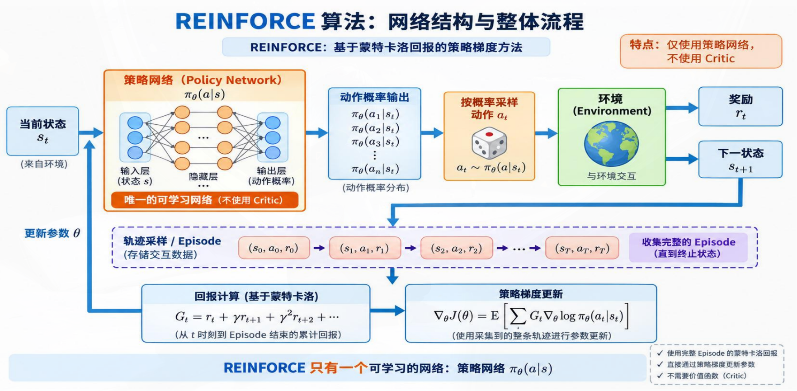

## 间接学习(value based，值函数学习)

间接学习（如DQN），先学习一个值函数 $Q(s,a)$，再通过贪心策略 $\pi(s)=\arg\max_a Q(s,a)$ 得到策略。

- 适合离散动作，但难以处理连续动作，且缺乏概率化决策。

## 直接学习(policy based，策略学习): 参数化策略（策略网络）

直接学习：直接学习一个**参数化的策略** $\pi_\theta(a|s)$，通过优化期望回报来更新参数 $\theta$。$\theta$ 是可学习的参数（如神经网络的权重）。

:::tip[回顾策略定义]

策略是状态 $s$ 到动作 $a$ 的映射，通常用概率分布表示，满足非负性和归一性：

$$
\pi(a|s)\ge 0,\quad \sum_{a\in\mathcal{A}(s)}\pi(a|s)=1
$$

- 确定性策略：状态映射到唯一动作。

- 随机策略：输出动作的概率分布（探索性更好，适合可微优化）。

:::

输出

- 离散动作：网络输出logits $Z_i$，经过一遍 softmax 输出每个动作的概率。$\pi_\theta(a_i|s)=\frac{e^{Z_i}}{\sum_j e^{Z_j}}$
- 连续动作：网络输出均值 $\mu_\theta(s)$ 和方差 $\sigma_\theta(s)$，动作从高斯分布中采样 $a\sim\mathcal{N}(\mu_\theta(s),\sigma_\theta(s))$。

## 策略学习的目标函数

目标：最大化期望累计回报

$$
\begin{aligned}
J(\theta)&=\mathbb{E}_{\tau\sim p(\tau)}[G_0]\quad&\text{目标函数}\\
\theta^*&=\arg\max_\theta J(\theta)\quad&\text{目标参数}\\
\theta &\leftarrow\theta+\alpha\nabla_\theta J(\theta)\quad&\text{梯度上升}
\end{aligned}

$$

- 轨迹 $\tau=(s_0,a_0,r_0,s_1,a_1,r_1,\dots,s_T)$ 是从初始状态开始按策略 $\pi_\theta$ 采样得到的状态-动作序列。

- $G_t$ 是从时间步 $t$ 开始的 **累计回报**。有的教材里面把整条轨迹从 $t=0$ 开始的累计回报记作 $G(\tau)$ 或 $R(\tau)$。
    $$
    R(\tau)=G(\tau)=G_0=\sum_{t=0}^{T-1}\gamma^t r_t
    $$

    注意一个小细节：$G_0$ 是整条轨迹的累计回报，$G_t$ 是从时间步 $t$ 开始的累计回报。它们之间的关系是：（后面推导策略梯度定理时会用到）

    $$
    \begin{aligned}
    G_t &=\sum_{k=t}^{T-1}\gamma^{k-t}r_k\\
    G_0 &= \underbrace{(r_0+\gamma r_1+\dots+\gamma^{t-1}r_{t-1})}_{ G_{0:t-1},\ t\text{时刻之前累计奖励}} + \gamma^t \underbrace{(r_t+\gamma r_{t+1}+\dots)}_{G_t}
    \end{aligned}

    $$

- 怎么把目标函数里的期望符号给表示出来呢？可以引入 **轨迹** $\tau$ 的 **概率分布** $p(\tau)$，它是由策略 $\pi_\theta$ 和环境的转移概率 $p(s'|s,a)$ 决定的：

    $$
    p(\tau)=\rho(s_0)\prod_{t=0}^{T-1}\pi_\theta(a_t|s_t)p(s_{t+1}|s_t,a_t)
    $$

  - $\rho(s_0)$ 是初始状态分布，
  - $\pi_\theta(a_t|s_t)$ 是策略给出的动作概率，这是唯一依赖于 $\theta$ 的部分，
  - $p(s_{t+1}|s_t,a_t)$ 是环境的转移概率(这个是环境)，属于未知量。

所以说期望就表示成了用轨迹概率 $p(\tau)$ 对累计回报 $G_0$ 的加权平均：

$$
\boxed{
J(\theta)=\mathbb{E}_{\tau\sim p(\tau)}[G_0]=\sum_\tau p(\tau)G_0}
\quad \text{目标函数（引入轨迹分布）}
$$

### 策略梯度定理

回看梯度上升式子里面的 $\nabla_\theta J(\theta)$，它是目标函数对策略 **参数** $\theta$ 的梯度。直接对 $J(\theta)$ 求导会很麻烦，因为累加符号在梯度外面，需要找到所有的轨迹求梯度并累加。于是要用**对数梯度技巧** $\nabla_x f(x)=f(x)\nabla_x\log f(x)$：

$$
\begin{aligned}
\nabla_\theta J(\theta)&=\sum_\tau \nabla_\theta p(\tau)G_0\\
&=\sum_\tau p(\tau)G_0\nabla_\theta\log p(\tau)\\
\nabla_\theta J(\theta)&=\mathbb{E}_{\tau\sim p(\tau)}[G_0\nabla_\theta\log p(\tau)]\quad\text{按概率加权等价于期望}\\
\end{aligned}
$$

进一步算对轨迹概率的梯度 $\nabla_\theta\log p(\tau)$：

$$
\begin{aligned}
\log p(\tau)&=\log \rho(s_0)+\underbrace{\sum_{t=0}^{T-1}\log \pi_\theta(a_t|s_t)}_{\text{策略部分(唯一参数相关)}}+\underbrace{\sum_{t=0}^{T-1}\log p(s_{t+1}|s_t,a_t)}_{\text{环境部分(不依赖参数)}}\\
\nabla_\theta\log p(\tau)&=\sum_{t=0}^{T-1}\nabla_\theta\log \pi_\theta(a_t|s_t)
\end{aligned}
$$

发现对轨迹概率的梯度，只和策略参数 $\theta$ 相关，所以得到**策略梯度定理**：

$$
\boxed{\nabla_\theta J(\theta)=\mathbb{E}_{\tau\sim\pi_\theta}\Big[G_0\sum_{t=0}^{T-1}\nabla_\theta\log \pi_\theta(a_t|s_t)\Big]}
$$

$$
\boxed{
\theta \leftarrow \theta + \alpha \mathbb{E}_{\tau\sim\pi_\theta}[G_0\sum_{t=0}^{T-1} \nabla_\theta\log \pi_\theta(a_t|s_t)]}
$$

### 从 $G_0$ 到 $G_t$：因果性替换

上面的定理里，每一项的权重都是**整条轨迹**的回报 $G_0$。但 $t$ 时刻的动作 $a_t$ 不可能影响它发生之前的奖励——把前面拆过的那一项代进来：

$$
G_0 = \underbrace{(r_0+\gamma r_1+\dots+\gamma^{t-1}r_{t-1})}_{G_{0:t-1}} + \gamma^t\, G_t
$$

对"过去的回报"这一项，先固定 $s_t$，只对动作 $a_t\sim\pi_\theta(\cdot|s_t)$ 取期望。$G_{0:t-1}$ 与 $a_t$ 无关，可以提到求和外面，剩下的正是归一性 $\sum_a \pi_\theta(a|s_t)=1$ 的梯度：

$$
\mathbb{E}_{a_t\sim\pi_\theta}\big[G_{0:t-1}\,\nabla_\theta\log \pi_\theta(a_t|s_t)\big]
= G_{0:t-1}\sum_{a_t} \pi_\theta(a_t|s_t)\,\nabla_\theta\log \pi_\theta(a_t|s_t)
= G_{0:t-1}\,\nabla_\theta \underbrace{\sum_{a_t}\pi_\theta(a_t|s_t)}_{=1} = 0
$$

也就是说，单步时间步 $t$ 之前 $G_{0:t-1}$ 对梯度期望的贡献 **恒为 0**，期望意义下可以把 $G_0$ 换成 $\gamma^t G_t$（$\gamma^t$ 是只跟时间步有关的常数因子，吸收进学习率即可）：

$$
\mathbb{E}\big[G_0\,\nabla_\theta\log \pi_\theta(a_t|s_t)\big]
=\mathbb{E}\big[\gamma^t G_t\,\nabla_\theta\log \pi_\theta(a_t|s_t)\big]\simeq\mathbb{E}\big[G_t\,\nabla_\theta\log \pi_\theta(a_t|s_t)\big]
$$

于是得到实践中真正使用的**因果形式**：

$$
\boxed{\nabla_\theta J(\theta)=\mathbb{E}_{\tau\sim\pi_\theta}\Big[\sum_{t=0}^{T-1}G_t\,\nabla_\theta\log \pi_\theta(a_t|s_t)\Big]}

$$

$$

\boxed{
\theta \leftarrow \theta + \alpha \mathbb{E}_{\tau\sim\pi_\theta}[\sum_{t=0}^{T-1} G_t\nabla_\theta\log \pi_\theta(a_t|s_t)]
}
$$

两个写法是**同一个梯度的两个无偏估计**，**期望相同**，但**方差不同**：

- $G_0$ 版本把和 $a_t$ 毫无关系的过去奖励也乘进权重里，纯粹给更新方向添噪声；
- $G_t$ 版本只保留 $a_t$ 能影响到的那部分回报，砍掉了无关项，方差更小。
- 这和后面 Baseline 降方差是同一个思路——凡与动作无关的加权项，期望下为零，去掉会更稳。

### 结合蒙特卡洛采样思想

求期望可以用多条轨迹的平均来近似

$$
\nabla_\theta J(\theta)\approx \frac{1}{N}\sum_{i=1}^N\sum_{t=0}^{T-1}G_t^{(i)}\nabla_\theta\log \pi_\theta(a_t^{(i)}|s_t^{(i)})
$$

### 直观理解

对于一条轨迹 $\tau=(s_0,a_0,r_0,s_1,a_1,r_1,\dots,s_T)$，在每个时间步 $t$，log是单调增函数 $\nabla_\theta\log \pi_\theta(a_t|s_t)$ 的方向就是让 $\pi_\theta(a_t|s_t)$ 增大的方向，也就是增加在 $s_t$ 状态下选择 $a_t$ 动作的概率，然后乘上从 $t$ 开始的累计回报 $G_t$，可以看作一个缩放系数，如果 $G_t$ 为正，那么这个缩放系数就是正的，这会增加 $\pi_\theta(a_t|s_t)$ 的概率，并且 $G_t$ 越大，增加的幅度越大；如果 $G_t$ 为负，那么这个缩放系数就是负的，这会减少 $\pi_\theta(a_t|s_t)$ 的概率，并且 $G_t$ 越小，减少的幅度越大。

$$
\nabla_\theta J^{(t)}(\theta) = G_t\nabla_\theta\log \pi_\theta(a_t|s_t)\\
$$

### 训练震荡的原因

1. 策略的不确定性
2. 环境提供的状态转移的不确定性
3. 奖励的不确定性
4. 长期累计效应。123都只影响单步，$G_t$ 的雷霆大求和会把全部随机性一网打尽，轨迹越长，$Var(G_t)$ 越大，训练越震荡。

### 离散动作的梯度细节

每个时间步要算的是 $\nabla_\theta \log\pi_\theta(a_t|s_t)$，完整的链是
$$
\nabla_\theta \log\pi_\theta(a_t|s_t)
=\underbrace{\frac{\partial \log\pi(a_t|s_t)}{\partial z}}_{\text{解析手算的部分（这两节）}}
\cdot
\underbrace{\frac{\partial z}{\partial \theta}}_{\text{autograd 负责的部分}}
$$

对于离散动作，策略网络输出一组实数值，称为 Logits（逻辑值）$z=(z_1,z_2,\dots,z_n)$，经过 softmax 得到每个动作的概率

$$
\pi_\theta(a_i|s)=\dfrac{\exp{(z_i)}}{\sum_j \exp{(z_j)}}
$$

取对数：

$$
\log \pi_\theta(a_i|s)=z_i-\log\sum_j \exp{(z_j)}
$$

现在我们要对网络输出的每一个 Logit $z_k$ 求梯度 $\nabla_{z_k}\log \pi_\theta(a_i|s)$，分两种情况：

1. $k=i$，即对选中的动作的 Logit 求梯度：

    $$
    \frac{\partial}{\partial z_i}\log \pi_\theta(a_i|s)=1-\pi_\theta(a_i|s)>0
    $$

2. $k\ne i$，即对未选中的动作的 Logit 求梯度：

    $$
    \frac{\partial}{\partial z_k}\log \pi_\theta(a_i|s)=-\pi_\theta(a_k|s)<0
    $$

3. 统一写法：

$$
\frac{\partial}{\partial z_k}\log \pi_\theta(a_i|s)=\mathbb1\{k=i\}-\pi_\theta(a_k|s)
$$

- 执行的动作的 Logit 的梯度是正的，未执行的动作的 Logit 的梯度是负的。也就是说，REINFORCE 会增加被执行动作的概率，减少未被执行动作的概率。

### 连续动作的梯度细节

对于连续动作，策略网络输出均值 $\mu_\theta(s)$ 和方差 $\sigma^2_\theta(s)$，动作从高斯分布中采样 $a\sim\mathcal{N}(\mu_\theta(s),\sigma_\theta(s))$。

$$
\pi_\theta(a|s)=\frac{1}{\sqrt{2\pi}\sigma_\theta(s)}\exp\Big[-\frac{(a-\mu_\theta(s))^2}{2\sigma^2_\theta(s)}\Big]
$$

取对数，并去掉对求导无影响的常数项：

$$
\log \pi_\theta(a|s) \propto -\log\sigma_\theta(s)-\frac{(a-\mu_\theta(s))^2}{2\sigma^2_\theta(s)}
$$

对 $\mu_\theta(s)$ 求梯度：

$$
\frac{\partial}{\partial \mu_\theta(s)}\log \pi_\theta(a|s)=\frac{a-\mu_\theta(s)}{\sigma^2_\theta(s)}
$$

对 $\sigma_\theta(s)$ 求梯度：这里为了防止出现负方差，用重参数化技巧 $\sigma_\theta(s)=\exp(\eta_\theta(s))$，对 $\eta_\theta(s)$ 求梯度：

$$
\frac{\partial}{\partial \eta_\theta(s)}\log \pi_\theta(a|s)=\frac{(a-\mu_\theta(s))^2}{\sigma^2_\theta(s)}-1
$$

## REINFORCE算法

:::tip[REINFORCE算法]

REINFORCE=Reward Increment = Nonnegative Factor \* Offset Reinforcement \* Characteristic Eligibility

:::

**核心思想**：

如果一次动作最终带来了较高回报，就提高以后在类似状态下选择该动作的概率；如果带来了较低回报，就降低选择该动作的概率

最经典的蒙特卡洛策略梯度算法。它直接依据 **完整轨迹** 的回报，构造策略梯度估计并更新参数。

### 算法流程

$$
\boxed{
\begin{aligned}
&\textbf{输入：}\text{episode 数 } N\text{，学习率 } \alpha\text{，折扣因子 } \gamma\\
&\text{随机初始化策略网络参数 } \theta\\
&\textbf{for episode}=1,\ldots,N\textbf{：}\\
&\quad \text{1. 按 } \pi_\theta(\cdot|s_t) \text{ 采样一条完整轨迹 } \tau=(s_0,a_0,r_1,s_1,\dots,s_T)\text{（走到终止）}\\
&\quad \text{2. 从末尾倒推累计回报，} G_T=0\text{：}\\
&\qquad\quad G_t=r_{t+1}+\gamma\,G_{t+1},\quad t=T-1,\dots,0\\
&\quad \text{3. 累加各时间步的梯度贡献（}\nabla_\theta\log\pi_\theta\text{ 由反向传播得到）：}\\
&\qquad\quad g=\sum_{t=0}^{T-1}G_t\,\nabla_\theta\log \pi_\theta(a_t|s_t)\\
&\quad \text{4. 梯度上升更新：}\theta\leftarrow\theta+\alpha\, g\\
&\textbf{end for}\\
&\textbf{输出：}\text{训练好的策略网络 } \pi_\theta
\end{aligned}
}
$$

实现上 $G_t$ 就是一个长度为 $T$ 的数组（张量），倒推那三行伪代码对应的就是原地回填：

```python
    G = np.zeros(T)
    G[T-1] = r[T-1]
    for t in range(T-2, -1, -1):
        G[t] = r[t] + gamma * G[t+1]
```

注意它是 **episode 级** 的更新：一条轨迹没走完，任何一步的 $G_t$ 都算不出来，参数也就没法动。这与 TD 方法"走一步更新一步"形成鲜明对比。

### 优缺点

**优点**：

- **Model-free**：梯度推导中环境转移概率项被消掉，不需要知道 $p(s'|s,a)$，甚至不需要可微的动力学；
- **天然支持连续动作**（高斯策略）和**固有随机策略**——这是 DQN 一类值函数方法做不到的（连续动作空间上 $\arg\max_a Q$ 本身是难点，且贪心策略是确定性的）；
- **梯度估计无偏**：$\mathbb{E}[\hat g]=\nabla_\theta J$，方向永远是对的，慢但诚实；
- **目标函数显式**：$J(\theta)$ 是良定义的期望，梯度上升的收敛性有理论保证（收敛到局部最优）；
- 实现简单、无目标网络/回放池等工程部件，轨迹间独立、天然易并行。

**缺点**：

- **方差大**：$G_t$ 把策略随机性、转移随机性、奖励随机性沿整条轨迹全部累积进来，单条轨迹的梯度估计噪声极强，训练曲线锯齿状震荡、收敛慢；
- **样本效率低**：on-policy，一条轨迹更新一次就丢弃，不能用回放池复用；
- **必须等 episode 结束**：只适用于回合制任务，对不停止的连续任务不直接适用；
- **可能早熟收敛**：softmax 策略一旦饱和成近似 one-hot（如 $[0.001, 0.998, 0.001]$），探索消失，困在局部最优；
- 对学习率 $\alpha$ 敏感——方差大意味着步长稍大就被噪声甩飞。

方差问题是 REINFORCE 最大的短板，不引入有偏误差的前提下降方差（Baseline 与优势函数），引出 Actor-Critic 架构
