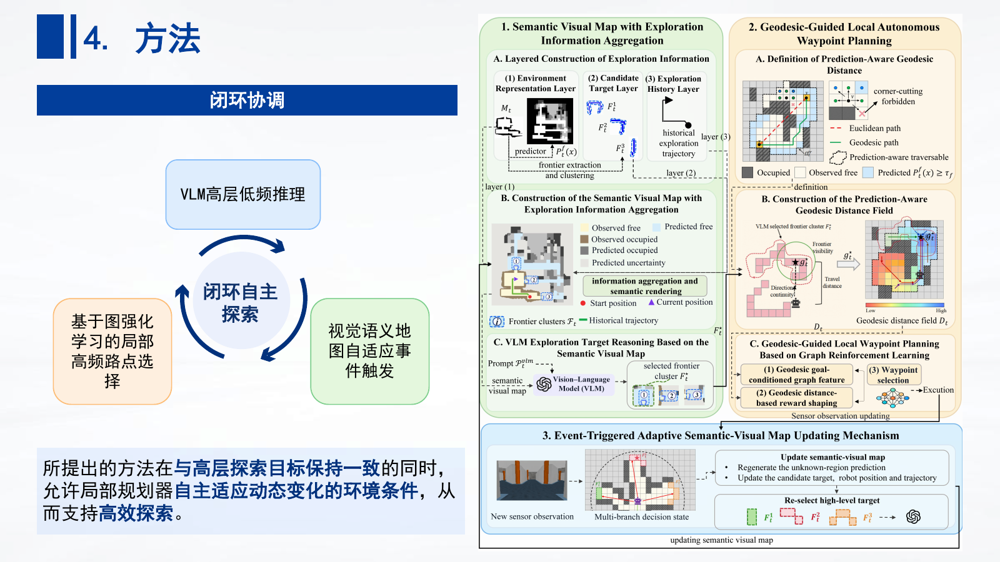

第八讲讨论一个具体问题：**单个移动机器人，在完全未知或先验极少的室内、地下空间中自主探索**。

它给出的答案不是"训练一个大模型直接输出速度"，而是一个五层分层框架：

> 环境感知与建图 → 动态图构建 → VLA 语义推理 → 图强化学习长期决策 → 路径规划与运动控制。

核心分工可以压缩成一句话：

- **VLA**：利用视觉、语言和常识，判断"哪个区域看起来值得探索"。
- **Graph RL**：综合拓扑、距离、历史、风险和长期回报，决定"下一步选哪个探索目标"。
- **规划器/控制器**：保证目标可达，把高层目标安全地执行成连续动作。

即 **Graph RL 输出"去哪"，传统规划器和控制器解决"怎么去"**。

## 整体闭环

整个系统可以写成一条闭环：

$$
o_t\to M_t\to G_t\to \text{VLA}\to \text{Graph RL}\to g_t\to \text{Planner}\to a_t\to o_{t+1}.
$$

| 符号 | 含义 |
| --- | --- |
| $o_t$ | 当前多模态观测 |
| $M_t$ | 当前构建的地图 |
| $G_t$ | 探索动态图（exploration dynamic graph） |
| $g_t$ | 选定的高层探索目标（某个 frontier 节点） |
| $a_t$ | 底层运动控制量，例如线速度与角速度 $[v_t,\omega_t]$ |

这条链的关键不是"VLA 与 GNN 简单串联"，而是建立互补关系：VLA 提供开放世界语义先验，Graph RL 用长期回报修正它，规划器负责可执行性。

## 为什么要把动作分层

如果让 VLA 直接输出连续速度，会同时遇到三个问题：

- **时间尺度不匹配**：语义推理是低频的，速度控制是高频的；一个语义判断要对应几十上百个控制步。
- **信用分配困难**：探索的收益（覆盖新区域）要很久以后才体现，直接学底层动作很难把回报归因到某一次转向。
- **安全与可解释性**：神经网络输出的速度没有可达性保证，规划器可以把"去哪"和"怎么去"解耦，路径可检查、可重规划。

所以这里把 $a_t$ 拆成两层：高层动作 $g_t$ 是离散的 frontier 选择，底层动作 $a_t$ 是连续控制。强化学习只负责高层，底层交给成熟的规划与控制。

## 建模为 POMDP

单智能体未知空间探索严格来说是一个部分可观测马尔可夫决策过程：

$$
\mathcal P=(\mathcal S,\mathcal A,\mathcal O,P,R,\Omega,\gamma),
$$

其中 $\mathcal S$ 是真实环境状态空间，$\mathcal A$ 是动作空间，$\mathcal O$ 是观测空间，$P$ 是状态转移，$R$ 是奖励，$\Omega$ 是观测模型，$\gamma$ 是折扣因子。机器人无法直接观测完整状态 $s_t$，只能得到局部多模态观测

$$
o_t=(I_t^{\mathrm{RGB}},D_t,L_t,q_t),
$$

分别是 RGB 图像、深度信息、激光雷达数据和机器人位姿/运动状态。

理论上应维护信念

$$
b_t=P(s_t\mid o_{0:t},a_{0:t}),
$$

但完整高维 belief 无法显式维护。这里用**地图 $M_t$ + 动态图 $G_t$** 构造一个结构化的 belief state，它同时包含空间、语义、拓扑和探索历史。策略写成

$$
\pi_\theta(g_t\mid G_t,o_t),
$$

其中 $g_t$ 不是"向左、向右"，而是一个高层探索目标。这既缩小了动作空间，又让长期回报的信用分配落在"选哪个区域"上。

## 感知与增量建图

机器人先用视觉—惯性、激光 SLAM 或 RGB-D SLAM 估计位姿 $q_t\in SE(3)$，再把深度或激光数据投影到全局坐标系，更新占据栅格或稠密几何地图：

$$
M_t=\mathcal U(M_{t-1},o_t,a_t).
$$

地图中的空间分为三类：

$$
M_t(c)\in\{\text{known free},\ \text{occupied},\ \text{unknown}\}.
$$

在已知自由空间与未知空间的交界处提取 **frontier**：

$$
F_t=\{f_1^t,f_2^t,\dots,f_{n_t}^t\},
$$

每个 frontier 都是一个潜在探索入口。frontier 的数量随探索变化，这也是后面动作空间会变的根源。

## 语义—拓扑探索动态图

把当前环境信息表示成动态图

$$
G_t=(V_t,E_t,X_t,E_t^f),
$$

$V_t$ 是节点集合，$E_t$ 是边集合，$X_t$ 是节点特征，$E_t^f$ 是边特征。为了同时表达机器人、拓扑、语义和未知区域，采用**异构节点**：

$$
V_t=V_t^r\cup V_t^f\cup V_t^p\cup V_t^s.
$$

| 节点类型 | 含义 | 例子 |
| --- | --- | --- |
| $V_t^r$ | 机器人节点 | 当前位姿 |
| $V_t^f$ | frontier 候选探索节点 | 未知区域入口 |
| $V_t^p$ | 已知拓扑位置节点 | 房间、走廊连接点、关键位姿 |
| $V_t^s$ | 语义对象或语义区域节点 | 门、楼梯、走廊、大厅、设备间 |

### 边与测地距离

若两个节点之间存在可通行路径，就建立边 $e_{ij}\in E_t$。边特征可定义为

$$
e_{ij}=[d_{ij}^{\mathrm{geo}},c_{ij},r_{ij},w_{ij},\chi_{ij}],
$$

分别是测地距离、路径运动代价、风险、通道宽度、语义或拓扑关系类型。

这里**必须用测地距离，而不是欧氏距离**：

$$
d_{ij}^{\mathrm{geo}}\neq \|p_i-p_j\|_2.
$$

未知环境里有墙体、狭窄通道和不可通行区域，欧氏距离很近的两点可能绕很远才能到达。测地距离是在当前可通行地图上沿路径计算的最短距离，直接决定 frontier 的"真实代价"。

### Frontier 节点特征

对每个 frontier 节点 $f_i^t$ 构造九维特征：

$$
x_i=[p_i,d_i,I_i,U_i,C_i,R_i,H_i,S_i,P_i^{\mathrm{VLA}}].
$$

| 特征 | 含义 |
| --- | --- |
| $p_i$ | frontier 的空间位置 |
| $d_i$ | 机器人到该 frontier 的测地距离 |
| $I_i$ | 预计信息增益 |
| $U_i$ | 局部环境不确定性 |
| $C_i$ | 局部可通行代价 |
| $R_i$ | 运动或碰撞风险 |
| $H_i$ | 历史访问信息 |
| $S_i$ | 语义特征 |
| $P_i^{\mathrm{VLA}}$ | VLA 对该 frontier 的高层探索优先度 |

信息增益 $I_i$ 表示"去这个 frontier 能减少多少地图不确定性"，可以用预计新增可观测面积近似：

$$
I_i\approx \Delta A_i^{\mathrm{unknown}}.
$$

这一组特征让策略不只知道"哪个 frontier 近"，还知道"哪个 frontier 新、危险、语义上更值得去"。

## VLA 提供语义先验

VLA 模型接收当前视觉观测、局部语义地图、机器人状态、frontier 集合和任务语言指令：

$$
(I_t^{\mathrm{RGB}},M_t^{\mathrm{local}},F_t,q_t,\ell),
$$

其中 $\ell$ 是任务提示，例如"尽可能快速探索整个未知建筑，并优先寻找通向新区域的空间结构"。

VLA 的输出**不直接作为最终动作**，而是产生三类信息：

1. **场景语义表示** $z_t^{\mathrm{VLA}}$：当前场景的高层语义编码。
2. **每个 frontier 的语义描述或 embedding** $z_i^{\mathrm{VLA}}$：这个入口看起来像什么。
3. **探索动作先验** $P^{\mathrm{VLA}}(g_t=v_i\mid o_t,G_t,q)$：VLA 认为哪个 frontier 更值得去。

例如 VLA 可能根据视觉和常识推断："该 frontier 位于走廊尽端，可能通向新的房间"，或者"该区域看起来像已经探索过的小型储物间，继续进入的潜在收益较低"。

把 VLA embedding 注入 frontier 节点后，图状态从纯几何拓扑变成：

> 几何 + 拓扑 + 语义 + 探索历史 + VLA 先验。

VLA 的作用本质上是给图强化学习增加一种基于语义和开放世界知识的**长期先验**，解决冷启动和常识问题；它不负责精确的长期回报优化。

## Graph Actor：融合 RL 得分与 VLA 先验

Actor 对每个 frontier 计算强化学习得分

$$
z_i^{\mathrm{RL}}=f_\theta(h_i,h_G),
$$

其中 $h_i$ 是 frontier 节点嵌入，$h_G$ 是全局图嵌入。VLA 同时给出先验 $p_i^{\mathrm{VLA}}$，一种简单有效的融合方式是

$$
z_i=z_i^{\mathrm{RL}}+\lambda\log\big(p_i^{\mathrm{VLA}}+\varepsilon\big),
$$

再在当前 frontier 集合 $F_t$ 上做 softmax：

$$
\pi_\theta(g_t=v_i\mid G_t,o_t)
=\frac{\exp(z_i)}{\sum_{j\in F_t}\exp(z_j)}.
$$

这表示最终决策既不完全由 VLA 决定，也不完全由 RL 决定，而是**长期学习得到的探索价值 + VLA 给出的语义先验**共同决定。$\lambda$ 控制先验强度，$\varepsilon$ 防止对零概率取对数。

注意动作空间是**当前 frontier 集合**，$|F_t|$ 随探索变化，所以这是一个动作空间随状态变化的强化学习问题。

## Graph Critic：学习长期探索价值

Critic 输入全局图状态，输出

$$
V_\varphi(h_G),
$$

含义是："在当前已经探索到的图结构下，从现在开始还能获得多少未来探索收益。"

对 transition $(G_t,g_t,r_t,G_{t+1})$，TD 误差为

$$
\delta_t=r_t+\gamma V_\varphi(h_{G_{t+1}})-V_\varphi(h_{G_t}),
$$

Critic 损失为 $\frac12\delta_t^2$ 或 mini-batch 上的均方误差。若使用 GAE：

$$
\hat A_t^{\mathrm{GAE}(\gamma,\lambda)}
=\sum_{l=0}^{T-t-1}(\gamma\lambda)^l\delta_{t+l}.
$$

Actor 用优势 $\hat A_t$ 更新。和普通 Actor-Critic 的区别只在状态表示：这里的"状态"是整张动态图的嵌入，而不是一个向量。

## PPO 与 VLA 一致性约束

为了保证策略更新稳定，Graph Actor 用 PPO 训练。令

$$
\rho_t(\theta)=\frac{\pi_\theta(g_t\mid G_t)}{\pi_{\theta_{\mathrm{old}}}(g_t\mid G_t)},
$$

PPO-Clip 目标为

$$
L^{\mathrm{PPO}}(\theta)
=\mathbb E_t\Big[\min\big(\rho_t\hat A_t,\ \mathrm{clip}(\rho_t,1-\epsilon,1+\epsilon)\hat A_t\big)\Big].
$$

实际目标还会加入熵正则和 Critic 损失：

$$
L^{\mathrm{actor}}+c_vL^{\mathrm{critic}}.
$$

为了让 Graph RL 在训练初期充分利用 VLA 知识，再加一个策略蒸馏项：

$$
L^{\mathrm{VLA}}=D_{\mathrm{KL}}\big(p^{\mathrm{VLA}}\,\|\,\pi_\theta\big),
$$

总目标变成

$$
L=L^{\mathrm{actor}}+c_vL^{\mathrm{critic}}+\lambda_kL^{\mathrm{VLA}}.
$$

但 $\lambda_k$ 不宜一直很大，常用退火：

$$
\lambda_k=\lambda_0e^{-\kappa k},
$$

$k$ 是训练迭代次数。训练初期更多利用 VLA 先验，训练后期更多根据真实长期回报修正甚至超越 VLA 的启发式判断。

> 这一步是"大模型 + RL"的核心设计：先用先验解决冷启动，再用回报把先验纠正过来。

## 探索奖励设计

奖励决定策略行为。一个典型的组合是

$$
r_t=w_Dr_t^{\mathrm{dist}}+w_Rr_t^{\mathrm{repeat}}+w_Kr_t^{\mathrm{risk}}.
$$

| 项 | 含义 |
| --- | --- |
| $r_t^{\mathrm{dist}}$ | 新增覆盖距离 / 新探索面积，鼓励推进边界 |
| $r_t^{\mathrm{repeat}}$ | 重复访问惩罚，抑制来回绕圈 |
| $r_t^{\mathrm{risk}}$ | 碰撞风险与地形风险惩罚，例如 $P_t^{\mathrm{collision}}+\eta_rR_t^{\mathrm{terrain}}$ |

此外，发现新的门、房间入口、走廊分支、功能区域都可以产生额外奖励。这些事件往往意味着"后面还有大片未知空间"，比单纯走距离更有探索价值。

奖励设计要避免两个极端：只给稀疏的"探索完成"奖励会让学习极慢；给过强的密集奖励则会让策略刷奖励而不是探索，例如反复触发同一个"发现入口"事件。

## 路径规划与底层执行

Graph RL 选定目标

$$
g_t=v_i^*,
$$

然后在当前可通行地图上求机器人当前位置 $q_t$ 到目标 $p_i$ 的路径：

$$
P^*=\arg\min_{P\in\mathcal P}\sum_{e\in P}c(e),
\qquad
c(e)=d(e)+\lambda_r r(e)+\lambda_c c_{\mathrm{clearance}}(e).
$$

代价同时考虑距离、风险与离障碍物的间隙。规划器可用 A*、D* Lite 或其他全局—局部规划器；局部控制器再把路径转成连续动作 $[v_t,\omega_t]$。

这层解耦带来两个好处：

- **安全性**：路径可行性由规划器保证，而不是靠神经网络"学会不撞"。
- **可解释性**：高层说去哪、底层怎么去，出问题可以分层排查。

## 动态图更新与事件触发

机器人运动一段距离或到达当前目标后获得新观测 $o_{t+1}$，更新地图

$$
M_{t+1}=\mathcal U(M_t,o_{t+1}),
$$

重新提取 frontier：删除已经被探索的节点，加入新发现的节点，更新边与特征。最终

$$
G_t\to G_{t+1},
\qquad
|V_t|\neq |V_{t+1}|.
$$

这是典型的**动态图强化学习**问题：

- 节点数随时间变化，动作空间随状态变化。
- 训练分布与执行分布不一致：策略在训练地图上见过大量 frontier，部署时可能只有两三个。
- 图结构变化后，旧的 $Q$ 值或价值估计不再对应同一个状态。

课程后段的论文案例把这条闭环落成一个"VLM 高层低频推理 + 图 RL 局部高频路点选择 + 事件触发的视觉语义地图更新"的系统，并给出三个组件：

### 视觉语义地图

直接把原始地图丢给 VLM 有表示鸿沟：自主探索常用的栅格/点云地图没有颜色和纹理，不是 VLM 擅长的图像形式。论文先把探索信息分成三层：

- **环境表示层**：已知/占用/未知栅格与未知区域预测结构；
- **候选目标层**：frontier 簇与候选探索目标；
- **探索历史层**：机器人轨迹与已访问区域。

三层聚合成一张**视觉语义地图**，再用确定性视觉渲染算子转成 VLM 可读的图像：

$$
S_t=(L_t^E,L_t^C,L_t^H),
\qquad
I_t^{\mathrm{sem}}=\mathcal R(S_t;\ell).
$$

VLM 在语义地图上推理，选出最有价值的 frontier 簇。这样做既保留了细粒度空间细节，又让输入形式符合 VLM 的视觉预训练分布。

### 预测感知测地距离场

普通测地距离只在**已知**可通行区域上计算；预测感知测地距离场会先把未知区域的预测结构补进来，再计算从每个栅格到探索目标的距离。这样距离更接近真值地图下的实际通行距离，而不是绕开所有未知区域的高估距离。

它被同时用于图节点特征和奖励塑形，给局部路点选择提供稠密的目标引导。

### 事件触发的高层重选

高层 VLM 推理是低频且昂贵的，不需要每步都跑。定义机器人周围局部半径内的局部决策邻域 $\mathcal B_t$。如果至少 $k_{\mathrm{branch}}$ 个 frontier 簇同时出现在 $\mathcal B_t$ 中：

$$
\#\{i:\ F_i^{\mathrm{cluster}}\cap\mathcal B_t\neq\varnothing\}\ge k_{\mathrm{branch}},
$$

就认为机器人处于**局部多分支决策状态**，触发高层重选：更新视觉语义地图、重新生成未知区域预测结构、更新候选目标，再让 VLM 重新给出高层目标。

消融实验的结论很直接：视觉语义地图优于抽象拓扑图（保留细粒度空间细节）；预测感知测地距离场优于欧式距离场（理解空间连通性）；事件触发优于固定间隔更新（把高层推理集中在真正需要重选的时刻）。例外是分支很少的隧道场景：抽象拓扑图已经能较准确刻画结构，两种表示的差距最小。

## 训练流程

| 阶段 | 做什么 | 目的 |
| --- | --- | --- |
| 一 | 冻结预训练 VLA，只取 $z_i^{\mathrm{VLA}}$ | 降低训练计算量，避免破坏大模型能力 |
| 二 | 用 VLA 先验或传统 frontier 专家产生示范，做行为克隆 | 给 Graph Policy 一个合理初始策略，缓解冷启动 |
| 三 | 在大量随机地图中用 Graph PPO 训练 | 用长期回报优化目标选择 |
| 四 | 随机化地图尺寸、房间数、走廊宽度、门位置、障碍物、光照、纹理、语义布局 | 让训练分布覆盖多种未知环境，提升泛化 |

行为克隆的损失就是标准的监督学习：

$$
L^{\mathrm{BC}}(\theta)
=-\mathbb E\big[\log\pi_\theta(g_t^{\mathrm{expert}}\mid G_t)\big].
$$

这个四阶段流程对应一个通用原则：**大模型负责先验，RL 负责长期回报，模仿学习负责把两者接起来。**

## 大模型 × 强化学习的通用设计模板

复习要点 14 问的是"一个任务如何同时设计大模型与强化学习"。第八讲给出的框架可以抽象成六步：

1. **问题建模**：写成 POMDP，明确状态、观测、动作、奖励；把大模型能影响的部分定义为高层离散动作（目标、路点、指令），底层连续控制交给规划器/控制器。
2. **动作空间**：大模型不直接输出电机指令；高层动作是"选哪个目标"，底层动作是速度或轨迹。
3. **状态表示**：把原始观测整理成大模型和 RL 都能用的结构化表示，例如地图 + 动态异构图 + 节点特征；大模型 embedding 作为额外特征注入。
4. **大模型的角色**（三选一或组合）：
   - **表征**：把图像/语言编码成状态特征；
   - **先验/教师**：给出动作先验，用 logits 融合或 KL 蒸馏；
   - **奖励设计者**：把偏好或常识转成奖励信号。
5. **强化学习的角色**：用 PPO、SAC 等优化长期回报；说明为什么不能只靠大模型——大模型缺长期信用分配、容易分布偏移、输出不保证安全。
6. **训练与稳定性**：冻结大模型、行为克隆暖启动、KL 一致性约束并退火、随机环境泛化、按任务指标评估。

一句话：**大模型提供"看起来该往哪走"的语义先验，强化学习提供"哪个选择真的让最终覆盖率高"的长期优化，两者用一致性约束和退火系数绑定在一起。**

顺带区分两条常见路线：

| | 大模型作为策略（RLHF） | 大模型作为先验（VLA + Graph RL） |
| --- | --- | --- |
| RL 优化的对象 | 大模型本身的输出 | 图上的高层目标选择策略 |
| 大模型是否更新 | 通常做 PPO/DPO 微调 | 冻结，只提供 embedding 与先验 |
| 奖励来源 | 人类偏好训练的奖励模型 | 环境探索奖励（覆盖、重复、风险） |
| 典型问题 | 对齐、有用性、安全性 | 未知空间探索、长时程规划 |

RLHF 的细节见 [PPO：从策略梯度到 RLHF 的核心优化器](/posts/reinforcement-learning/ppo/) 与 [RLHF 与 PPO](/posts/nlp/09-01-rlhf-ppo/)；这里的重点不是对齐，而是把 VLA 当作图 RL 的语义教师。

## 名词速查与核心公式

| 名词 | 一句话 |
| --- | --- |
| POMDP | 状态不可完全观测的 MDP，用观测模型 $\Omega$ 和信念 $b_t$ 代替真实状态 |
| Frontier | 已知自由空间与未知空间的交界，潜在探索入口 |
| 动态异构图 | 节点类型与数量随探索变化的图，承载机器人、frontier、拓扑、语义信息 |
| 测地距离 | 在可通行地图上沿路径计算的距离，不是欧氏直线距离 |
| VLA 先验 | $P^{\mathrm{VLA}}(g_t=v_i\mid o_t,G_t,q)$，大模型对 frontier 探索价值的判断 |
| Graph Actor | 在图嵌入上给每个 frontier 打分并输出 softmax 策略 |
| Graph Critic | 用全局图嵌入估计长期探索价值 |
| KL 蒸馏退火 | $\lambda_k=\lambda_0e^{-\kappa k}$，先靠 VLA 先验，后靠真实回报 |
| 事件触发重选 | 局部出现多个分支时，才调用高层 VLM 重新决策 |

六个核心公式：

1. $o_t\to M_t\to G_t\to \text{VLA}\to \text{Graph RL}\to g_t\to \text{Planner}\to a_t\to o_{t+1}$
2. $G_t=(V_t,E_t,X_t,E_t^f)$，$V_t=V_t^r\cup V_t^f\cup V_t^p\cup V_t^s$
3. $x_i=[p_i,d_i,I_i,U_i,C_i,R_i,H_i,S_i,P_i^{\mathrm{VLA}}]$
4. $z_i=z_i^{\mathrm{RL}}+\lambda\log(p_i^{\mathrm{VLA}}+\varepsilon)$，再对 $F_t$ 做 softmax
5. $L=L^{\mathrm{actor}}+c_vL^{\mathrm{critic}}+\lambda_kD_{\mathrm{KL}}(p^{\mathrm{VLA}}\|\pi_\theta)$
6. $c(e)=d(e)+\lambda_rr(e)+\lambda_cc_{\mathrm{clearance}}(e)$

一句话：**VLA 负责"哪里值得去"，Graph RL 负责"哪个选择长期回报最高"，规划器负责"怎么安全到达"；三者用动态图和一致性约束组成一个闭环。**

延伸阅读：[PPO](/posts/reinforcement-learning/ppo/)（Clip 与 KL 约束）、[GRPO](/posts/reinforcement-learning/grpo/)（另一条降低 Critic 开销的路线）、[GCN](/posts/gcn/gcn/)（图节点嵌入的基础）、[信息论](/posts/dl-basics/informationtheory/)（信息增益）、[KL 散度与交叉熵](/posts/dl-basics/kldivergenceandcrossentropy/)（蒸馏项）。
