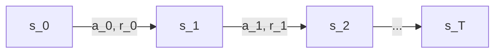
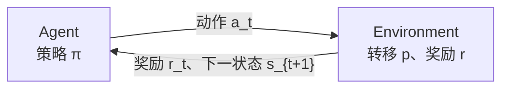
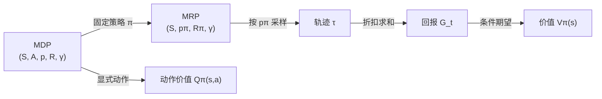

采用**动作时刻**记法：在 $S_t$ 执行动作 $A_t$ 后**立刻**得到的奖励记为 $R_t$。部分教材把它记为 $R_{t+1}$，只是整体下标平移，本系列保持 $R_t$ 不变。

| 记号 | 含义 |
| --- | --- |
| $S_t,\ A_t,\ R_t,\ S_{t+1}$ | $t$ 时刻的状态、动作、即时奖励与下一状态 |
| $\mathcal S,\ \mathcal A,\ \mathcal R$ | 状态空间、动作空间、奖励取值集合 |
| 大写 / 小写 | 随机变量 / 随机变量的具体取值，如 $s,a,r,s'$ |

## 强化学习基本组成

### Agent

- **定义**：在环境中感知状态、选择动作，并通过交互改进策略的学习主体。例如机器人、棋手、对话模型。
- **目标**：通过交互找到一个策略，使期望回报最大（$J(\pi)$ 的定义见「Return」）。
- 策略、价值函数这些"属于智能体"的量会随学习改变。

### Environment

- **定义**：智能体之外、决定状态如何转移与奖励如何产生的全部规律。
- 环境规律不随智能体的学习而改变。
- 例：房间的物理规律、棋盘规则、用户与评分器。

### State

- **定义**：智能体做决策所依据的当前信息，$S_t\in\mathcal S$。
- 一个合格的状态应满足**马尔可夫性**：它已汇总预测未来所需的全部历史（严格定义见「马尔可夫性」）。
- 状态不等于观测：机器人只记录位置、不记录速度时，位置不足以预测下一步，需要补上速度或历史。
- 可以是离散的（棋盘落子）、连续的（关节角度与速度），也可以是多模态的（图像 + 传感器读数）。

### Action

- **定义**：智能体在某个状态下可以执行的操作，$A_t\in\mathcal A$。
- **可行动作集**：$\mathcal A(s)\subseteq\mathcal A$，即状态 $s$ 下允许的动作；策略的定义域是 $\mathcal A(s)$。
- 例：离散动作（棋盘落子、游戏按键）、连续动作（关节力矩、方向盘转角）。

### Reward

- **定义**：执行动作后，环境返回的标量反馈 $R_t\in\mathcal R$。
- 奖励是**随机变量**：对同一个 $(s,a)$，环境每次可能给出不同的 $r$。它的条件期望才是**奖励函数** $\bar r(s,a)$（见「奖励函数」）。
- 奖励的含义由任务设计决定，没有脱离任务的绝对大小；只在回合末尾给奖励的任务称为**稀疏奖励**（如围棋的胜负）。

### Policy

- **定义**：

$$
\pi(a\mid s)=P(A_t=a\mid S_t=s),\qquad
\pi(a\mid s)\ge 0,\quad \sum_{a\in\mathcal A(s)}\pi(a\mid s)=1.
$$

| 说法 | 含义 |
| --- | --- |
| 随机策略 | 给定 $s$ 输出动作分布 $\pi(\cdot\mid s)$，同一状态可采样出不同动作 |
| 确定性策略 | 给定 $s$ 输出唯一动作；选中动作概率为 $1$，是随机策略的退化情形 |
| 固定（平稳）策略 | 动作分布不随时间或访问次数改变；被动强化学习评价的就是这样的策略 |

前两行按动作选择方式区分，第三行按是否随时间变化区分——这是两个不同的分类维度。

## 强化学习数学模型

基本组成回答"有哪些东西"，数学模型回答"一步交互如何用概率描述"。核心是把奖励与下一状态写成条件分布。

### 马尔可夫性

- **历史**：$H_t=(S_0,A_0,R_0,S_1,\ldots,A_{t-1},R_{t-1},S_t)$。
- **定义**：给定当前状态与动作后，下一步的奖励和状态与更早历史无关：

$$
p(r_t,s_{t+1}\mid H_t,A_t=a)=p(r_t,s_{t+1}\mid S_t=s,A_t=a).
$$

- **含义**：当前状态已是预测未来的充分统计量，不必保存完整历史。
- 若某个观测不满足此式，就需要把它扩展成充分状态，或改用 POMDP。

### MDP

满足马尔可夫性的决策问题建模为五元组：

$$
M=(\mathcal S,\mathcal A,p,R,\gamma),
$$

| 元素 | 含义 |
| --- | --- |
| $\mathcal S$ | 状态空间 |
| $\mathcal A$ | 动作空间 |
| $p(s'\mid s,a)$ | 状态转移概率 |
| $R(s,a) \text{或}R(s,a,s')$ | 奖励函数（即时奖励） |
| $\gamma$ | 折扣因子 |

- 策略 $\pi$ 不属于五元组：同一个 MDP 配不同策略，会得到不同轨迹与价值。
- MDP 上的价值函数、最优性条件与贝尔曼方程见 [价值函数与贝尔曼方程](/posts/reinforcement-learning/rl_bellmanequation/)。

### MRP

把动作从描述中消去，就得到马尔可夫奖励过程，四元组：

$$
M_\pi=(\mathcal S,p_\pi,R_\pi,\gamma),
$$

其中策略诱导的转移与平均奖励为

$$
p_\pi(s'\mid s)=\sum_{a}\pi(a\mid s)\,p(s'\mid s,a),
\qquad
R_\pi(s)=\sum_{a}\pi(a\mid s)\,R(s,a).
$$

- 固定策略后，轨迹分布完全由初始分布与 $p_\pi$ 决定。
- MRP 的价值函数为 $V^\pi(s)$。

### 状态转移概率

- **定义**（动作条件）：

$$
p(s'\mid s,a)=P(S_{t+1}=s'\mid S_t=s,A_t=a),\qquad
\sum_{s'\in\mathcal S}p(s'\mid s,a)=1.
$$

- **矩阵形式**：固定动作 $a$，把 $p(s_j\mid s_i,a)$ 排成矩阵 $P_a$，则 $P_a$ 的每一行和为 $1$。
- 它描述的是环境，与策略无关；策略固定后的转移概率 $p_\pi$ 见「MRP」。

### 奖励概率和奖励函数

- **奖励分布**：$p(r\mid s,a)=P(R_t=r\mid S_t=s,A_t=a)$。
- **奖励函数**：条件期望

$$
\begin{aligned}
  R(s,a)&=\mathbb E[R_t\mid S_t=s,A_t=a]\\
&=\sum_r r\cdot\,p(r\mid s,a).
\end{aligned}

$$

- 带动作 $a$ 的 $p(r\mid s,a)$、$R(s,a)$ 是**环境量**，与策略无关。
- 奖励写成确定性的 $R(s,a,s')$
  $$
  R(s,a)=\sum_{s'}p(s'\mid s,a)R(s,a,s')
  $$
- 最一般地，奖励与下一状态 $s'$ 可能相关，应使用联合分布 $p(r\mid s,a,s')$ 而非 $p(r\mid s,a)$；由于 $s'$ 是由 $s,a$ 决定的，所以
  $$
  p(r\mid s,a,s')=\sum_{s'}p(r\mid s,a,s')\,p(s'\mid s,a)
  $$

### 折扣因子

- **定义**：通常 $0\le\gamma<1$，把 $k$ 步之后的奖励按 $\gamma^k$ 加权；$\gamma=1$ 只适用于有限时域或平均奖励等特殊设定。
- **三个作用**：
  1. 表达对远期收益的重视程度，$\gamma$ 越大越重视长期；
  2. 奖励有界时保证无限时域回报收敛；
  3. 控制远期奖励对当前决策的影响。
- **两个极端**：

| 取值 | 含义 |
| --- | --- |
| $\gamma=0$ | 完全近视，只看即时奖励 |
| $\gamma\to1$ | 各期奖励近似等权；无限时域下需要额外条件（奖励有界、平均奖励）才收敛 |

- 例：$\gamma=0.99$ 时，$0.99^{1000}\approx4.3\times10^{-5}$，千步之后的奖励已可忽略。

## 时间与奖励概念

### Episode 与 Horizon

- **回合（episode）**：从初始状态出发，到终止状态结束的一次完整交互。
- **范围（horizon）$T$**：回合的长度。有限时域到 $T$ 结束；无限时域没有自然终点。
- 回合制任务（棋局、迷宫）与持续任务（机器人持续运行）：持续任务可设最大步数，或研究无限时域折扣问题。

### Trajectory

- **定义**：一次完整交互产生的状态—动作—奖励序列

$$
\tau=(s_0,a_0,r_0,s_1,a_1,r_1,\ldots,s_{T-1},a_{T-1},r_{T-1},s_T).
$$

- **轨迹概率**：由初始分布、策略与环境转移共同决定

$$
p(\tau)=p_0(s_0)\prod_{t=0}^{T-1}\pi(a_t\mid s_t)\,p(s_{t+1},r_t\mid s_t,a_t).
$$

- 轨迹是随机变量：同一策略、同一环境可以产生多条不同轨迹。

### Return

- **定义**：从 $t$ 开始到回合结束的折扣奖励之和

$$
G_t=R_t+\gamma R_{t+1}+\gamma^2R_{t+2}+\cdots
=\sum_{k=0}^{T-t-1}\gamma^k R_{t+k}
$$

- **递推**（bootstrapping）：

$$
\boxed{\,G_t=R_t+\gamma G_{t+1}\,}
$$

- **优化目标**：

$$
J(\pi)=\mathbb E_\pi[G_0],\qquad
\pi^*\in\arg\max_\pi J(\pi).
$$

- 值函数是回报的条件期望：$V^\pi(s)=\mathbb E_\pi[G_t\mid S_t=s]$。

### Terminal State

- **终止状态** $s_T$：回合在此结束，之后不再产生动作与奖励，约定 $G_T=0$。
- **终止与截断不同**：

| 概念 | 含义 | 对自举的影响 |
| --- | --- | --- |
| 终止（termination） | 任务真正结束，未来价值为 0 | TD 目标取 $R_t$，不再加 $\gamma V(S_{t+1})$ |
| 截断（truncation） | 外部步数或时间上限，任务本身未结束 | 未来价值仍存在，自举时不能当作终止 |

- 若任务没有自然终止状态，就是无限时域问题；奖励有界且 $\gamma<1$ 时回报仍有限。

## 概念之间的关系

### Agent 与 Environment 的交互

一步的顺序固定：**先由策略选动作，再由环境给后果**。把转移元组 $(S_t,A_t,R_t,S_{t+1})$ 写成联合分布：

$$
p(a,r,s'\mid s)=\underbrace{\pi(a\mid s)}_{\text{智能体选动作}}\cdot
\underbrace{p(r,s'\mid s,a)}_{\text{环境给奖励与下一状态}}.
$$

- 一条样本就是这个乘积的一次采样：先按 $\pi$ 抽 $A_t$，再按 $p$ 抽 $(R_t,S_{t+1})$。
- 两个不确定性相乘：策略的随机性 × 环境的随机性。
- 奖励横跨两者：它由环境产生，但采到哪个奖励由策略选择的动作决定。

### MDP 与 MRP 的关系

- MDP 显式包含动作，是"智能体还能选择"的模型；MRP 不含动作，是"不显式包含动作选择"的模型。
- 固定策略 $\pi$ 后，对动作边缘化，MDP 退化为 MRP：

$$
M=(\mathcal S,\mathcal A,p,\bar r,\gamma)
\;\xrightarrow{\ \pi\ }\;
M_\pi=(\mathcal S,p_\pi,\bar r_\pi,\gamma).
$$

- 价值函数的定义域随之缩小：MDP 上可定义 $V^\pi(s)$ 与 $Q^\pi(s,a)$；MRP 上只剩 $V^\pi(s)$。
- 反过来，仅凭 MRP 无法恢复原 MDP 的动作结构与 $p(s'\mid s,a)$。

### Policy 在 MDP 与 MRP 之间的作用

固定策略通过**边缘化**把 MDP 压成 MRP：它把动作变量按概率加权求和掉，$p_\pi,\bar r_\pi$ 的定义见「MRP」。

- 环境量 $p,\bar r$ 始终不变；策略改变通常会改变诱导量 $p_\pi,\bar r_\pi$，进而改变 MRP 与 $V^\pi$。
- 把诱导转移代回贝尔曼方程，得到 MDP 上的策略评价式：

$$
V^\pi(s)=\sum_a\pi(a\mid s)\Big[\bar r(s,a)+\gamma\sum_{s'}p(s'\mid s,a)V^\pi(s')\Big].
$$

- 由此有两条学习路线：
  - **值函数方法**：先学 $Q^\pi$，再由 $\arg\max_a Q$ 导出策略，见 [DQN](/posts/reinforcement-learning/rl_dqn/)；
  - **策略梯度方法**：直接参数化 $\pi_\theta(a\mid s)$，对 $J(\theta)$ 求梯度，见 [REINFORCE](/posts/reinforcement-learning/rl_policylearning/) 与 [PPO](/posts/reinforcement-learning/ppo/)。

### 即时奖励与累计回报

| 对比项 | 即时奖励 $R_t$ | 累计回报 $G_t$ |
| --- | --- | --- |
| 定义 | 执行 $A_t$ 后立刻得到的标量反馈 | 从 $t$ 起直到回合结束的折扣奖励之和 |
| 时间范围 | 单步 | 多步 / 整条后续轨迹 |
| 随机性来源 | 环境噪声、随机下一状态 | 策略、转移、奖励的随机性沿轨迹累积 |
| 与策略的关系 | 由环境产生；采到哪个受策略选择的动作影响 | 整条后续轨迹共同决定 |
| 期望 | 条件期望是奖励函数 $\bar r(s,a)$ | $\mathbb E_\pi[G_t\mid S_t=s]=V^\pi(s)$ |
| 用途 | 构成回报的原子项 | 定义价值函数与优化目标 $J(\pi)$ |

- 奖励是"一步的分数"，回报是"从这一步开始的折扣总分"；强化学习优化的是回报的期望，而不是某一步的奖励。
- 奖励大不代表回报大：一步高奖励之后可能接着长期惩罚，反之亦然。

### 关系总览

从 MDP 到价值：固定策略得到 MRP，按 MRP 采样出轨迹，轨迹上的折扣和是回报，回报的条件期望是价值。这条链就是后续贝尔曼方程、蒙特卡洛、TD 与策略梯度的共同起点。
