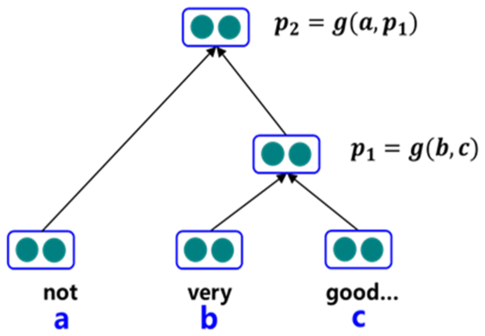
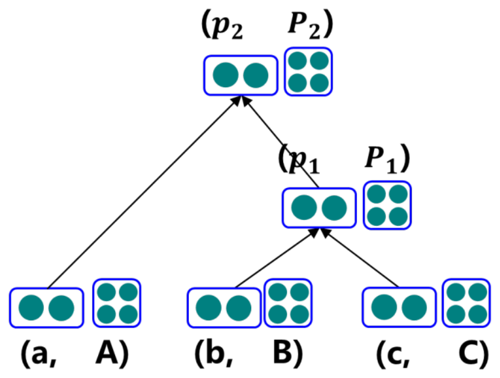

## 树：语义的组合性

"not very good" 的情感不能由三个词的情感相加得到：good 是正向的，very 放大 good 的强度，not 再把整个短语的极性翻转。词袋模型把句子视为无序词的集合，无法表达这种成分之间的组合；链式循环网络按顺序读入，能利用词序，但把历史压缩进一个隐状态，并没有显式区分"哪两段先结合成一个成分"。

**句法结构**提供了另一种建模方式：句子可以表示成一棵成分树，每个内部节点对应一个短语，短语的意义由它的两个子成分组合而成。

**递归神经网络**（Recursive Neural Network）把这一自底向上的过程直接写进网络：叶节点是词向量，每个父节点的表示由两个子节点的表示经同一个组合函数算出，一直算到根节点就得到整句表示。

中文里**循环神经网络**（Recurrent Neural Network）与**递归神经网络**（Recursive Neural Network）都常简称 RNN，但两者结构不同：

- 循环网络沿时间步展开成链，参数在各时间步共享，用于任意长度的序列；
- 递归网络沿句法树展开，同一个组合函数在树的所有内部节点共享，建模的是成分如何组合。

沿着情感分类这条任务线，本文介绍三种组合函数：标准递归网络（Socher et al., EMNLP 2011）、MV-RNN（Socher et al., EMNLP-CoNLL 2012）与 RNTN（Socher et al., EMNLP 2013）。

## 任务与数据

### 短语级情感分类

给定一个短语或句子，判断它的情感极性。Stanford Sentiment Treebank 使用 5 类标注：0 到 4 依次为 very negative、negative、neutral、positive、very positive；句子级也可以合并成正、负两类做二分类。

### Stanford 情感树库

Stanford Sentiment Treebank（SST）的数据来自 Pang 和 Lee（2005）发布的电影评论语料（rottentomatoes.com）。构造过程分两步：先用 Stanford Parser 做句法分析得到成分树（二叉化后的树），再让标注人员对树中每个短语标注情感。语料规模是 11,855 个句子、215,154 个短语，每个短语对应树上的一个节点。

每个节点都有标签，这是后面训练方式的前提：不只根节点（整句）有监督，每个中间短语也有监督，词向量能够直接收到短语级标签传来的梯度。

### 词表示

每个词初始化为一个 $d$ 维稠密向量，所有词向量组成嵌入矩阵

$$
L\in\mathbb R^{d\times |V|},
$$

$|V|$ 为词表大小，训练中词向量随网络一起更新。Socher 等人的设置里，词向量从均匀分布 $U(-r,r)$ 采样，$r=0.0001$。

## 一般框架：组合函数加分类头

设内部节点的两个子节点表示为 $\mathbf b,\mathbf c\in\mathbb R^d$，父节点表示为

$$
\mathbf p=g(\mathbf b,\mathbf c),
$$

$g$ 称为组合函数。从叶到根自底向上，每次把两个相邻的表示合成一个，直到根节点得到整句表示。

在每个节点上接同一个 softmax 分类器：

$$
\mathbf y^a=\mathrm{softmax}(W_s\mathbf a)\in\mathbb R^5,
\qquad W_s\in\mathbb R^{5\times d},
$$

$\mathbf a$ 是节点表示，$\mathbf y^a$ 是 5 类情感的概率分布。三种模型的分类头 $W_s$ 与训练目标都相同，**区别只在组合函数 $g$ 如何利用两个子节点的信息**。

## 标准递归网络（Socher et al., 2011）

### 组合函数

最直接的做法是把两个子向量拼接后过一个线性层与非线性：

$$
\mathbf p_1=f\left(W\begin{bmatrix}\mathbf b\\ \mathbf c\end{bmatrix}\right),
\qquad W\in\mathbb R^{d\times 2d},
$$

$[\mathbf b;\mathbf c]\in\mathbb R^{2d}$ 是纵向拼接，$f$ 取 $\tanh$。树的形状来自句法分析器的二叉化输出，模型不学习树结构；整棵树的所有节点共享同一个 $W$。

图中的短语是 "not very good"：先由 very 和 good 得到 very good 的表示 $\mathbf p_1$，再与 not 组合得到整个短语的表示 $\mathbf p_2$。组合顺序由语法结构决定——very 修饰 good、not 修饰 very good，而不是从左到右逐词结合。

### 逐节点分类

对每个节点的表示 $\mathbf a$ 分类：

$$
\mathbf y^a=\mathrm{softmax}(W_s\mathbf a),
\qquad W_s\in\mathbb R^{5\times d}.
$$

训练时树上的每个节点都参与损失，因此同一套 $W$、$W_s$ 与词向量要同时满足短语级和句子级的标签。

### 结果

Socher 等人报告：句子级正负二分类准确率从 80% 提升到 85.4%，短语级情感预测从 71% 提升到 80.7%。标准递归网络的组合对两个子节点是线性的，子节点之间的交互只能通过逐元素非线性间接表达，这是 MV-RNN 与 RNTN 改进的出发点。

## MV-RNN：给每个成分再配一个矩阵

### 动机

在标准递归网络中，"not" 的作用完全由它的词向量承载，而所有词的向量经过同一个 $W$ 线性组合。可是 not 这类词的功能是**改变相邻成分的表示**：very good 是正向的，not very good 就变成负向。一个固定向量很难表达"这个成分如何作用于邻近成分"。

MV-RNN（Matrix-Vector RNN）的做法是：每个词和每个内部节点都表示为一个**向量加一个矩阵**的对 $(\mathbf a,A)$，其中向量表示成分自身的意义，矩阵表示**该成分如何改变相邻成分的意义**，可以理解为一个线性算子。

词矩阵初始化为单位矩阵 $I$ 再加少量高斯噪声：单位阵意味着初始时几乎不改变邻居，噪声用来打破对称性。

### 组合规则

设两个子节点为 $(\mathbf b,B)$ 与 $(\mathbf c,C)$，父节点 $(\mathbf p_1,P_1)$ 的向量与矩阵分别为

$$
\mathbf p_1=f\left(W\begin{bmatrix}C\mathbf b\\ B\mathbf c\end{bmatrix}\right),
\qquad W\in\mathbb R^{d\times 2d},
$$

$$
P_1=f\left(W_M\begin{bmatrix}B\\ C\end{bmatrix}\right),
\qquad W_M\in\mathbb R^{d\times 2d},\ P_1\in\mathbb R^{d\times d}.
$$

第一个式子里，两个矩阵交叉作用于对方的向量：右子节点的 $C$ 作用在 $\mathbf b$ 上，左子节点的 $B$ 作用在 $\mathbf c$ 上。第二个式子把 $B$ 与 $C$ 上下叠成 $2d\times d$ 的矩阵，$W_M$ 左乘后得到父节点的 $d\times d$ 矩阵。

### 代价

矩阵让词与词之间的交互直接发生在组合函数内部，"not" 的否定作用可以由它自己的矩阵编码。代价在参数量：词表中每个词都有一个 $d\times d$ 矩阵，总参数约为 $|V|d^2$，词表大时增长很快；而且每个词矩阵的语义全靠初始化与训练确定。

## RNTN：双线性张量层

### 组合函数

RNTN（Recursive Neural Tensor Network）不再给每个词配矩阵，而是用一个**全局共享的张量**直接写出两个子节点表示之间的双线性交互：

$$
\mathbf p_1=f\left(
\begin{bmatrix}\mathbf b\\ \mathbf c\end{bmatrix}^{\top}
V^{[1:d]}
\begin{bmatrix}\mathbf b\\ \mathbf c\end{bmatrix}
+W\begin{bmatrix}\mathbf b\\ \mathbf c\end{bmatrix}
\right),
$$

其中 $V\in\mathbb R^{2d\times 2d\times d}$ 称为张量层：第 $i$ 个切片 $V_i\in\mathbb R^{2d\times 2d}$ 与拼接向量构成二次型

$$
\begin{bmatrix}\mathbf b\\ \mathbf c\end{bmatrix}^{\top}V_i
\begin{bmatrix}\mathbf b\\ \mathbf c\end{bmatrix}\in\mathbb R,
$$

$d$ 个切片得到的标量拼成 $d$ 维向量。$W\in\mathbb R^{d\times 2d}$ 是线性项，与标准递归网络完全一致。

三个维度上的对应关系值得记住：输入是两段 $d$ 维向量拼成的 $2d$ 维，所以每个切片是 $2d\times 2d$；输出要 $d$ 维向量，所以需要 $d$ 个切片；切片之间参数不同，但所有节点共享同一个 $V$ 与 $W$。

![RNTN 的张量层：每个虚线框是一个切片，把 [b;c] 的双线性型压缩成一个标量，再与线性项 W[b;c] 相加](assets/image-31.png)

图中画了两个切片示意 $d$ 个切片的作用方式：每个切片把 $2d$ 维输入的双线性型压缩成一个标量，$d$ 个标量组成输出向量；右侧绿色部分是线性项 $W[\mathbf b;\mathbf c]$。

### 与标准递归网络的关系

令 $V=0$，双线性项消失，组合函数退化为

$$
\mathbf p_1=f\left(W\begin{bmatrix}\mathbf b\\ \mathbf c\end{bmatrix}\right),
$$

正是标准递归网络。所以 RNTN 是标准递归网络的严格推广：在**线性组合**之外增加**乘法交互**，让两个子成分的取值以乘积方式共同影响父节点，例如否定词与情感词的组合。

### 参数量

$V$ 共有 $4d^3$ 个参数，与词表大小无关：$d=25$ 时约 6 万，$d=300$ 时超过一亿。相比 MV-RNN 的 $|V|d^2$，RNTN 的参数不再随词表增长，但张量本身在高维时仍然很重。

## 训练：树上逐节点的交叉熵

### 损失函数

每个节点 $i$ 的预测是 $\mathbf y^i=\mathrm{softmax}(W_s\mathbf a_i)\in\mathbb R^5$，标签 $\mathbf t^i\in\mathbb R^5$ 为 one-hot 向量。损失对所有节点求和：

$$
E(\theta)=-\sum_i\sum_{j=1}^{5}t_j^i\log y_j^i+\lambda\|\theta\|_2^2,
\qquad \theta=(V,W,W_s,L),
$$

$L$ 是词嵌入矩阵；标准递归网络没有 $V$，MV-RNN 则把 $V$ 换成 $W_M$ 与逐词矩阵。第一项是每个节点上的交叉熵之和，第二项是 L2 正则。参数按

$$
\theta_j\leftarrow\theta_j-\alpha\frac{\partial E}{\partial\theta_j}
$$

更新。

损失对**所有节点**求和是这套模型的关键：根节点的标签监督整句，内部节点的标签监督短语，词向量因此能从短语级标签直接获得梯度，而不必只依赖整句标签回传。

### 树上的反向传播

前向计算自底向上，反向传播从根向叶。对节点 $i$，回传到它表示的梯度由两部分相加：自身分类损失对它表示的梯度，以及从它的父节点传回的梯度。得到该节点的误差后，再经组合函数的雅可比分别传给左、右子节点。

以标准递归网络的 $\mathbf p=f(W[\mathbf b;\mathbf c])$ 为例，记 $\mathbf z=W[\mathbf b;\mathbf c]$，则

$$
\frac{\partial\mathbf p}{\partial\mathbf b}
=\mathrm{diag}\big(1-\mathbf p^2\big)\,W_{:,1:d},
\qquad
\frac{\partial\mathbf p}{\partial\mathbf c}
=\mathrm{diag}\big(1-\mathbf p^2\big)\,W_{:,d+1:2d},
$$

其中 $W_{:,1:d}$ 与 $W_{:,d+1:2d}$ 是 $W$ 的左右两半，$1-\mathbf p^2$ 来自 $\tanh'(z)=1-\tanh^2(z)$。两条分支独立回传，并在每个节点处与节点自身的损失梯度相加。

这与链式网络沿时间反向传播是同一套链式法则，区别只在遍历顺序按树的拓扑排序，而不是按时间索引；循环网络中的对应推导见 [BPTT 与梯度消失](/posts/rnn/rnn-bptt/)。

### 逐节点监督的作用

深树上的连乘同样会让梯度衰减或爆炸，问题与 BPTT 相同。SST 为每个短语都提供标签，相当于在树的每一层都加了监督：浅层节点的梯度不必完整穿过从根到叶的路径，这缓解了深树的梯度问题，也让词向量学到与情感更相关的表示。

## 与循环网络的对比和局限

### 与链式循环网络

| 维度 | 循环神经网络（链式） | 递归神经网络（树式） |
| --- | --- | --- |
| 展开结构 | 沿时间步的链 | 句法成分树 |
| 组合顺序 | 固定，按输入顺序 | 由树结构决定 |
| 参数共享 | 各时间步共享 | 所有树节点共享 |
| 树的来源 | 不需要 | 句法分析器，或搜索得到 |
| 中间监督 | 通常只在输出端 | 每个短语节点都有标签 |
| 典型任务 | 语言模型、序列标注、Seq2Seq | 短语/句子情感、成分级分类 |
| 主要困难 | 长期依赖、串行计算 | 树的质量、深树梯度、参数与计算 |

### 与图网络、注意力的联系

树是特殊的图，自底向上的组合可以看作树上按拓扑序的消息传递；图神经网络把这套"在结构上递归应用同一函数"的思想推广到任意图。

后来的自注意力机制不再依赖显式句法树：任意两个位置直接交互，把"组合谁"交给数据学习，见 [自注意力](/posts/transformer/trasformer-attetion/)。显式树结构的好处是组合顺序有语言学依据、中间节点可解释；代价是必须有可靠的句法分析，分析错误会直接影响组合顺序。

### 局限

1. **依赖句法分析器**：树的形状决定组合顺序，分析器出错时误差直接传递；自动学树的方法搜索空间大、训练更复杂。
2. **深层梯度**：长句对应更深的树，梯度连乘的问题与循环网络相同，逐节点监督只是缓解。
3. **参数与计算**：MV-RNN 每个词一个矩阵，RNTN 的张量有 $4d^3$ 个参数，在高维设置下都不便宜。
4. **标注成本**：SST 的 215,154 个短语标签由人工标注，这类树库代价很高。
5. **范式变迁**：预训练语言模型与注意力机制成为主流后，显式树模型不再是通用文本任务的默认选择，但在成分级情感分析等需要结构解释的任务中仍有价值。

## 答题要点

:::tip[标准递归网络]

1. 树结构、自底向上；组合函数 $\mathbf p_1=f(W[\mathbf b;\mathbf c])$，$W\in\mathbb R^{d\times 2d}$，$f=\tanh$，全树共享一个 $W$。
2. 每个节点接同一个 softmax 分类器 $\mathbf y^a=\mathrm{softmax}(W_s\mathbf a)$，$W_s\in\mathbb R^{5\times d}$。
3. 词向量 $d$ 维，嵌入矩阵 $L\in\mathbb R^{d\times |V|}$，$U(-r,r)$、$r=0.0001$ 初始化。
4. 损失为所有节点的交叉熵之和加 L2 正则。

:::

:::tip[MV-RNN]

1. 每个词与内部节点表示为向量加矩阵 $(\mathbf a,A)$，矩阵编码"该成分如何修饰相邻成分"。
2. 词矩阵初始化为单位阵加少量高斯噪声。
3. 组合：$\mathbf p_1=f(W[C\mathbf b;B\mathbf c])$，父矩阵 $P_1=f(W_M[B;C])$，两个矩阵交叉作用于对方向量。
4. 参数量随词表增长，每个词一个 $d\times d$ 矩阵。

:::

:::tip[RNTN]

1. 组合函数 $\mathbf p_1=f([\mathbf b;\mathbf c]^{\top}V^{[1:d]}[\mathbf b;\mathbf c]+W[\mathbf b;\mathbf c])$。
2. $V\in\mathbb R^{2d\times 2d\times d}$ 为共享张量，共 $d$ 个切片；输入 $2d$ 维决定切片大小，输出 $d$ 维决定切片个数。
3. $V=0$ 时退化为标准递归网络；双线性项显式建模两个子节点的乘法交互。
4. 参数量 $4d^3$，与词表无关；损失对每个节点求交叉熵，梯度反传过树。

:::

## 小结

三种模型共用一套框架：树上的节点表示、共享的 softmax 分类头、逐节点的交叉熵与树上的反向传播；区别只在组合函数如何利用两个子节点。标准递归网络用一次线性变换，MV-RNN 用逐词的矩阵算子，RNTN 用全局张量的双线性型。沿着"更显式地建模组合"这条线读，三者的递进关系就清楚了。

链式序列模型见 [RNN 基础](/posts/rnn/rnn-basic/) 与 [BPTT](/posts/rnn/rnn-bptt/)；从序列到序列的建模见 [Seq2Seq](/posts/rnn/rnn-seq2seq/)。
