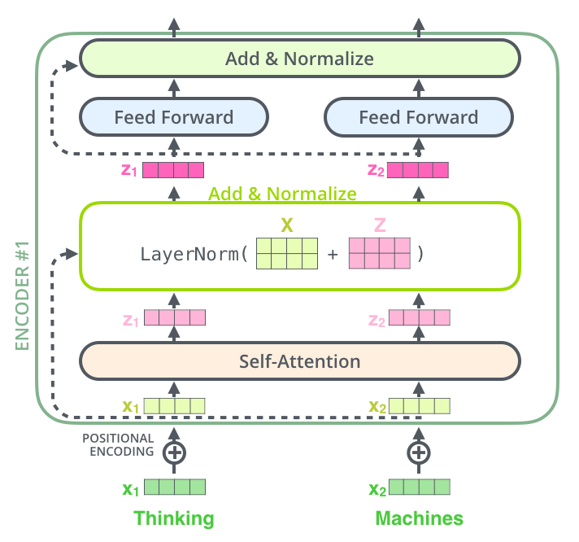
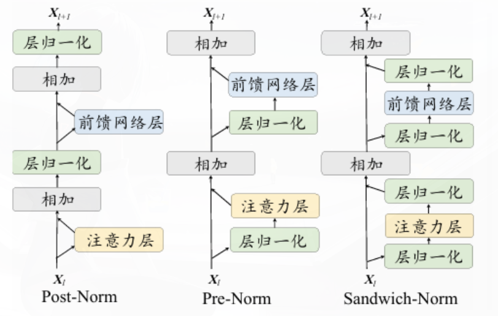

Add: 指残差连接（Residual Connection），也叫跳跃连接（Skip Connection）

Norm: 指层归一化（Layer Normalization）

这俩加一块解决了深度神经网络训练中梯度消失/爆炸的问题，保证了训练的稳定性和收敛速度。

先看 Transformer 的一个标准 Encoder Block，包含两次残差连接和两次层归一化：

## 残差连接（Residual Connection）

### 定义

对于一个子层（SubLayer，可以是多头注意力或前馈网络），把他的输出记作 $\mathcal{F}(X_{in})$，那么残差连接的输出 $X_{out}$ 就是：

$$
X_{out} = X_{in} + \mathcal{F}(X_{in})
$$

### Identity Mapping

网络不再直接学习一个完整的映射 $H(X)$，而是学习相对于输入的残差：$\mathcal{F}(X_{in}) = H(X_{in}) - X_{in}$。

### 梯度传播与深层网络训练

另外，从梯度的角度来看，残差连接提供了一条“捷径”，使得梯度可以直接从输出传递到输入，缓解了深层网络中梯度消失的问题：

$$
\frac{\partial L}{\partial X_{in}} = \frac{\partial L}{\partial X_{out}} \cdot \left( I + \frac{\partial \mathcal{F}(X_{in})}{\partial X_{in}} \right)
$$

## 数据分布带来的问题

1. 训练不稳定 2. 梯度消失/爆炸 3. 收敛慢

常见的现象是loss震荡

为了增加神经网络训练的稳定性，通常会引入特定的归一化策略。

### 层归一化（Layer Normalization）

采用列优先表示：$X_{in}\in\mathbb{R}^{d\times n}$，每一列 $\mathbf{x}_i\in\mathbb{R}^{d}$ 是第 $i$ 个 token 的表示。

- LayerNorm 对每一列内部的 $d$ 个特征独立归一化；索引 $j$ 遍历特征维度。
- 第一个 Token 独立计算自己的均值和方差。
- 第二个 Token 独立计算自己的均值和方差。
- ...
- 多个 Token 之间不共享归一化统计量。

$$
\mu_i = \frac{1}{d}\sum_{j=1}^{d} x_{ji}, \quad \sigma^2_i = \frac{1}{d}\sum_{j=1}^{d} (x_{ji} - \mu_i)^2\\[1ex]
\hat{x}_{ji} = \frac{x_{ji} - \mu_i}{\sqrt{\sigma^2_i + \epsilon}}, \quad \operatorname{LN}(\mathbf{x}_i) = \boldsymbol{\gamma}\odot\hat{\mathbf{x}}_i + \boldsymbol{\beta}
$$

其中 $\mu_i$ 和 $\sigma^2_i$ 分别是第 $i$ 个 token 在特征维度上的均值和方差，$\epsilon$ 是一个小常数以避免除零错误，$\boldsymbol{\gamma},\boldsymbol{\beta}\in\mathbb{R}^{d}$ 是可学习的逐特征缩放与偏移参数。

拓展到整个输入矩阵 $X_{in}$，层归一化的每一步和最终输出可以表示为：

$$
\boldsymbol{\mu} = [\mu_1, \mu_2, \ldots, \mu_n]\in\mathbb{R}^{1\times n}, \quad \boldsymbol{\sigma}^2 = [\sigma^2_1, \sigma^2_2, \ldots, \sigma^2_n]\in\mathbb{R}^{1\times n}\\[1ex]
\hat{X}_{in} = \frac{X_{in} - \mathbf{1}_d\boldsymbol{\mu}}{\sqrt{\mathbf{1}_d(\boldsymbol{\sigma}^2 + \epsilon)}} \quad \operatorname{LN}(X_{in}) = (\boldsymbol{\gamma}\mathbf{1}_n^T)\odot\hat{X}_{in} + \boldsymbol{\beta}\mathbf{1}_n^T
$$

- $\odot$ 表示逐元素乘法（Hadamard Product）
- $\boldsymbol{\gamma}$ 和 $\boldsymbol{\beta}$ 是 $d$ 维向量，分别表示每个特征维度的缩放和偏移参数。
- 它们在计算时会沿 token 维度广播成 $d\times n$ 的矩阵。

### 为什么不用 Batch Norm（批归一化）？

Batch Norm在CNN中极其成功，对一个 Batch 中的样本，在 **每个特征维度** 上计算均值和方差，然后进行标准化。但在Transformer/NLP中水土不服，原因有三：

1. 对 Batch 组成敏感  
   BN 依赖一个 Batch 中多个样本的统计量，Batch 的组成可能影响归一化结果。而 LN 只依赖当前 Token 的特征，不依赖其他样本。

2. 变长序列和 Padding 带来的问题  
   NLP 中不同句子的长度不同，通常需要 Padding 补齐。如果不进行特殊处理，Padding 位置可能参与统计量计算，影响 BN 的结果。

3. 小 Batch 训练时统计量不稳定  
   对于 Batch Size 较小的场景，BN 的均值和方差估计可能不够稳定。LN 则不受 Batch Size 的影响。

层归一化则完全独立于Batch，只依赖单个样本自身，天然适配变长序列。

### RMSNorm（Root Mean Square Normalization）

RMSNorm 是一种简化版的归一化方法，它只计算每个样本的均方根（Root Mean Square）作为归一化因子，而不计算均值。省去了均值中心化的计算，结构更加简单

对于每一个 token 的表示 $\mathbf{x}_i\in\mathbb{R}^{d}$，RMSNorm 的计算公式为：
$$
\operatorname{RMSNorm}(\mathbf{x}_i) = \frac{\mathbf{x}_i}{\sqrt{\frac{1}{d}\sum_{j=1}^{d} x_{ji}^2 + \epsilon}} \cdot \boldsymbol{\gamma}
$$

对于整个输入矩阵 $X_{in}\in\mathbb{R}^{d\times n}$，RMSNorm 的计算可以表示为：

$$
\operatorname{RMSNorm}(X_{in}) = \frac{X_{in}}{\sqrt{\frac{1}{d}\sum_{j=1}^{d} X_{in,j}^2 + \epsilon}} \cdot \boldsymbol{\gamma}\mathbf{1}_n^T
$$

## Pre-LN vs Post-LN vs Sandwich-LN

$\mathcal{F}$ 表示子层（注意力Attention/前馈网络FFN），$X_{in}$ 是子层的输入，$X_{out}$ 是子层的输出。

|~|Post-LN|Pre-LN|Sandwich-LN
|---|---|---|---
|公式|$X_{out} =\mathcal{LN}(X_{in} + \mathcal{F}(X_{in}))$|$X_{out} = X_{in} + \mathcal{F}(\mathcal{LN}(X_{in}))$|$X_{out} = X_{in} + \mathcal{LN}(\mathcal{F}(\mathcal{LN}(X_{in})))$|
|常见应用|原始 Transformer|现代大模型|超深网络|

Post-Norm主要优点是有助于加快神经网络的训练收敛速度，可以降低神经网络
对于超参数（如学习率、初始化参数等）的敏感性，有利于网络调优

Post-Norm的问题：在深层网络中，残差路径的梯度虽然直通，但紧接着就进入LayerNorm。如果LayerNorm的梯度不稳定（尤其是早期训练阶段），仍可能放大噪声。

Pre-Norm的优势：它将所有子层（注意力/FFN）的输入都“摆正”（归一化到0均值1方差），使得子层的优化更加平稳。更重要的是，残差连接本身不受归一化影响，梯度可以直接“流过”加法路径，不用穿过LayerNorm。

Pre-LN的缺点：性能略差

### Pre-LN 架构的梯度分析

对于多头注意力子层 $\mathcal{F}$，设第 $l$ 层的输入为 $X_l$，则 Pre-LN 残差更新为 $X_{l+1}=X_l+\mathcal{F}(\mathcal{LN}(X_l))$。

损失函数 $L$ 对 $X_{l+1}$ 的梯度为 $\frac{\partial L}{\partial X_{l+1}}$，那么对 $X_l$ 的梯度为：

$$
\frac{\partial L}{\partial X_l} = \frac{\partial L}{\partial X_{l+1}} \cdot \left( I + \frac{\partial \mathcal{F}(\mathcal{LN}(X_l))}{\partial X_l} \right)
$$

Pre-LN 通过残差连接提供了一条不经过 LayerNorm 和子层计算的恒等梯度传播路径，使得深层网络能够更直接地传递梯度，从而改善训练稳定性，降低深层网络优化的难度。
