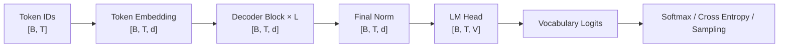

## Transformer 的三种架构范式

Transformer 不是某一个固定模型，而是一组以 Attention、前馈网络、残差连接和归一化为基础的架构。根据输入信息如何流动，可以划分为三种常见范式：

| 架构            | 注意力方式                                           | 输入与输出                        | 典型模型             |
| --------------- | ---------------------------------------------------- | --------------------------------- | -------------------- |
| Encoder-only掩码语言模型    | 双向 Self-Attention                                  | 输入序列 $\rightarrow$ 上下文表示 | BERT、ViT、RoBERTa   |
| Encoder-Decoder | Encoder 双向；Decoder 因果；两者之间 Cross-Attention | 源序列 $\rightarrow$ 目标序列     | 原始 Transformer、T5、BART、GLM  |
| Decoder-only自回归模型    | 因果 Self-Attention                                  | 一个序列持续向后生成              | GPT、LLaMA |

Encoder-only 掩码语言模型允许每个位置同时访问左右两侧的 Token，适合分类、检索和序列标注等理解任务（非生成任务）。

Encoder-Decoder 模型先将源序列编码成表示，再由 Decoder 通过 Cross-Attention 读取这些表示，适合翻译、摘要等显式的序列到序列任务。

Decoder-only 即后面生成的单元内容（文字）只能通过前序单元内容来预测生成，这也是典型的语言模型工作机制

$$
P_\theta(x_t\mid x_{<t})
$$

但是并非把Decoder堆起来就是Decoder-only

1. Decoder-only Transformer 仍然是一个完整的 Transformer 模型，它包含了多层因果 Self-Attention 和前馈网络，并且每一层都带有残差连接和归一化。

2. 它没有独立的 Encoder，也没有连接 Encoder 的 Cross-Attention。
3. 没有显式地区分模型的输入和输出
4. 对自注意力模块的规模（个数）做了大幅扩充

为什么现在大语言模型大多采用 Decoder-only？

核心原因是：自回归语言建模（Autoregressive Language Modeling）非常适合统一的文本生成任务。

1. 训练目标统一：预测下一个 Token。

2. 可以直接进行文本生成。

3. 能够通过大规模无监督文本进行预训练。

4. 对话、问答、代码生成等任务都可以转换成文本续写问题。

## Decoder-only 的完整数据流

一个 Decoder-only 语言模型可以抽象为以下数据流：

1. Token Embedding：将 Token 转换为向量。

2. Positional Information：注入位置信息。

3. Masked Self-Attention：提取上下文信息。

4. FFN：对每个位置的特征进行非线性变换。

5. Residual Connection + LayerNorm：稳定网络训练。

6. LM Head：将最终隐藏状态映射到词表，预测下一个 Token。

这条数据流有两个值得注意的特点。

- Transformer Block 前后的形状始终保持 $[B,T,d]$，因此可以重复堆叠。
- 只在最后由LM Head 把隐藏维度 $d$ 投影到词表维度 $V$，模型中间层并不直接处理词表概率。

## Causal Self-Attention

这是 Decoder-only 最核心的结构特征。

普通 Self-Attention 具体计算已经在[Self-Attention 笔记](/posts/transformer/Trasformer-Attetion/)中展开。这里用行优先表示：

$$
\operatorname{Attention}(Q,K,V)=\operatorname{softmax}\left(\frac{QK^\top}{\sqrt{d_h}}\right)V
$$

Decoder-only 的 Self-Attention 还需要加入因果掩码（Causal Mask），保证每个位置只能访问自己和左侧的 Token。在缩放点积中加入 **因果掩码** $M$,构造一个下三角矩阵：

$$
A
=
\operatorname{softmax}
\left(
\frac{QK^\top}{\sqrt{d_h}}+M
\right)
$$

其中：

$$
M_{ij}
=
\begin{cases}
0,&j\le i\\
-\infty,&j>i
\end{cases}
$$

当序列长度为 4 时，掩码可以写成：

$$
M=
\begin{bmatrix}
0&-\infty&-\infty&-\infty\\
0&0&-\infty&-\infty\\
0&0&0&-\infty\\
0&0&0&0
\end{bmatrix}
$$

Softmax 之后，$-\infty$ 对应位置的权重变为 0，因此行第 $i$ 个位置不能读取列 $j>i$ 的未来信息。注意力输出为：

$$
Z=AV
$$

因果掩码约束的是“一个位置可以访问哪些位置”，并不会强迫训练程序逐 Token 循环。训练数据中的整段序列已经给定，所以所有位置的 $QK^\top$ 仍然可以一次性并行计算。

因果掩码和 Padding Mask 也需要区分。Causal Mask 防止看到未来 Token；Padding Mask 则用于忽略为了批处理而补齐的 PAD Token。两者可能同时加入 Attention Score，但解决的是不同问题。

## LM Head

前面讲了 Attention 和 FFN，它们最终得到的是一组隐藏向量（Hidden States），但模型最终需要输出的是词表中的 Token 概率。经过所有 Decoder Block 后，第 $t$ 个位置得到隐藏状态：

$$
\mathbf{h}_t\in\mathbb{R}^{d}
$$

LM Head 使用输出矩阵 $W_{\mathrm{out}}\in\mathbb{R}^{V\times d}$ 将它投影到词表得到logit：

$$
z_t=W_{\mathrm{out}}\mathbf{h}_t+\mathbf{b}_{\mathrm{out}}\in\mathbb{R}^{V}
$$

Softmax 将这个 logit 转成下一个 Token 的条件概率。

$$
P(w_t\mid w_{<t})=\operatorname{softmax}(z_t)
$$

:::tip[如何选择 LM Head 的输出矩阵？]

许多语言模型会使用 Weight Tying：

$$
W_{\mathrm{out}}=E
$$

输入 Embedding 和输出 LM Head 因而共享同一组 $Vd$ 参数。这样不仅减少了一个词表投影矩阵，也让“如何表示一个 Token”和“如何判断一个 Token 应该被输出”处在同一个向量空间中。Weight Tying 是常见设计，但不是 Decoder-only 架构成立的必要条件。

:::

## 训练前向与自回归生成

训练时输入完整序列，模型一次产生全部位置的 logits：

$$
[B,T]\longrightarrow[B,T,d]\longrightarrow[B,T,V]
$$

随后把 logits 与向右错位一位的标签计算交叉熵：

~~~text
input_ids：[我, 喜欢, 学习, 人工]
labels：   [喜欢, 学习, 人工, 智能]
~~~

这正是 Teacher Forcing：真实历史 Token 已经给定，Causal Mask 又保证每个位置不能看到未来，因此一次前向传播就能计算整段序列的 Next-Token Prediction loss。

推理时没有真实后续 Token，模型只使用最后一个有效位置的 logits 选择下一个 Token，再把结果追加回输入：

~~~text
prompt
  → next token
  → prompt + next token
  → next token
  → ...
~~~

| 维度           | 训练             | 推理                         |
| -------------- | ---------------- | ---------------------------- |
| 输入历史       | 真实 Token       | 模型已经生成的 Token         |
| 使用的 logits  | 通常使用所有位置 | 通常只使用最后一个位置       |
| 序列位置并行   | 可以             | 自回归依赖下通常不可以       |
| 是否计算梯度   | 是               | 否                           |
| Attention 计算 | 整段序列         | 可通过 KV Cache 复用历史 K/V |

KV Cache 不会改变模型概率，只是避免每生成一个 Token 都重新计算全部历史 Token 的 Key 和 Value。它属于推理优化，将在现代 LLM 组件文章中单独展开。

## 张量形状与参数组成

沿着一次前向传播，各张量的形状可以归纳为：

| 位置                | 张量         | 形状          |
| ------------------- | ------------ | ------------- |
| Token IDs           | $I$          | $[B,T]$       |
| Token Embedding     | $H^{(0)}$    | $[B,T,d]$     |
| Q/K/V（拆分多头后） | $Q,K,V$      | $[B,h,T,d_h]$ |
| Attention Score     | $QK^\top$    | $[B,h,T,T]$   |
| Block 输出          | $H^{(\ell)}$ | $[B,T,d]$     |
| LM Head 输出        | $Z$          | $[B,T,V]$     |

如果暂时忽略 bias、Norm 和现代 Attention 变体，标准多头注意力中的 $Q$、$K$、$V$、$O$ 四个投影矩阵大约包含：

$$
4d^2
$$

个参数。两层 FFN 大约包含：

$$
2dd_{\mathrm{ff}}
$$

个参数。因此单个标准 Transformer Block 的主要参数量近似为：

$$
N_{\mathrm{block}}
\approx
4d^2+2dd_{\mathrm{ff}}
$$

当 $d_{\mathrm{ff}}=4d$ 时：

$$
N_{\mathrm{block}}\approx12d^2
$$

此外，Token Embedding 需要 $Vd$ 个参数；如果 LM Head 不共享权重，还要再增加 $Vd$。这解释了为什么小模型对词表大小尤其敏感：隐藏维度和层数较小时，Embedding 与 LM Head 可能占据相当高的参数比例。

参数量与计算量并不是一回事。标准 Self-Attention 需要构造 $T\times T$ 的注意力得分，序列长度相关复杂度约为 $O(T^2d)$；FFN 的主要复杂度约为 $O(Tdd_{\mathrm{ff}})$。上下文变长时，Attention 的二次项会逐渐成为计算和显存瓶颈。
